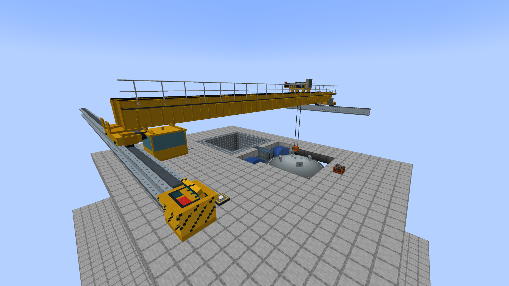
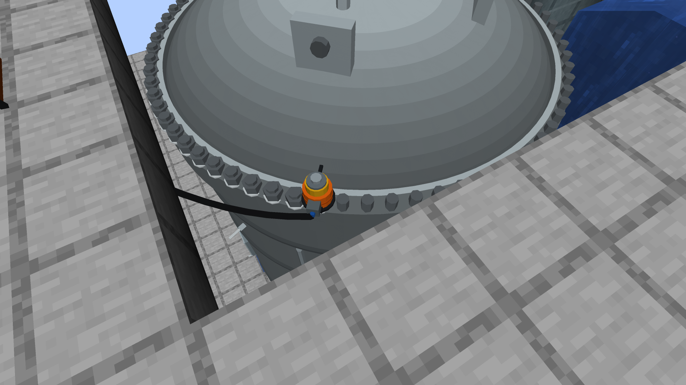
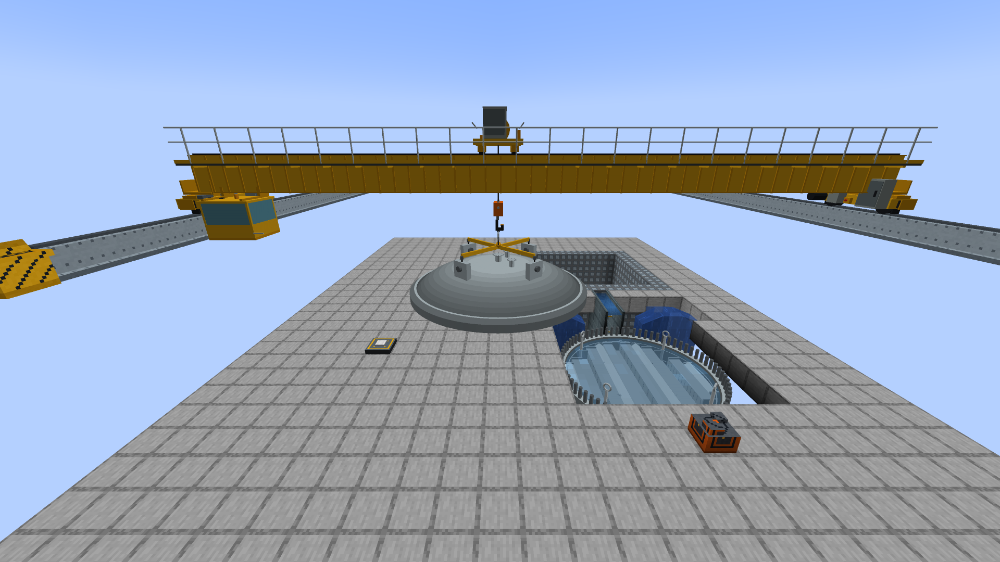
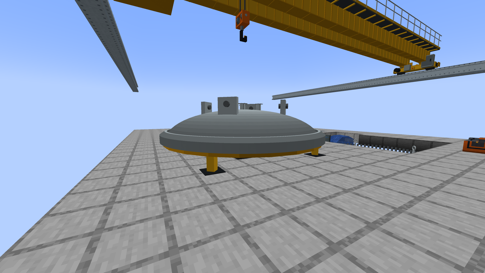
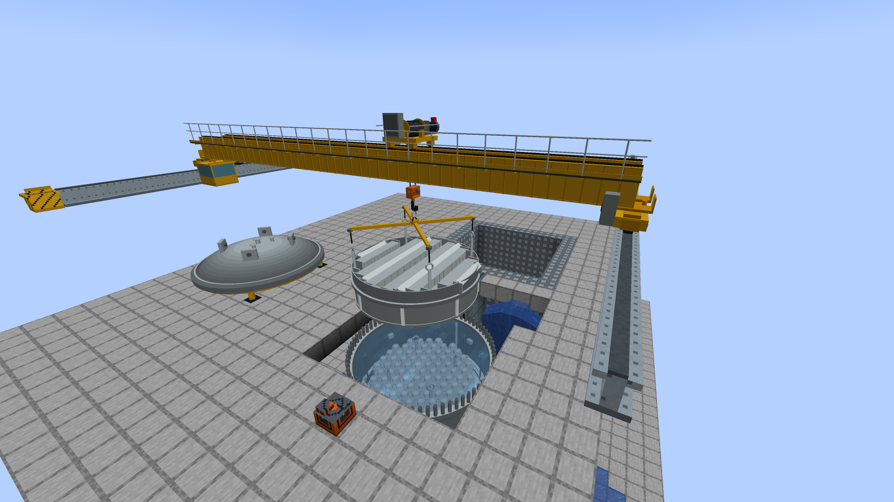
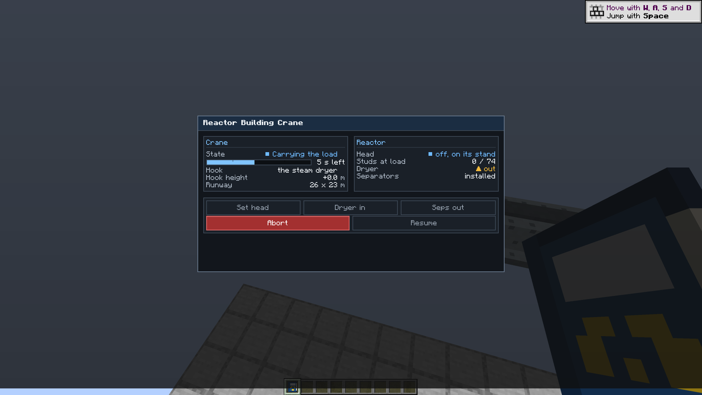

# The reactor building crane, the stud tensioner and the head stand

The vessel head used to come off with the HEAD OFF button on the reactor panel, and the dryer and the separators were lifted out by the
refuelling bridge. A real plant does neither. The head is held down by studs (74 on the reference vessel) and is lifted by the **reactor building
crane**, an overhead bridge crane on high runway rails over the refuel floor; the same crane lifts the dryer and then the separators into the
dryer/separator storage pool. The **refuelling bridge moves fuel only**. Nothing here moves unless a player, or their program, says so.

1. A **stud tensioner** detensions the closure studs. The nuts and washers come off; the studs stay in the flange.
2. The **crane** lifts the head, slung on its strongback, onto a **head stand** on the refuel floor.
3. The crane lifts the dryer, then the separators, onto **equipment storage pads** in a pit of water.
4. The refuelling bridge moves the fuel ([REFUELLING-BRIDGE.md](REFUELLING-BRIDGE.md)).
5. Then the reverse: separators in, dryer in, head on the flange, and the tensioner brings the studs back to load.

The old HEAD OFF button is the server option **`instantHeadRemoval`** (`bwr-gameplay.toml`), **off by default**. Off, the panel's head button explains
this procedure. On, it lifts and seats the head at once, as it always did, for casual play.

## Building one

All blocks are in the Realistic BWR creative tab (iron, gray concrete, a comparator and glass panes for the console).

1. **Runway rails.** Two parallel runs of **Crane Runway Rail**, high on opposite walls of the reactor hall, at the same height, up to 40 blocks apart,
   overlapping along their length by at least two blocks. A rail has an axis (the way you face when you place it); the crane runs along it. The
   reactor's vessel must lie between the rails (inside their overlap and between them). The rail block is a runway beam with the crane rail on its top;
   it needs a wall or posts of your own under it. The crane hangs its hook level with the *floor* of the rail block at rest, and the load hangs below
   that, so the rails must be high enough for the load to clear the vessel's lip: the crane refuses with the height to build to. For the 7 x 7 x 10 test
   vessel the rail block must stand at least 2 blocks over the top of its shell for the head (it hangs 2.4 blocks under the hook) and 4 blocks over it for
   the dryer (4.2 blocks: the lifting rig adds 1.3 m over the lifting eyes); a taller vessel needs more.
2. **The console.** A **Reactor Building Crane Console** beside any rail block. Right-click opens the pendant screen; sneak-click prints what the crane sees
   (rails, reactor, head stands, pads) and the state of the head.
3. **A head stand.** A **Head Stand** on clear floor between the rails beside the well. The block is the **middle** of the place the head lies, and the
   head is as wide as the vessel, so keep the floor round it clear: the whole footprint must lie between the rails, and not on the vessel (the stand
   must be at least one vessel width from the vessel's middle, along one axis). The crane says which of those is wrong. A stand holding a head cannot be
   broken by hand.
4. **Equipment pads.** Place one **Equipment Storage Pad** for the dryer and one for the separators on the floor of a pit of water the crane reaches (between
   its rails): the plant's dryer/separator storage pool, built of vanilla water. Nothing about the pads changed.
5. **A stud tensioner.** A **Stud Tensioner** power pack on the refuel floor within 8 blocks of the vessel's footprint, with power (FE) on any side. Its
   tool is drawn crawling round the flange; there is nothing else to build.

## Using it

### The studs

The tensioner's screen (right-click it) has DETENSION, RETENSION and STOP, the studs at load, the stud in hand, the time and the power the rest of the
pass needs.

| | Detension | Retension |
|---|---|---|
| Needs | head on, vessel at 25 psig or less, some stud at load | head on the flange, some stud bare |
| One stud | 4 s, 3,000 FE | 6 s, 6,000 FE |
| 74 studs | **296 s and 222,000 FE** | **444 s and 444,000 FE** |
| Effect | each stud's nut comes off (the studs stay in the flange) | each stud goes back to load |

The FE for a stud is taken from the pack's 24,000 FE buffer when the stud is begun (it takes at most 2,400 FE per tick). Out of power, the pass stops
where it is and says so; a player starts it again. STOP leaves the studs already done as they are; the stud in hand starts over.

While any stud is bare the head is **not sealed**: with the head on but one nut off the vessel leaks steam through the flange exactly as an open head does
(350 kg/s per psi of gauge pressure), and water raised over the flange spills. The vessel holds pressure only with the head on **and** every stud at load.

### The crane

The pendant screen has LIFT HEAD / SET HEAD, DRYER OUT / DRYER IN, SEPS OUT / SEPS IN, ABORT and RESUME, the phase and its time, what hangs from
the hook, where the head and the studs are and the reason for a halt.

* **LIFT HEAD** needs every stud detensioned, the pressure at 25 psig or less and the head not failed; it takes the head to the nearest free stand that
  can take it. **SET HEAD** needs the dryer and the separators back in; it takes the head from its stand (or from where it lies, in an old world) to the flange.
  The head is then on, every nut off, and the vessel cannot hold pressure until the tensioner has brought every stud to load.
* **DRYER OUT / SEPS OUT** keep every rule of the alpha.53 lifts: the head off, the vessel flooded to its flange, the dryer first; the separators back first.
  The dose rules are unchanged (a lifted assembly is a gamma source, shielded by the water over it).
* ABORT leaves a load on the hook; the same button continues from there. A halt waits for RESUME or ABORT.

A lift, phase by phase (the same phases as the bridge, with a crane's numbers):

| Phase | What happens | Time |
|---|---|---|
| travel | the crane runs along the runway and the trolley across it, hook at its rest height | slower of 0.5 m/s along and 0.4 m/s across |
| lower | the hook comes down onto the load | 0.5 m/s |
| latch | the load is hooked on (the strongback rigged on the head); at its end it leaves its seat | 5 s |
| lift | the load goes up to the hook's rest height | 0.25 m/s (loaded) |
| carry | across at that height, to above its destination | 0.5 / 0.4 m/s |
| set down | the load is lowered onto its seat | 0.25 m/s |
| release | unhooked; the load is in its new place | 5 s |
| raise | the empty hook goes back up | 0.5 m/s |

Measured in the GameTests with the 7 x 7 x 10 vessel, the stand 11 m from its middle and the rails 14 blocks above the floor: **head to the stand 108 s, dryer out 121 s, separators out 111 s, head back on 98 s** (each a whole lift: travel, lower, hook on, lift, carry, set down, unhook, raise).

## The head's states

| State | Where the head is | Studs | Holds pressure |
|---|---|---|---|
| tight | on the flange | all at load | yes |
| loosened | on the flange | some or all bare (nuts off) | **no** |
| on the hook | on the crane's hook (the vessel is open: the existing **Refuelling** state) | all bare | no |
| on a stand | on a head stand (open) | all bare | no |
| laid down | an old world, or the instant button: lying clear, no block needed (open) | all bare | no |

The vessel's saved state is the same `VesselState` as before: `refueling` means the head is off, wherever it is. New saved keys, written only while not
the default: the reactor's `StudsOff` (a count, only with the head on and some stud bare) and `HeadAt` (the crane console or the head stand holding the
head, only with the head off); the head stand's `Holding`, `Reactor` and `Vessel`; the tensioner's `Energy`, and while a pass is under way `Mode`,
`Reactor`, `Vessel` and `Ticks`; the crane console's `Phase`, `Move`, `Queue`, `Route`, `CarriedHead` and `CarriedInternal` while it works or holds a load.

**Old worlds.** A world with the head already off stays off: the head counts as laid down and the crane puts it back (or the option does). A
world with the head on has every stud at load. The tests load both.

## The model

The crane is a yellow industrial overhead crane in the style of the new refuelling bridge: two box girders with a walkway, an operator's cab hung
under the first girder near the first rail, end carriages with flanged wheels on the rail heads, a trolley with a wire-rope hoist drum, gear motor
and brake, two falls of rope and an orange hook block. It is not a block and not an entity: the block entity renderer draws cached meshes
(`MachineMeshCache`), authored in Blender, headless
(`blender.exe --background --python art/models/building_crane/build_models.py`, which also saves `building_crane.blend` and Workbench review renders);
`python tools-export-building-crane.py` bakes them into `assets/bwr/models/block/building_crane/<part>/` (`--check` verifies byte for byte). No brand
names, no textures: flat colours from the mod's material approach.

| Part | What | Triangles |
|---|---|---:|
| `end_carriage` | wheels, axles, carriage beam, buffers, drive motor, gearbox, cabinet, girder seats (one per rail; the second is the same part turned half a turn) | 796 |
| `girder_plain` | one metre of both box girders, flanges and trolley rails, the walkway; **stretched** along the span | 188 |
| `girder_tile` | one metre of diaphragms, stiffeners and the cable festoon; **tiled** once per metre | 184 |
| `cab` | the operator's cab with glass, seat, console and hangers | 336 |
| `trolley` | wheels, frame, hoist drum, gear motor, brake, cabinet | 1,552 |
| `hook_block`, `rope` | the hook, two sheaves and the block; a unit rope scaled to the length paid out | 388 + 12 |
| `strongback_hook`, `spreader`, `sling` | the lifting ring and pendants; the crossed spreader beams scaled to the head's lug ring; a unit sling scaled to each lug | 176 + 84 + 12 |
| `stand_cradle` | the ring and four legs under the head's flange on a head stand, scaled to the head | 288 |
| `tensioner_tool` | the stud tensioner's tool, in units of the stud radius, on a stud of the flange | 436 |

**How the span scales.** The rails can be 1 to 40 blocks apart, so the girder mesh is built once per span length (a cache key of the span; plain
section stretched, detailed tile repeated each metre) and the end carriages are drawn at the two rail centre lines whatever the distance. The crane is
2.7 m along the runway and 4.0 m tall over the rail block's floor (the trolley's cabinet is the highest point), and its cab hangs 1.2 m under the girders, so the hall
needs head room.

**The head.** The head is drawn from the vessel's own head mesh (`VesselModel.buildHead`: flange forging, dome, crown nozzles, lugs) without its
nuts, at the vessel's size: hanging from the spreader on four slings, then resting on the stand's cradle with its mating face 0.85 m over the stand
block. The nuts are drawn on the head while it sits on the flange: all of them with every stud at load, none with every stud bare, and the ones still on,
one draw each, while the tensioner is part way round. The stud tensioner's tool is drawn on the stud in hand with a hose back to the pack.

**Drawing.** Every part is a cached vertex buffer; nothing is rebuilt per frame (the client check `-PbwrBuildingCraneCheck` fails if a mesh is uploaded
again while a picture stands still). The pose is the leg the server started advanced by the client clock, so a moving crane costs one packet per phase.

## Pictures (1920 x 1080, `art/building-crane/`)

From `-PbwrBuildingCraneCheck` (`BuildingCraneClientCheck`), a real client, the moves run by the block entities' own logic:













Also in the set: `tensioner-screen.png` and `studs-detensioned-nuts-off.png`. The Workbench review renders of the Blender parts are in `art/models/building_crane/`.

## Performance, chunks, saves

* **No idle tickers.** The console, the stand and the tensioner have no block entity ticker. A lift schedules one block tick a game tick only until the
  queue is empty or it halts; a pass of the tensioner likewise only while it works (`anIdleCraneAndAnIdleTensionerNeverTick...` and the real-scheduler test).
* **Chunk safe.** The crane never loads a chunk: with the reactor's chunk unloaded it waits where it is. Surveys read only loaded blocks and run on demand
  (a click, a computer's call, the screen's snapshot every half second, the start of a lift), never per tick.
* **Saves.** A lift saved on the hook finishes the same job after the world loads; so does a pass of the tensioner (at the same stud, mid-stud included).
  Breaking the console under a hanging load sets a dryer or separator assembly back in its vessel and lays a hanging head down on the floor (nothing is lost);
  removing a stand that holds the head does the same.
* **The bridge.** The bridge's own internal lifts are behind the legacy server option `bridgeLiftsInternals` (default **true** for now, see below).

## Computers

CC:Tweaked peripherals (every method runs on the server thread):

| Peripheral | Methods |
|---|---|
| `bwr_building_crane` (the console) | `getStatus()` (`ready`, `phase`, `busy`, `halted`, `progress`, `secondsLeftInPhase`, `queued`, `holding`, `carried`, `hook {x,y,z}`, `haltReason`, `reactorFound`, `headOff`, `studsTensioned`, `studTotal`, `dryerInstalled`, `separatorInstalled`, `from`, `to`), `queueHeadOut()`, `queueHeadIn()`, `queueInternalOut(name)`, `queueInternalIn(name)` (each returns `{ok, message}`), `abort()`, `resume()` |
| `bwr_stud_tensioner` (the pack) | `getStatus()` (`mode`, `running`, `studProgress`, `energyFE`, `capacityFE`, `studTotal`, `studsTensioned`, `studsDetensioned`, `secondsPerStudDetension`, `secondsPerStudRetension`, `message`), `detension()`, `retension()` (`{ok, message}`), `stop()` |
| `bwr_head_stand` | `getStatus()` (`holdingHead`, `reactor`) |
| the reactor | `getHead()`: `headOn`, `studTotal`, `studsTensioned`, `studsDetensioned`, `sealed`, `liftable`, `headAt` ({x, y, z} while the head is off on a stand or a hook), `summary`; `getInternals()` as before |

```lua
local tensioner = peripheral.find("bwr_stud_tensioner")
local crane = peripheral.find("bwr_building_crane")
local r = tensioner.detension()                -- the program's choice, nothing else starts a pass
if not r.ok then print(r.message) end
while tensioner.getStatus().running do sleep(5) end
print(crane.queueHeadOut().ok)
```

## The legacy option and the old tests (read this)

The alpha.53 GameTests `VesselInternalsTests` (and `VesselInternalsCcChecks`) assert that the **refuelling bridge** lifts the dryer and the separators
(`f.bridge.queueInternal(VesselInternal.DRYER, true) == null, "the high rails lift it"` and many like it, and `queueInternalOut("dryer")` returning `ok`).
They may not be edited here, so the rule "the bridge refuses internal lifts, with a message pointing to the crane" is built but gated: the server option
**`bridgeLiftsInternals`** (default **true**) leaves the bridge's old lifts working; with it **false** the bridge refuses them ("The refuelling bridge moves fuel only. The reactor building crane
lifts the vessel head, the steam dryer and the separator assembly."), the screen's buttons go dark and the peripheral returns `ok = false`. The
crane does all of those lifts either way. To finish the change: edit those tests to use the crane, then flip the option's default to false.

## Tests

Core (`:core:acceptance`): `CraneMotionTest` (legs, the 74-stud pass's time and energy, when the head is liftable and sealed).
GameTests (`BuildingCraneTests`, namespace `bwrcrane`, `-PbwrOnlyCrane`): the full sequence (refuse while tensioned, detension 296 s and 222,000 FE, the crane lifts the head to the stand,
dryer then separators to the pads, fuel to the pool and back by the bridge, then the separators in, the dryer in, the head on, retension 444 s and 444,000 FE, sealed); the head will
not lift with even one stud tensioned and the studs wait for 25 psig; the tensioner's time, energy and out-of-power stop; the bridge refuses the lifts with the option off; the instant option on and off
(the button's message, the old behaviour); a lift saved on the hook and a pass saved half way; an old world with the head off and one with it on, and that new keys are written only when not
the default; the stand's placement rules and a stand removed under the head; low rails; a console broken under a hanging load; a head on with a bare stud leaks like an open head; no idle ticking and a
working crane or tensioner ticking once a tick on the real scheduler; the computer faces. Client check `-PbwrBuildingCraneCheck` (`BuildingCraneClientCheck`) saves the pictures in `art/building-crane/`;
the two screens are in `-PbwrGuiScreenCheck`.

## Honest limits

* The cab is a picture: the operator does not ride it, the console is beside the rails. Nothing can stand on the walkway.
* One reactor and one crane per console (the nearest reactor between the rails). Two consoles on the same rails are two independent cranes that do not know each other.
* One head, one stand at a time per lift; a second stand is not used for the same head. A head carried on the hook has no radiation source (the dryer and the separators do).
* The rails are the player's: the crane does not check that anything holds them up, nor what the head would sweep through on its way to the stand.
* The stud tensioner works round the flange in index order, not the star pattern of a real tightening; the stage count is one.
* The nuts of the studs are drawn off the head; the nuts of a detensioned head are not stacked anywhere (they are gone with the studs' load).
