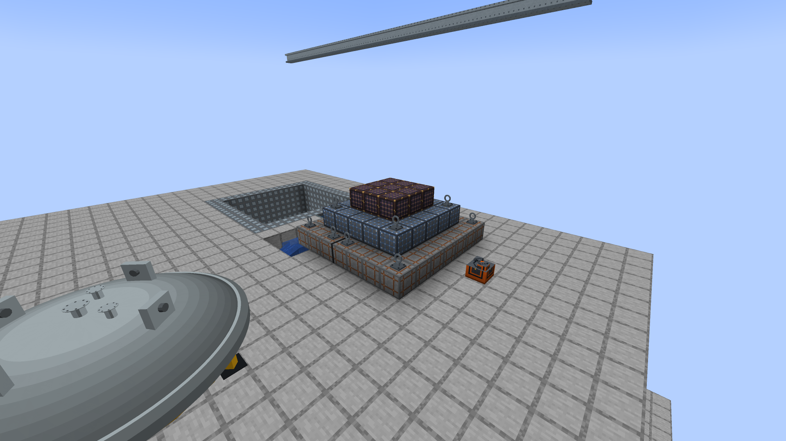
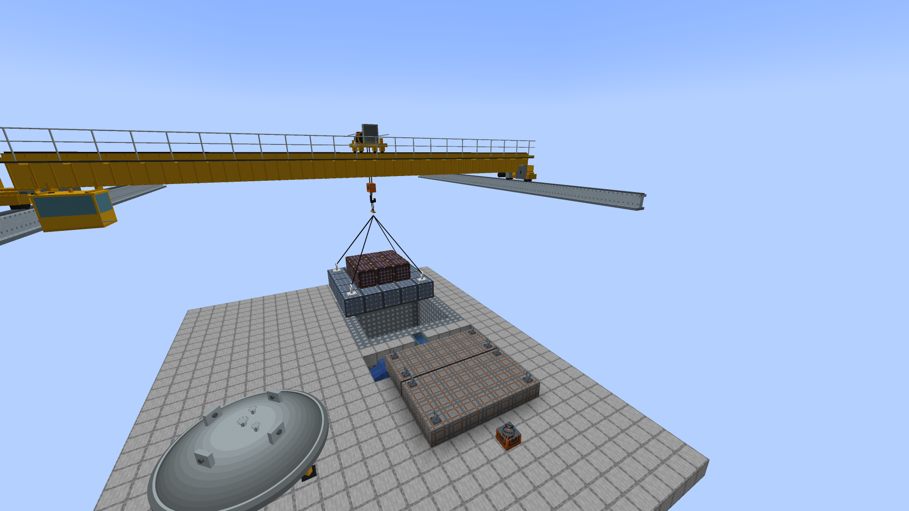
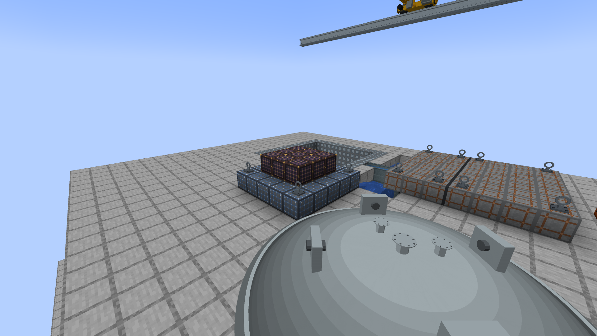
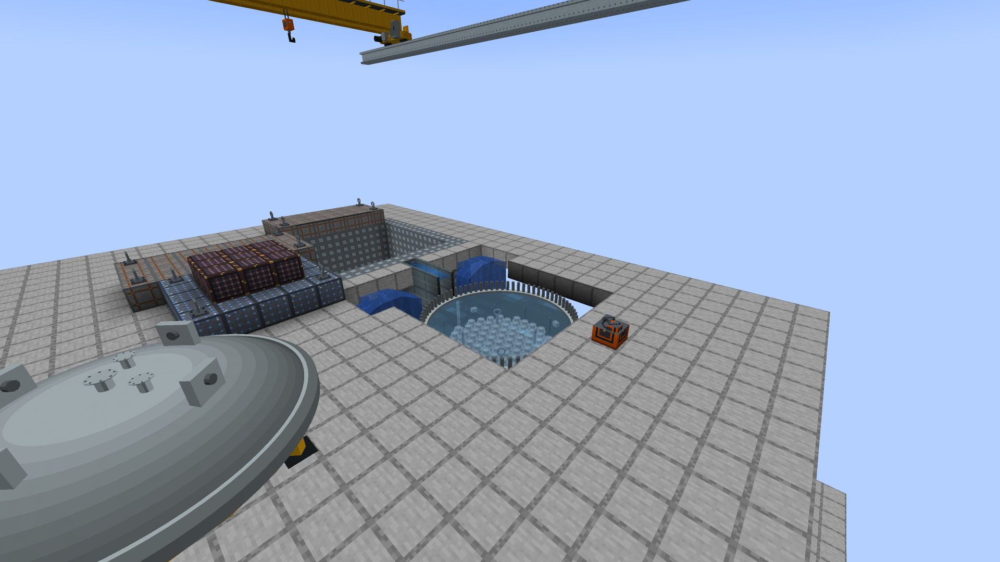

# The reactor building crane, the stud tensioner and the head stand

The vessel head used to come off with the HEAD OFF button on the reactor panel, and the dryer and the separators were lifted out by the
refuelling bridge. A real plant does neither. The head is held down by studs (74 on the reference vessel) and is lifted by the **reactor building
crane**, an overhead bridge crane on high runway rails over the refuel floor; the same crane lifts the dryer and then the separators into the
dryer/separator storage pool. The **refuelling bridge moves fuel only**. Nothing here moves unless a player, or their program, says so.

1. A **stud tensioner** detensions the closure studs. The nuts and washers come off; the studs stay in the flange.
2. The **crane** lifts the head, slung on its strongback, onto a **head stand** on the refuel floor.
3. The crane lifts the dryer, then the separators, onto **equipment storage pads** in a pit of water.
4. The refuelling bridge moves the fuel ([REFUELLING-BRIDGE.md](REFUELLING-BRIDGE.md)).
5. Then the reverse: separators in, dryer in, head on the flange, and the tensioner brings the studs back to load.

Before any of that, the same crane lifts the **shield plugs** off the well, section by section (PLUG OFF / PLUG ON, see "Lifting the shield plugs" below).

The old HEAD OFF button is the server option **`instantHeadRemoval`** (`bwr-gameplay.toml`), **off by default**. Off, the panel's head button explains
this procedure. On, it lifts and seats the head at once, as it always did, for casual play.

## Building one

All blocks are in the Realistic BWR creative tab (iron, gray concrete, a comparator and glass panes for the console).

1. **Runway rails.** Two parallel runs of **Crane Runway Rail**, high on opposite walls of the reactor hall, at the same height, up to 40 blocks apart,
   overlapping along their length by at least two blocks. A rail has an axis (the way you face when you place it); the crane runs along it. The
   reactor's vessel must lie between the rails (inside their overlap and between them). The rail block is a runway beam with the crane rail on its top;
   it needs a wall or posts of your own under it. The crane hangs its hook level with the *floor* of the rail block at rest, and the load hangs below
   that, so the rails must be high enough for the load to clear the vessel's lip: the crane refuses with the height to build to. For the 7 x 7 x 10 test
   vessel the rail block must stand at least 2 blocks over the top of its shell for the head (it hangs 2.4 blocks under the hook) and 4 blocks over it for
   the dryer (4.2 blocks: the lifting rig adds 1.3 m over the lifting eyes); a taller vessel needs more.
2. **The console.** A **Reactor Building Crane Console** beside any rail block. Right-click opens the pendant screen; sneak-click prints what the crane sees
   (rails, reactor, head stands, pads) and the state of the head.
3. **A head stand.** A **Head Stand** on clear floor between the rails beside the well. The block is the **middle** of the place the head lies, and the
   head is as wide as the vessel, so keep the floor round it clear: the whole footprint must lie between the rails, and not on the vessel (the stand
   must be at least one vessel width from the vessel's middle, along one axis). The crane says which of those is wrong. A stand holding a head cannot be
   broken by hand.
4. **Equipment pads.** Place one **Equipment Storage Pad** for the dryer and one for the separators on the floor of a pit of water the crane reaches (between
   its rails): the plant's dryer/separator storage pool, built of vanilla water. Nothing about the pads changed.
5. **A stud tensioner.** A **Stud Tensioner** power pack on the refuel floor within 8 blocks of the vessel's footprint, with power (FE) on any side. Its
   tool is drawn crawling round the flange; there is nothing else to build.

## Using it

### The studs

The tensioner's screen (right-click it) has DETENSION, RETENSION and STOP, the studs at load, the stud in hand, the time and the power the rest of the
pass needs.

| | Detension | Retension |
|---|---|---|
| Needs | head on, vessel at 25 psig or less, some stud at load | head on the flange, some stud bare |
| One stud | 4 s, 3,000 FE | 6 s, 6,000 FE |
| 74 studs | **296 s and 222,000 FE** | **444 s and 444,000 FE** |
| Effect | each stud's nut comes off (the studs stay in the flange) | each stud goes back to load |

The FE for a stud is taken from the pack's 24,000 FE buffer when the stud is begun (it takes at most 2,400 FE per tick). Out of power, the pass stops
where it is and says so; a player starts it again. STOP leaves the studs already done as they are; the stud in hand starts over.

While any stud is bare the head is **not sealed**: with the head on but one nut off the vessel leaks steam through the flange exactly as an open head does
(350 kg/s per psi of gauge pressure), and water raised over the flange spills. The vessel holds pressure only with the head on **and** every stud at load.

### The crane

The pendant screen has LIFT HEAD / SET HEAD, DRYER OUT / DRYER IN, SEPS OUT / SEPS IN, PLUG OFF / PLUG ON, ABORT and RESUME, the phase and its time, what hangs from
the hook, where the head and the studs are and the reason for a halt.

* **LIFT HEAD** needs every stud detensioned, the pressure at 25 psig or less and the head not failed; it takes the head to the nearest free stand that
  can take it. **SET HEAD** needs the dryer and the separators back in; it takes the head from its stand (or from where it lies, in an old world) to the flange.
  The head is then on, every nut off, and the vessel cannot hold pressure until the tensioner has brought every stud to load.
* **DRYER OUT / SEPS OUT** keep every rule of the alpha.53 lifts: the head off, the vessel flooded to its flange, the dryer first; the separators back first.
  The dose rules are unchanged (a lifted assembly is a gamma source, shielded by the water over it).
* ABORT leaves a load on the hook; the same button continues from there. A halt waits for RESUME or ABORT.

A lift, phase by phase (the same phases as the bridge, with a crane's numbers):

| Phase | What happens | Time |
|---|---|---|
| travel | the crane runs along the runway and the trolley across it, hook at its rest height | slower of 0.5 m/s along and 0.4 m/s across |
| lower | the hook comes down onto the load | 0.5 m/s |
| latch | the load is hooked on (the strongback rigged on the head); at its end it leaves its seat | 5 s |
| lift | the load goes up to the hook's rest height | 0.25 m/s (loaded) |
| carry | across at that height, to above its destination | 0.5 / 0.4 m/s |
| set down | the load is lowered onto its seat | 0.25 m/s |
| release | unhooked; the load is in its new place | 5 s |
| raise | the empty hook goes back up | 0.5 m/s |

Measured in the GameTests with the 7 x 7 x 10 vessel, the stand 11 m from its middle and the rails 14 blocks above the floor: **head to the stand 108 s, dryer out 121 s, separators out 111 s, head back on 98 s** (each a whole lift: travel, lower, hook on, lift, carry, set down, unhook, raise).

## Lifting the shield plugs (PLUG OFF / PLUG ON)

In a real plant the first step of an outage is lifting the **shield plugs**, the huge stepped concrete sections over the reactor well, off with this same crane onto the
refuel floor. Before this change the mod had no such step: a player mined plug blocks by hand (hardness 4, 8 or 16). Now the crane does it, one section at a time, by command.
Nothing acts by itself: every lift is a button on the pendant (or a computer's call), and ABORT and RESUME work as for the other lifts.

### What you build

* **Shield plug concrete** over the well, in any shape and any of the three tiers (see SEVERE-ACCIDENT-UPDATE.md). These are the blocks that stop a thrown head and shield by
  half-value layer; nothing about them changed except that they can now carry **seams**.
* **Crane Anchors** (`bwr:crane_anchor`, two iron ingots make four; 0.05 t each): a steel lifting eye bolted to the **top face of a plug block**. It can be placed on nothing else, and breaks
  if the plug block under it goes. Four anchors on the tops of the blocks of a piece make it a four-point lift. An anchor marks the whole piece under it as liftable.
* **The Plug Seam Marker** (`bwr:plug_seam_marker`, an iron ingot on a stick): cuts the plug into pieces.
* The crane, its rails and console as before, a **refuel floor** to set the pieces on (any solid blocks), and enough height: the load hangs from the hook on its slings, and the
  rails must be higher than the section's own height plus its slings above the floor (the crane says "raise the rails to y ..." when they are not).

### Splitting a plug: seams

A plug is cut into sections by **seams**. A seam is a marked **joint between two touching plug blocks**. A **section** is the set of plug blocks connected, face to face, to a
block that carries an anchor, flood-filled, **stopping at a seam and at any block that is not shield plug concrete**; the anchors standing on those blocks belong to it.

* **To mark a seam:** right-click a plug block with the Plug Seam Marker **near the edge where you want the cut**. The click picks the nearest edge of the face you hit, and the
  joint between that block and the plug block beyond that edge becomes a seam. A seam is drawn as a **dark groove** one pixel wide round the four faces at the joint (so two
  blocks give a two pixel line), and it shows on both blocks. To cut a whole plane, click along it.
* **To undo it:** click the same place again; the seam is removed. **Sneak-click** a block to clear every seam on it. Nothing else about a block changes: the marker does not
  move or break blocks, is not used up, and does not change blast resistance, shielding or mining.
* A seam must lie between two plug blocks (the marker tells you when the other side is not plug). It is stored as one boolean property on each of the two blocks for the face it is on
  (`seam_north`, `seam_up`, and so on), all false by default, so it is part of the block's state: it saves with the world, survives every lift exactly, and old worlds are unchanged.
  One block carrying the seam is enough to split the joint.

### The procedure

The pendant has **PLUG OFF** and **PLUG ON** beside ABORT and RESUME (PLUG OFF reads PLUG ON while a section is set down and the hook is empty).

* **PLUG OFF** surveys the crane's reach and takes the section **nearest the middle of the well that has exactly four anchors** (a computer may name any anchor). If no section has
  four it names the nearest section it saw and says "needs 4 anchors, has N". It then refuses, with the reason, if the section is **over the rated capacity** or the rails are too low
  or the section is not reachable. The crane runs out, lowers, hooks on (5 s), lifts (0.25 m/s), carries and sets it down on the **laydown**, then unhooks and raises.
* **PLUG ON** sets the section most recently set down back **exactly where it came from** (last off, first on). It is refused while the vessel head is off and the section would
  cover the well; a section that has since been broken or changed is dropped from the book with a message.
* **The laydown rule.** The crane sets the section on the clear spot **nearest to where it stood** (distance between the pick points, then the smaller drop, then x, then z):
  a whole number of blocks away in x and z and up to 8 up or 4 down, where **every cell is air** (the crane never replaces a block, not even water or a plant), the lowest layer
  rests on **solid floor** (a block with a sturdy top), the whole piece lies within the crane's reach in loaded chunks, off the reactor well and the square (as wide as the vessel)
  round every **head stand** in reach, so a later head lift is not blocked. No such place: the lift is refused and nothing moves.
* **Capacity.** A section weighs the **sum of its blocks' masses plus its anchors'**, and the masses are **data**: the block data map `bwr:plug_mass`
  (`data/bwr/data_maps/block/plug_mass.json`, tonnes for one block of one cubic metre; a datapack overrides or adds an entry). The defaults, roughly real densities x 1 m3:

  | Block | Mass | Basis |
  |---|---:|---|
  | Shield Plug Concrete (tier 1) | **2.4 t** | ordinary reinforced concrete, about 2.4 t/m3 |
  | Heavily Reinforced Shield Plug Concrete (tier 2) | **3.2 t** | a heavyweight-aggregate mix with heavy rebar (heavyweight shielding concrete of barite, magnetite or steel punchings runs about 3.5 to 4.0 t/m3, IAEA and ACI 304) |
  | Ultra-Reinforced Shield Plug Concrete (tier 3) | **4.0 t** | magnetite or barite heavy concrete with steel, the top of that range; **the figure is a game value** (the tier is netherite-loaded, which no real concrete is) |
  | Crane Anchor | 0.05 t | a forged eye on its plate |

  The crane is rated **125 t** (a reactor building polar crane's main hook; there was no figure in the crane code). That is at most 52, 39 or 31 whole blocks of a tier, so a
  heavier tier needs more seams to stay under the rating. Over it the lift is refused, with the mass, the rating and "mark a seam with the Plug Seam Marker to cut it into smaller
  sections". **The mass is shown before anything is lifted:** the pendant's *Next plug* row reads, for the section PLUG OFF would take, "28 blocks, 112.2 t of 125 t, 4 anchors"
  (or "over the rating", or "needs 4"), a computer's `getStatus().plugNext` and `getPlugSections()` give the same numbers for every section in reach, and on the hook the
  crane's *Hook* row reads "a shield plug section (28 blocks, 112.2 t)".
* **Four anchors.** Exactly four anchors rig a section (the four slings of the rig). Fewer, or more, is refused with "needs 4 anchors, has N".
* **Head interlock.** LIFT HEAD (and SET HEAD) are **refused while any shield plug block stands over the reactor well**, with the count and the nearest block. "Over the well" is read
  from the reactor's own survey: any column inside the vessel's footprint, or a cell of the well that the cavity survey found (`CavitySeal`), from the first row above the vessel
  up to the rails. After PLUG OFF has taken the last piece off the head lifts as before.
* **Order of an outage:** PLUG OFF (every piece), detension the studs, LIFT HEAD, DRYER OUT, SEPS OUT, fuel; then the reverse: SEPS IN, DRYER IN, SET HEAD, retension, PLUG ON (every
  piece, last off first).

### A lifted section is an entity

When the hook closes on a section its blocks **leave the world**, every block state (tier, seams, the anchors) written into **one entity**, `bwr:plug_section`, **hanging from the hook**
(four slings from the hook ring to the four anchors) and moving with the bridge and the trolley exactly as the head does. Because the blocks are gone from the well, a lifted section
**stops no head missile and shields nothing** while it hangs or lies as an entity; put back, the same blocks do both again (the tests measure it). A section set down on the laydown is
ordinary blocks again.

#### Nothing is ever lost

* **Exact.** A section is taken and set down state for state; nothing is regenerated, so seams, tiers and anchors come back as they were.
* **Never replaces.** A set-down checks every cell first (air, loaded chunk); one block in the way and nothing is placed: the crane halts at RELEASE with the section still on the
  hook, and RESUME tries again. The same check is made before the hook closes, so a blocked laydown stops the lift before the section is touched.
* **Saves.** The entity is saved with its chunk and loaded with it, never despawns, is never duplicated (the crane keeps only its id, the plan and the laydown book; the blocks live
  in the entity alone). A world saved mid-lift loads the same section on the same hook and the crane carries on. If the entity's chunk is not loaded the crane waits where it is.
* **Chunks.** The crane never loads a chunk: it moves the entity only into chunks that are loaded, and the set-down and the survey read only loaded blocks.
* **Can't be touched.** The entity cannot be hurt, pushed, picked, ridden or collided with, and `/summon` cannot make one. A destroying removal (`/kill`, a discard) puts the blocks back
  at the place they were taken from, or drops them as items if that place is no longer clear.
* **The crane or the runway broken** while a section hangs: breaking the console puts the section **back where it was taken from** (state for state) if every one of those places is still
  clear and loaded, and otherwise **drops every block as an item** (plug blocks and anchors) where the section hangs. The entity also checks once a second, while it is loaded, that its
  crane is loaded, still has a runway and still holds it; if the **runway** is broken, or the crane is gone or does not claim it (an orphan), it does the same and the crane lets go.
  Putting back is preferred because it is exact and loses nothing; dropping is the fallback when the old place is built over (it never replaces a block).

### Computers

`bwr_building_crane`: `queuePlugOff([x, y, z])` (no arguments: the nearest rigged section; with the position of one of its anchors: that section) and `queuePlugOn()`, each returning
`{ok, message}`; `getStatus()` adds `plugsLaid` and `plugNext` (`blocks`, `anchors`, `massT`, `ratedT`, `rigged`, `overCapacity`, `onHook`, `x`, `y`, `z` of the section PLUG OFF would take), `getPlugSections()` lists every anchored section in reach the same way (nothing moves), and `carried` reads "a shield plug section (N blocks, T t)" while one hangs.

```lua
local crane = peripheral.find("bwr_building_crane")
local r = crane.queuePlugOff()        -- the program's choice; nothing else starts a lift
if not r.ok then print(r.message) end
while crane.getStatus().busy do sleep(5) end
```

## The head's states

| State | Where the head is | Studs | Holds pressure |
|---|---|---|---|
| tight | on the flange | all at load | yes |
| loosened | on the flange | some or all bare (nuts off) | **no** |
| on the hook | on the crane's hook (the vessel is open: the existing **Refuelling** state) | all bare | no |
| on a stand | on a head stand (open) | all bare | no |
| laid down | an old world, or the instant button: lying clear, no block needed (open) | all bare | no |

The vessel's saved state is the same `VesselState` as before: `refueling` means the head is off, wherever it is. New saved keys, written only while not
the default: the reactor's `StudsOff` (a count, only with the head on and some stud bare) and `HeadAt` (the crane console or the head stand holding the
head, only with the head off); the head stand's `Holding`, `Reactor` and `Vessel`; the tensioner's `Energy`, and while a pass is under way `Mode`,
`Reactor`, `Vessel` and `Ticks`; the crane console's `Phase`, `Move`, `Queue`, `Route`, `CarriedHead` and `CarriedInternal` while it works or holds a load.

**Old worlds.** A world with the head already off stays off: the head counts as laid down and the crane puts it back (or the option does). A
world with the head on has every stud at load. The tests load both.

## The model

The crane is a yellow industrial overhead crane in the style of the new refuelling bridge: two box girders with a walkway, an operator's cab hung
under the first girder near the first rail, end carriages with flanged wheels on the rail heads, a trolley with a wire-rope hoist drum, gear motor
and brake, two falls of rope and an orange hook block. It is not a block and not an entity: the block entity renderer draws cached meshes
(`MachineMeshCache`), authored in Blender, headless
(`blender.exe --background --python art/models/building_crane/build_models.py`, which also saves `building_crane.blend` and Workbench review renders);
`python tools-export-building-crane.py` bakes them into `assets/bwr/models/block/building_crane/<part>/` (`--check` verifies byte for byte). No brand
names, no textures: flat colours from the mod's material approach.

| Part | What | Triangles |
|---|---|---:|
| `end_carriage` | wheels, axles, carriage beam, buffers, drive motor, gearbox, cabinet, girder seats (one per rail; the second is the same part turned half a turn) | 796 |
| `girder_plain` | one metre of both box girders, flanges and trolley rails, the walkway; **stretched** along the span | 188 |
| `girder_tile` | one metre of diaphragms, stiffeners and the cable festoon; **tiled** once per metre | 184 |
| `cab` | the operator's cab with glass, seat, console and hangers | 336 |
| `trolley` | wheels, frame, hoist drum, gear motor, brake, cabinet | 1,552 |
| `hook_block`, `rope` | the hook, two sheaves and the block; a unit rope scaled to the length paid out | 388 + 12 |
| `strongback_hook`, `spreader`, `sling` | the lifting ring and pendants; the crossed spreader beams scaled to the head's lug ring; a unit sling scaled to each lug | 176 + 84 + 12 |
| `stand_cradle` | the ring and four legs under the head's flange on a head stand, scaled to the head | 288 |
| `tensioner_tool` | the stud tensioner's tool, in units of the stud radius, on a stud of the flange | 436 |

**How the span scales.** The rails can be 1 to 40 blocks apart, so the girder mesh is built once per span length (a cache key of the span; plain
section stretched, detailed tile repeated each metre) and the end carriages are drawn at the two rail centre lines whatever the distance. The crane is
2.7 m along the runway and 4.0 m tall over the rail block's floor (the trolley's cabinet is the highest point), and its cab hangs 1.2 m under the girders, so the hall
needs head room.

**The head.** The head is drawn from the vessel's own head mesh (`VesselModel.buildHead`: flange forging, dome, crown nozzles, lugs) without its
nuts, at the vessel's size: hanging from the spreader on four slings, then resting on the stand's cradle with its mating face 0.85 m over the stand
block. The nuts are drawn on the head while it sits on the flange: all of them with every stud at load, none with every stud bare, and the ones still on,
one draw each, while the tensioner is part way round. The stud tensioner's tool is drawn on the stud in hand with a hose back to the pack.

**Drawing.** Every part is a cached vertex buffer; nothing is rebuilt per frame (the client check `-PbwrBuildingCraneCheck` fails if a mesh is uploaded
again while a picture stands still). The pose is the leg the server started advanced by the client clock, so a moving crane costs one packet per phase.

## Pictures (1920 x 1080, `art/building-crane/`)

From `-PbwrBuildingCraneCheck` (`BuildingCraneClientCheck`), a real client, the moves run by the block entities' own logic:


Shield plug lifting (the same check):









Also in the set: `tensioner-screen.png` and `studs-detensioned-nuts-off.png`. The Workbench review renders of the Blender parts are in `art/models/building_crane/`.

## Performance, chunks, saves

* **No idle tickers.** The console, the stand and the tensioner have no block entity ticker. A lift schedules one block tick a game tick only until the
  queue is empty or it halts; a pass of the tensioner likewise only while it works (`anIdleCraneAndAnIdleTensionerNeverTick...` and the real-scheduler test).
* **Chunk safe.** The crane never loads a chunk: with the reactor's chunk unloaded it waits where it is. Surveys read only loaded blocks and run on demand
  (a click, a computer's call, the screen's snapshot every half second, the start of a lift), never per tick.
* **Saves.** A lift saved on the hook finishes the same job after the world loads; so does a pass of the tensioner (at the same stud, mid-stud included).
  Breaking the console under a hanging load sets a dryer or separator assembly back in its vessel and lays a hanging head down on the floor (nothing is lost);
  removing a stand that holds the head does the same.
* **The bridge.** The refuelling bridge moves fuel only and refuses the head, dryer and separator lifts (see below).
* **Shield plug lifts.** A plug lift saved on the hook finishes the same job after the world loads (the crane's `Plug` plan and `PlugEntity` id, and the entity in its chunk); the laydown book (`Laid`) is written only while a section is set down. Breaking the console under a hanging section puts it back where it was taken from, or drops its blocks as items (see "Lifting the shield plugs").

## Computers

CC:Tweaked peripherals (every method runs on the server thread):

| Peripheral | Methods |
|---|---|
| `bwr_building_crane` (the console) | `getStatus()` (`ready`, `phase`, `busy`, `halted`, `progress`, `secondsLeftInPhase`, `queued`, `holding`, `carried`, `hook {x,y,z}`, `haltReason`, `reactorFound`, `headOff`, `studsTensioned`, `studTotal`, `dryerInstalled`, `separatorInstalled`, `from`, `to`), `queueHeadOut()`, `queueHeadIn()`, `queueInternalOut(name)`, `queueInternalIn(name)` (each returns `{ok, message}`), `abort()`, `resume()` |
| `bwr_stud_tensioner` (the pack) | `getStatus()` (`mode`, `running`, `studProgress`, `energyFE`, `capacityFE`, `studTotal`, `studsTensioned`, `studsDetensioned`, `secondsPerStudDetension`, `secondsPerStudRetension`, `message`), `detension()`, `retension()` (`{ok, message}`), `stop()` |
| `bwr_head_stand` | `getStatus()` (`holdingHead`, `reactor`) |
| the reactor | `getHead()`: `headOn`, `studTotal`, `studsTensioned`, `studsDetensioned`, `sealed`, `liftable`, `headAt` ({x, y, z} while the head is off on a stand or a hook), `summary`; `getInternals()` as before |

```lua
local tensioner = peripheral.find("bwr_stud_tensioner")
local crane = peripheral.find("bwr_building_crane")
local r = tensioner.detension()                -- the program's choice, nothing else starts a pass
if not r.ok then print(r.message) end
while tensioner.getStatus().running do sleep(5) end
print(crane.queueHeadOut().ok)
```

## The bridge moves fuel only

In alpha.53 the refuelling bridge lifted the dryer and the separators. The crane now does, and the bridge refuses: `queueInternal` (the console's
buttons, the peripheral's `queueInternalOut` / `queueInternalIn`) and a raw internal move return "The refuelling bridge moves fuel only. The reactor building
crane lifts the vessel head, the steam dryer and the separator assembly." There is no option for the old behaviour. The one exception is a load already on
the bridge's hoist (a world saved mid-lift in alpha.53, never released): the bridge still sets it down on a free pad (or back into the vessel), whatever the
height of its rails, and the console's DRYER DOWN / SEPS DOWN buttons (lit only while the hoist holds that assembly) and the same peripheral calls do it. A
lift already in flight when such a world loads finishes. The alpha.53 tests of the bridge's lift (`VesselInternalsTests`, `VesselInternalsCcChecks`) now do the same
lifts with the crane and assert that the bridge refuses.

## Tests

Core (`:core:acceptance`): `CraneMotionTest` (legs, the 74-stud pass's time and energy, when the head is liftable and sealed).
GameTests (`BuildingCraneTests`, namespace `bwrcrane`, `-PbwrOnlyCrane`): the full sequence (refuse while tensioned, detension 296 s and 222,000 FE, the crane lifts the head to the stand,
dryer then separators to the pads, fuel to the pool and back by the bridge, then the separators in, the dryer in, the head on, retension 444 s and 444,000 FE, sealed); the head will
not lift with even one stud tensioned and the studs wait for 25 psig; the tensioner's time, energy and out-of-power stop; the bridge refuses the lifts; the instant option on and off
(the button's message, the old behaviour); a lift saved on the hook and a pass saved half way; an old world with the head off and one with it on, and that new keys are written only when not
the default; the stand's placement rules and a stand removed under the head; low rails; a console broken under a hanging load; a head on with a bare stud leaks like an open head; no idle ticking and a
working crane or tensioner ticking once a tick on the real scheduler; the computer faces. Client check `-PbwrBuildingCraneCheck` (`BuildingCraneClientCheck`) saves the pictures in `art/building-crane/`;
the two screens are in `-PbwrGuiScreenCheck`.

Shield plug lifting: core `PlugLiftTest` (mass, the 125 t rating, the four-anchor rule); GameTests `PlugLiftTests` (namespace `bwrplug`, batch `plugs`, `-PbwrOnlyPlug`, 15 tests): anchors on plug tops only; a seam
splits a plug in two and the marker toggles and clears it; PLUG OFF takes exactly one section, its blocks leave the well and land exactly at the laydown, the entity hangs under the hook and moves with it; PLUG ON restores state
for state (tier, seams, anchors); an over-capacity refusal; a tier 3 section over the rating refused where the same size in tier 1 is taken; the same size weighing differently by tier and the mass shown before the lift; the four-anchor rule (3 and 5 refused); LIFT HEAD and SET HEAD refused with a plug over the well and allowed after; a laydown that is not
clear refuses the lift, stops a lift that was queued, and stops a set-down without replacing the block; a save and reload mid-lift with one entity and every block once; a console broken under a hanging section (put back, or dropped as items when its place
is built over), a runway broken (the entity's own check) and `/kill`; the head missile and the shielding with the plug off and on; an old crane with no plug data. The client check's four plug pictures are in `art/building-crane/` (`plug-*.png`).

## Honest limits

* The cab is a picture: the operator does not ride it, the console is beside the rails. Nothing can stand on the walkway.
* One reactor and one crane per console (the nearest reactor between the rails). Two consoles on the same rails are two independent cranes that do not know each other.
* One head, one stand at a time per lift; a second stand is not used for the same head. A head carried on the hook has no radiation source (the dryer and the separators do).
* The rails are the player's: the crane does not check that anything holds them up, nor what the head would sweep through on its way to the stand.
* A shield plug section hangs from four slings to its anchors; the crane does not check what else it would sweep through on the way (other plug sections, equipment). It checks only that the rails are high enough to carry it over its own height above the floor.
* The crane takes one section at a time, nearest the well first. It does not order the sections for you: the plug's real lifting sequence is the player's.
* PLUG OFF is not tied to the reactor's state: a plug can be lifted off a running reactor, as nothing in the game depends on the plug being there except the head interlock, the shielding and the head missile.
* Anchors are whole blocks on the tops of plug blocks (one per block), not points anywhere on a face; a section needs a plug block with open air above it for each of its four anchors.
* The stud tensioner works round the flange in index order, not the star pattern of a real tightening; the stage count is one.
* The nuts of the studs are drawn off the head; the nuts of a detensioned head are not stacked anywhere (they are gone with the studs' load).
