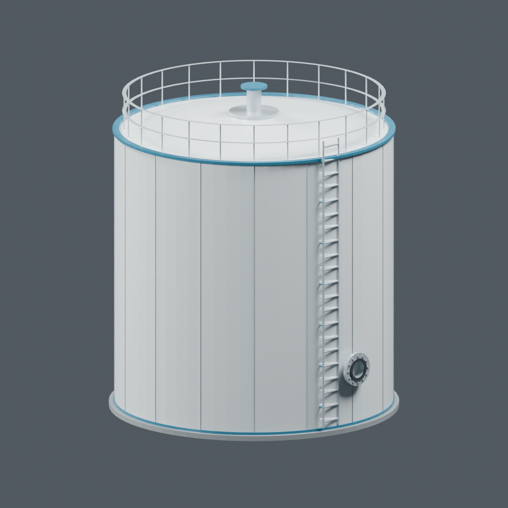
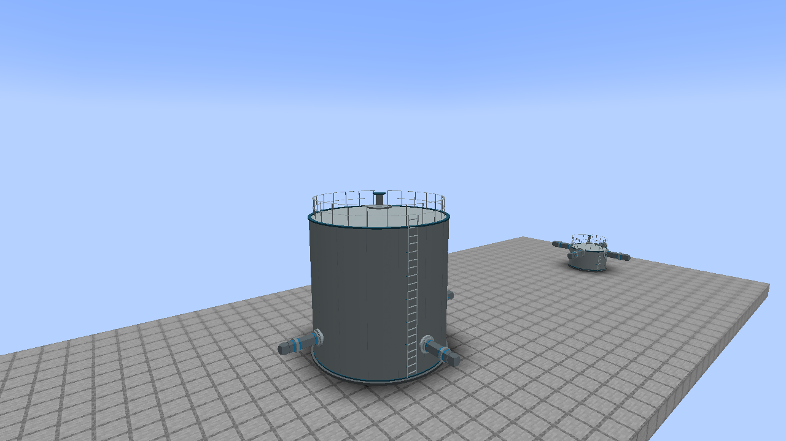
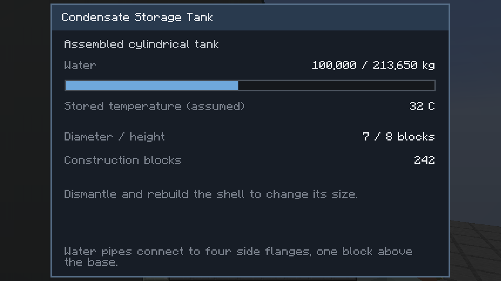

# Scalable condensate storage tank

The existing Condensate Storage Tank item now assembles a cylindrical multiblock.
Its components are modeled in Blender: an enamel shell, shallow cone roof, roof
railing, vent, access ladder, concrete plinth and four full-size pipe flanges.
The unassembled block uses a simple casing texture.

## Build and change size

1. Build a **complete box** from Condensate Storage Tank blocks: a floor, four
   walls and roof. Keep the interior empty. Width and depth must match and be
   an odd **3–15 blocks**; height is **3–24 blocks**, including floor and roof.
2. Placing the final missing shell block automatically forms the cylinder.
   There is no Assemble button or manual size selection. A filled box is also
   accepted, but a hollow shell uses fewer blocks.
3. Right-click any assembled part to see capacity, stored water and dimensions.
   To change size, drain and dismantle the tank, then build the desired box.

The cylinder occupies the box footprint, leaving the outside corners clear.
Stand clear during formation. Obstructions, unloaded space, protected areas,
and insufficient capacity prevent formation without consuming the box. The
combined available water of the placed blocks, including fractional withdrawals,
is preserved. Four full-size flanges appear one block above the base.
Keep the full structure loaded to transfer water.

Breaking any part dismantles the cylinder into ordinary, recoverable casing
blocks. Mine the broken part with a suitable pickaxe in survival to receive its
normal drop; creative breaking and unsuitable tools consume only that part.
The remaining casings stay in the world. Any construction blocks beyond the
number of casing positions are refunded as item stacks. Collision-only cells
do not create extra materials. The surviving casings follow the cylinder's
footprint; rebuild them into a box to form the tank again.

Sections in unloaded chunks are restored when those chunks become available;
pending restorations are saved with the world. **Drain the tank before breaking
it:** dismantling does not preserve its water.

## Capacity and connections

Capacity follows the modeled cylinder, using this initial game approximation:

```text
capacity (kg) = floor(pi * (0.47 * diameter - 0.08)^2 * (height - 1.4) * 1000)
```

The height allowance represents the foundation, roof and freeboard. One mB is
one kg in this mod. All tank parts share one finite inventory, and all ports
share the same fractional pump-withdrawal accounting.

There is one water flange at the center of each cardinal side, **one block above
the base**, facing outward. Connect BWR High-Pressure Water Pipe or Mekanism
Mechanical Pipe. Each flange accepts or supplies water; the connected pump or
pipe determines flow direction. Steam pipes do not connect. Existing feedwater,
emergency and cooling-water pumps can draw from the assembled tank.

Buckets work on the tank, and CC:Tweaked keeps the existing type
`bwr_condensate_tank`. The existing `getStored`, `getCapacity`, `getLevel`,
`getTemperature`, and `getStatus` calls remain available. `getStatus` now also
reports `assembled`, `ready`, `diameter`, and `height`. Size construction is a
local player action, so computers cannot bypass the material cost.

Stored water now mixes by mass and enthalpy, including during automatic
formation and reload. Older untagged inventories retain the former 32 C value;
new untagged external water enters at 13 C. Water chemistry is unchanged. See
[temperature transport and third-party compatibility](PLANT-TRANSPORT.md).

## Existing worlds

Old single-block tanks retain their **2,000,000 kg** capacity and saved water.
Build a valid tank shell around an old block to convert it. A full old tank
needs a sufficiently large box or must be drained before conversion. Updating the mod
does not automatically expand tanks into nearby blocks.

## Source and validation

Blender sources and renders: `art/models/condensate_tank/`. Since the remodel (below) the parts come from
`build_cst.py`; re-export them with `python tools-export-condensate-tank.py` and use `--check` to verify the generated
OBJ/MTL/model resources. Models are original geometry; no external mesh was imported.

Server checks cover legacy water, minimum/medium/maximum sizes, pipe faces,
shared storage, fractional persistence, obstruction rejection, survival material
cost/refund and dismantling, including actual player mining and deferred
restoration across unloaded chunks. The opt-in client check is
`:mod:runTurbineModelCheck -PbwrTankPanelCheck`; it also captures the recovered
casings after breaking the middle tank.







## Remodel: what the tank looks like now

The first model (an enamel can, a flat cone, a ring of railing, a plain ladder) was replaced by one drawn after a real outdoor
condensate storage tank. Only the look changed: the block, the box sizes (odd 3 to 15 across, 3 to 24 high), the cells and
their collision, the controller, the capacity and the four flanges (centres one block above the base on the box sides, faces
outward) are the same, so pipes join exactly where they did. There is still no level shown in the world, so there was no
level display to keep working.

**What the reference plant has.** Columbia (BWR/5) has two condensate storage tanks, COND-TK-1A and 1B, of 400,000 gal each.
They are carbon steel with a 1/16 in corrosion allowance and a phenolic lining. They are designed for atmospheric pressure
plus the static head, 140 F, a 20 psf wind and a 20 psf snow load. Electric heaters hold them above 40 F, and the pipes above
ground are heat-traced. They stand in a Seismic Category I concrete dike that holds the contents of both tanks, on a 2 ft 4 in
reinforced mat with thickened edges. The level is read in the control room, with low and low-low switches. (FSAR 9.2.6 and
3.8.5.1.5; sources below.)

**What the model shows** (`art/models/condensate_tank/build_cst.py`, one atlas from `make_cst_atlas.py`):

- **Foundation.** The concrete dike mat over the box with a low curb round its edge, and a chamfered concrete ringwall under
  the shell. The bottom plate projects past the shell, with its fillet weld.
- **Shell.** An off-white coated shell in courses about 2.6 blocks (8 ft) high. Girth seams run round it, and the vertical
  seams are staggered course by course. A top angle runs round the eave. On tanks 5 or more across and tall enough, the name
  band "CONDENSATE STORAGE TANK" is stencilled on.
- **Roof.** A cone roof sloped about 1 in 10, with radial plate laps. It carries a flanged centre gooseneck vent with its
  screen, and a roof manway with a hinged cover beside the ladder landing.
- **Handrail.** A perimeter handrail on the roof edge: posts every 1.9 blocks with top and mid rails. It is open at the landing.
- **Ladder.** A caged ladder on the old ladder column. Rails and rungs stand off the shell on brackets, and the cage starts
  2.2 blocks up. At the top a grating landing reaches in over the roof, with toe plates and walk-through rails.
- **Water nozzles.** The four nozzles have weld-neck flanges with 12 studs, nuts and a gasket, a blue water band, and a
  reinforcing pad where each meets the shell.
- **Shell fittings.**
  - a 24 in shell manway with a bolted cover and hinge davit;
  - a flanged immersion heater with its terminal box and conduit (Columbia's heaters);
  - a float-and-tape level gauge board with its scale, head plate and roof sheave box;
  - an overflow line running down from under the eave to a splash box;
  - a tank plate and a radiological posting;
  - anchor bolt chairs round the foot, kept clear of the fittings.

Parts that stretch with the size: the mat, the ringwall, the shell, the girth seams, the top angle, the roof and the name
band. Everything else is full size and placed on the shell by `CondensateTankRenderer.build`, which mirrors `layout()` in
`build_cst.py`. Small tanks leave out what would not fit: the tank plate, the posting, the name band, the overflow and the
roof hatch below 5 across. One cached mesh per size, as before (MACHINE-RENDERING.md).

| Size | Old triangles | New triangles |
| --- | ---: | ---: |
| 3 x 3 | 8,738 | 11,160 |
| 7 x 8 | 9,718 | 14,914 |
| 15 x 24 | 12,854 | 25,970 |

The largest tank's cached mesh is about 3.7 MB of vertex data (36 bytes a vertex), below one natural-draft cooling tower
(35,604 triangles).

**Not changed, on purpose.**
- The unassembled casing block (`condensate_storage_tank`, a plain cube) is the model that old single-block tanks use, so it
  stays as it was.
- The alpha part sources (`base`, `wall`, `roof`, `port` and `ladder` `.json` beside `build_models.py`) are kept for the
  before/after renders. Their exported names are reused by the new parts.

**Pictures.**
- Blender previews (`art/models/condensate_tank/review/`, JPEG) from `preview_cst.py`, before and after: three sizes, the 7 x 8 up
  close, and the 15 x 24 roof and foot.
- In-game, 1920 x 1080: `:mod:runTurbineModelCheck -PbwrTankNozzleShots=<label>` through run-mc.ps1 (TankNozzleShots) saves
  them to `run/turbineModelCheck/tank-nozzle-shots/<label>/`. JPEG copies are in `art/cst-recirc-remodel/before/` and `after/`.

### REFERENCES

Viewed online or in the local FSAR copy; nothing is bundled. No maker's name or logo is used.

- **Columbia Generating Station FSAR, Amendment 67** (NRC ADAMS accession ML23346A215). The local copy is
  `../references/columbia/Columbia FSAR.pdf`, outside the repository. Pages used (1-based PDF pages):
  - §9.2.6.2-9.2.6.5, pages 3279-3281: two 400,000 gal tanks, heaters, design pressure and temperature, wind and snow loads,
    the Seismic Category I dike, carbon steel with the phenolic lining, level instrumentation and heat-traced piping.
  - §3.8.5.1.5, page 1269: the retaining area, a 2 ft 4 in reinforced-concrete mat with thickened edges carrying both tanks
    and the perimeter dike walls.
  - §1.2 (page 97): the two interconnected 400,000 gal tanks.
- **Columbia from the air**, Wikimedia Commons (viewed): the plant's layout and the six round towers. The tanks themselves are
  too small to read in these pictures.
  - https://commons.wikimedia.org/wiki/File:Columbia_Generating_Station_overhead_1.jpg
  - https://commons.wikimedia.org/wiki/File:Columbia_Generating_Station_overhead_3.jpg
- **A welded steel storage tank**, Wikimedia Commons (viewed): course seams with staggered vertical seams, the top angle, and
  a perimeter handrail of posts with top and mid rails on the roof edge.
  https://commons.wikimedia.org/wiki/File:Fuel_tank_gnangarra.jpg
- **Storage tank** (Wikipedia, viewed): fixed cone roofs and vertical cylindrical welded tanks.
  https://en.wikipedia.org/wiki/Storage_tank

**Gaps.** No public source gave Columbia's tank diameter, height, roof type, colour or access arrangement. Nor did any give
the exact nozzle schedule. The cone roof, the caged ladder (chosen over a spiral stair so the ladder keeps its existing
cells), the manway, the gauge board, the overflow and the anchor chairs are ordinary welded water-tank practice, not
Columbia drawings. The proportions follow the player's box, not the real 400,000 gal tank.
