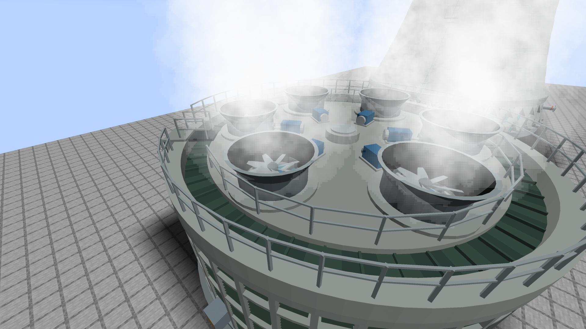
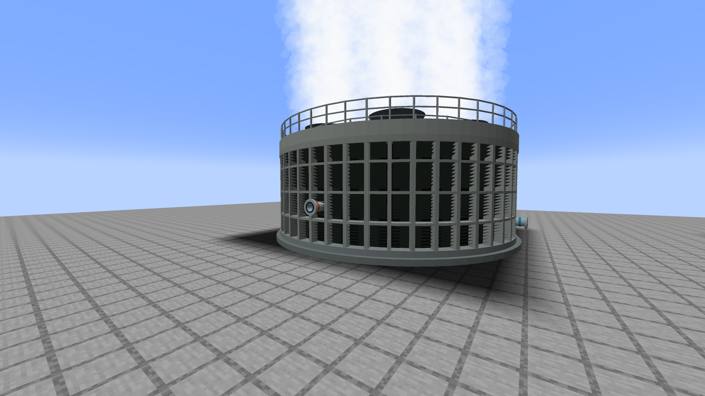
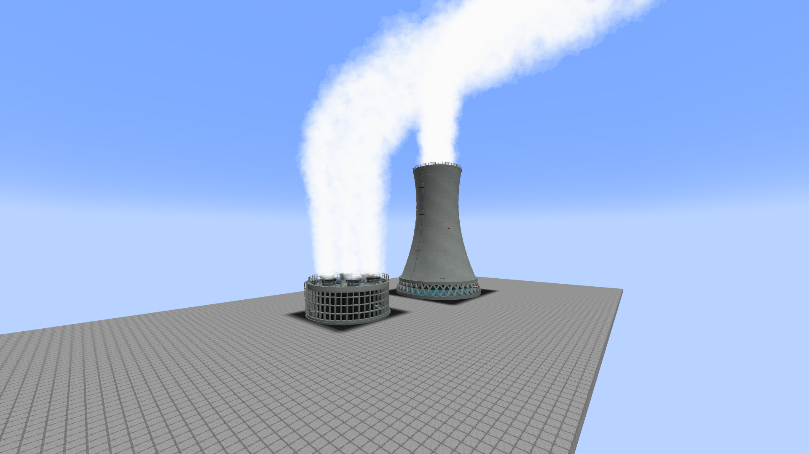
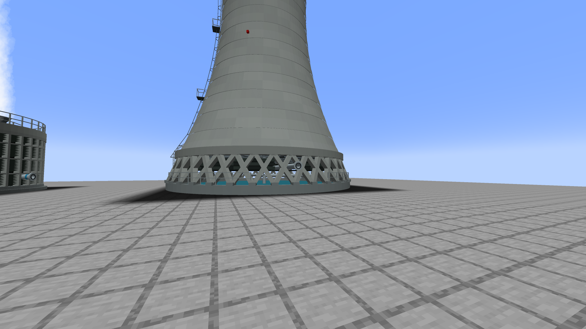
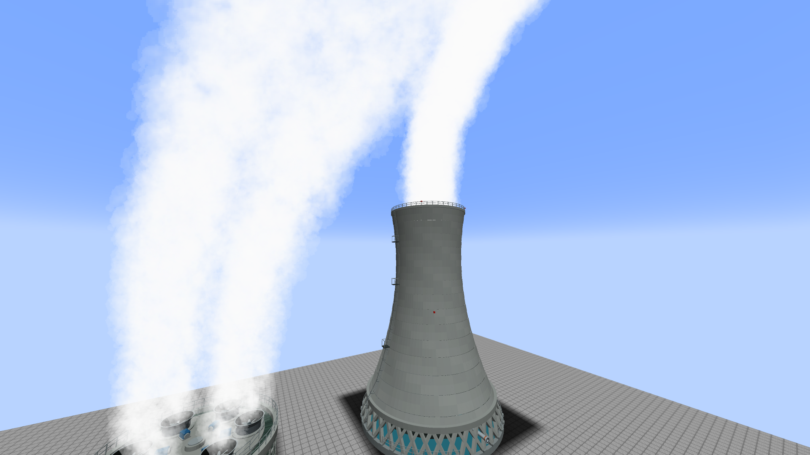
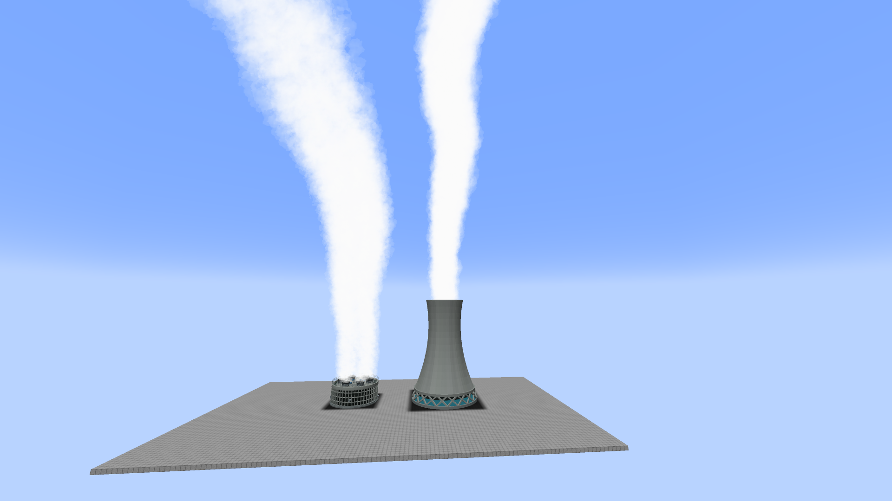

# Cooling-tower remodel: references (alpha.54)

Research was view-only: pages were read and photographs were looked at in a browser pane, nothing was downloaded
or imported. Every URL below is a place to look; what each one showed is written next to it. Where a page could not
be read (HTTP 403, or a PDF the fetcher could not decode) that is said, and nothing from it is claimed.

## What Columbia Generating Station's towers really are

**Round, precast-concrete, mechanical-draft towers, six of them, each with six fans in a ring. They are induced
draft (fans on top, pulling air up through the fill), not forced draft.**

| Question | Answer | Evidence |
| --- | --- | --- |
| How many towers? | Six | Wikipedia infobox "6 x Mechanical Draft"; NRC letter (below) "six mechanical draft cooling towers"; the overhead photograph shows six circles |
| Round or rectangular? | Round (concentric drums) | Overhead photograph: six circular drums; Wikipedia footnote "concentric low-profile precast concrete cooling towers" |
| Fans per tower | **Six**, one ring of six, no centre fan | Overhead photograph (viewed at 3840 px): every drum has exactly six fan stacks on a hexagon. Wikipedia footnote: "each with 6 x individual induced-draft cooling cells, for a total of 36". |
| Induced or forced? | **Induced.** Fans are at the air outlet on the top deck; air enters through louvers around the base. | Fan stacks and blades are on the deck in the photograph; the louvered drum below has no fans. Definitions: Wikipedia, "Cooling tower": induced draft = fans at the outlet pulling air through, forced draft = fans at the inlet pushing it in. |
| The owner's word | "Forced draft towers" | Probably loose wording. The sources and the photographs agree on induced draft, and that is what was modelled. |
| Shape | Wide and low. Drum about 17 : 8 (diameter : height) with the stacks | Side photograph: broad drums, about four stacked louver tiers separated by pale concrete bands, a flat deck, short fan stacks |
| Top | Dark outer annulus (hot-water distribution deck) with a pale central fan deck; six short flared fan stacks in a ring; handrail on the outer edge; a stair tower and a walkway bridge from the edge to the deck | Overhead photograph |
| Plume | Large, continuous, rises far above the towers (Wikipedia: "can reach 10,000 feet") | Distance photograph |

Earlier notes in this repository (COOLING-WATER.md, build_revision.py) described a 19-fan Columbia tower. That does
not match the photographs, and the alpha.54 model replaces it with the six-fan ring. The fan pivots are the same six
positions the very first (alpha.8) model used, so old saves that still carry that layout line up as well.

### Sources, with what each shows

- Aerial photograph, six round towers, six fans each: <https://commons.wikimedia.org/wiki/File:Columbia_Generating_Station_overhead_3.jpg>
  (look at the lower-left corner). Shows the ring of six fan stacks, dark annular deck, pale central deck, edge
  handrail, stair tower and bridge. Viewed at 3840 x 2880.
- Side view of the drums and plume: <https://commons.wikimedia.org/wiki/File:Cooling_(1959001278).jpg>. Shows the
  low wide drums, four louver tiers, a stepped upper stage, and the plume.
- Distance view, 2015, by Chris Uhlik (CC BY-SA 4.0): <https://commons.wikimedia.org/wiki/File:Columbia_Generating_Station_at_Hanford_Washington.JPG>.
  Shows how low the towers are next to the reactor building and how large the plume is.
- Article text and footnote ("6 concentric low-profile precast concrete cooling towers, each with 6 induced-draft cooling
  cells"): <https://en.wikipedia.org/wiki/Columbia_Generating_Station>.
- NRC letter, March 2010 (read as a search snippet only): <https://www.nrc.gov/docs/ML1007/ML100710046.pdf> states that
  closed-cycle cooling rejects heat by evaporation "using six mechanical draft cooling towers".
- NRC license renewal application, section 2.4.12.3 (cited by the earlier doc as "six circular mechanical-induced-draft
  towers"): <https://www.nrc.gov/reactors/operating/licensing/renewal/applications/columbia/columbia-lra.pdf>. The
  server answered 403 to the fetcher, so this one was NOT re-read; it is listed because the earlier doc used it.
- Induced versus forced draft, definitions: <https://en.wikipedia.org/wiki/Cooling_tower>. Also listed by the
  earlier doc and not re-read: <https://spxcooling.com/library/induced-draft-vs-forced-draft-cooling-towers/>.

## Natural-draft (hyperbolic) tower

- Smooth double-curved concrete shell, throat about 70 % of the way up, slightly flared top, faint horizontal lift
  lines: <https://commons.wikimedia.org/wiki/File:Didcot_power_station_cooling_tower_zootalures.jpg> (viewed).
- The inside of a shell: smooth, ring lines from each pour, bright open throat above:
  <https://commons.wikimedia.org/wiki/File:Inside_of_a_Natural_Draft_Cooling_Tower.jpg> (viewed).
- Construction of a real set, with numbers: <https://www.pa-roots.com/southbend/kellertosi/southbend02.html>
  (read). Four hyperbolic towers, 300 ft base diameter, 320 ft high, a compression ring footing, 40 ft high columns
  arranged in a V around the ring, a continuous 2 ft x 2 ft ring beam tying the legs, then a solid shell poured in 2 ft
  lifts by climbing forms. This is where the legs, the ring beam and the visible pour joints come from.
- Concrete struts under the shell, a pond wall around the basin, cooling zone in the lowest 10 m:
  <https://www.designingbuildings.co.uk/Cooling_tower_design_and_construction> (read).
- Diagonal columns at the base carrying the ring beam, listed among the cast-in-place elements of a tower
  specification (read as a search snippet): <https://tenders.bhel.com/sites/default/files/ndct-technical-specification-specn-bk2-of-2-1564152737.pdf>.
- USGS photograph of a hyperbolic tower and the SPX natural-draft data sheet, as cited by the earlier doc and not
  re-read: <https://www.usgs.gov/media/images/natural-draft-cooling-tower>, <https://spxcooling.com/pdf/CL800ND-09.pdf>.
- Not found in any source that could be read: the shell ladder, landings and aviation lights. They follow common
  practice (a caged vertical ladder, rest landings, red obstruction lamps at the rim and at mid height) and are
  labelled as such, not as a copy of a particular tower.

## Side by side: what the reference shows against what the game shows

The reference pictures are not copied here (view-only research); the right-hand column says what the linked photograph
shows, and the left-hand column is the in-game 1920 x 1080 picture (run `-PbwrCoolingTowerShots`).

| In game | What the reference shows | Match |
| --- | --- | --- |
|  `round-fan-stack-closeup` | Overhead photograph: a ring of six fan stacks on a pale central deck, a dark annulus around it, an edge handrail, a stair tower and bridge | Six stacks on the hexagon, pale deck, dark annulus, handrail, motors. The annulus is narrower than in the photograph because the fan pivots (radius 4.9 of 8.5) are kept for saves. |
|  `round-louvers-and-ports` | Side photograph: a wide low drum, four dark louver tiers separated by pale bands | Four dark louver tiers between pale beam rings; columns are slimmer than the first attempt. The ports (warm inlet with the orange band, the others blue) sit mid-bay. |
|  `both-towers` | Distance photograph: low wide towers, a big continuous plume | Same plume code as before; the round tower is low and wide next to the shell. |
|  `natural-base-legs` | pa-roots (Keystone) description: V-shaped columns round a compression ring, a 2 ft x 2 ft ring beam tying the legs, then the shell | 80 crossing diagonal legs on pedestals, the thick ring beam, fill and pipes visible between the legs, the basin water. |
|  `natural-rim-and-ladder` | Didcot photograph: smooth shell, throat about 70 % up, flared top, faint lift lines | Same curve as alpha.53 (so the collision matches), stepped pour joints, rim handrail, red lamps, caged ladder with landings. |
|  `natural-lod-far` | Same shell from far away | The 64-sided stand-in, drawn only beyond 80 blocks (the check fails if it is drawn nearer or not drawn far away). |

## What was modelled from this

Natural-draft tower (25 x 36 x 25, outside curve unchanged from alpha.53):

- 28 cast-in-place pour lifts, alternate lifts stepped 3.5 cm so the joints show, five concrete tones;
- a separate inner skin that thickens toward the base, a thick coping with a handrail and four red rim lamps, three
  red lamps at mid height;
- a ring beam at the shell base, carried by 80 diagonal legs (a crossing X between 40 nodes) on pedestals, with
  corbels at the head;
- a concrete cold-water basin with water, a guard rail with gaps at the three ports and the ladder;
- three layers of fill packs visible between the legs, ring mains and laterals, drift eliminators, a clear corridor
  for the hot-water header;
- a caged ladder up the shell with three landings.

Columbia-style round tower (17 x 8 x 17):

- plinth and basin curb, 48 slim precast columns, four louver tiers (about 1,300 slats), beam rings between tiers, a
  dark backing wall so the louvers read dark like the photographs;
- a coping wall with handrail, a dark hot-water distribution annulus with panel seams, a pale central fan deck
  with six circular openings;
- six fan stacks on a hexagon (radius 4.9, the fan pivots are unchanged), each a short cylinder flaring to a
  velocity-recovery lip, with a gearbox under the hub, support beams, a shaft through a guard collar and a motor on
  the deck, a central riser housing;
- a stair tower with a caged ladder and a walkway bridge to the deck, handrails.

Rectangular cell tower: **not added.** The existing mechanical tower was already round, and a rectangular cell tower
would need a new block, a new footprint and new ports, none of which the owner asked to change. A rectangular tower
can be added later as a variant of the same block physics.
