# Realistic BWR

<p align="center"></p>

**By [OldGunslingerWildBill](https://github.com/OldGunslingerWildBill)**

This is a boiling water reactor mod for Minecraft 1.21.1 (NeoForge). You build the reactor and the whole
plant around it: pumps, steam lines, turbines, the condenser, cooling towers, emergency cooling,
containment, and the grid tie. I based most of it on Columbia Generating Station (a BWR/5) and the NRC
docs for it.

The power comes out of the neutronics. You pull rods and set recirculation flow, and the core does what
it does. There's no "set burn rate" button, and nothing in the plant does anything on its own. No auto
scram, no auto ECCS. If you want protection you wire it yourself from a control room you build.


## Status

**Early alpha. Current version: `0.1.0-alpha.59`.** Stuff will change between versions and there will be
bugs. **Back up your worlds before you update.** Everything that changed is in [CHANGELOG.md](CHANGELOG.md).

The source is public under my own [Realistic BWR Source-Available License](LICENSE). You can read it,
build it and play it, but publishing changed versions or reusing the code and assets somewhere else needs
my written OK first. If you share it, credit **OldGunslingerWildBill**. Details are in
[license and credit](#license-and-credit).

## Requirements

| | Version | Notes |
| --- | --- | --- |
| Minecraft | 1.21.1 | |
| NeoForge | 21.1.248 or newer | |
| Java | 21 | |
| Mekanism | 10.7 or newer, optional | Pipes that hook into the plant's water and steam ports, uranium and steel items, the fabricator's chemical route, the fuel assembly recipe, the Mekanism tier of the crafting recipes, the turbine oil route, and tritium processing with Mekanism Generators |
| CC:Tweaked | 1.111 or newer, optional | Lua control of almost every machine, plus CC bindings on panels |
| Immersive Engineering | optional | IE concrete counts as concrete for blast and radiation shielding |
| Cold Sweat | 2.4.3 or newer, optional | RTGs warm you up |

None of the optional mods are bundled, and the mod runs fine without them. Without Mekanism you still
need some mod that gives you steel (`c:ingots/steel`) for the fuel fabricator. Sodium and Iris work too,
with or without a shader pack ([notes](docs/shader-packs.md)).

## What's in it

### The reactor

- Real reactor physics: delayed neutrons, rod worth, a spatial flux map, void and temperature feedback,
  xenon, burnup, decay heat, vessel inventory, pressure and damage. Rods move smoothly between notches
  (0 to 48). [SPEC.md](SPEC.md), [REFERENCE-DATA.md](REFERENCE-DATA.md), [ROD-MOTION.md](ROD-MOTION.md)
- Vessels from 7 x 7 up to 23 x 23. A 17 x 17 vessel holds 764 fuel assemblies and 185 control rod
  drives. [COMPACT-CORE.md](COMPACT-CORE.md)
- Vessel height matters. A short vessel gives you wetter steam and less water before the core uncovers.
  A tall one gives dry steam and more margin but heats up slower. True scale for 17 x 17 is 39 tall.
  [VESSEL-HEIGHT.md](VESSEL-HEIGHT.md)
- The pressure vessel is modelled on Columbia's drawings: support skirt, bottom head with the CRD field,
  shell courses, nozzle forgings, the flange with 74 studs, and a domed head. With the head off you can
  see the steam dryer, the separators, the core spray and feedwater spargers, the top guide and the core.
  [RPV-REFERENCE.md](RPV-REFERENCE.md)
- Recirculation with jet pumps and external pumps, or internal pumps.
  [RECIRCULATION.md](RECIRCULATION.md), [INTERNAL-PUMPS.md](INTERNAL-PUMPS.md)

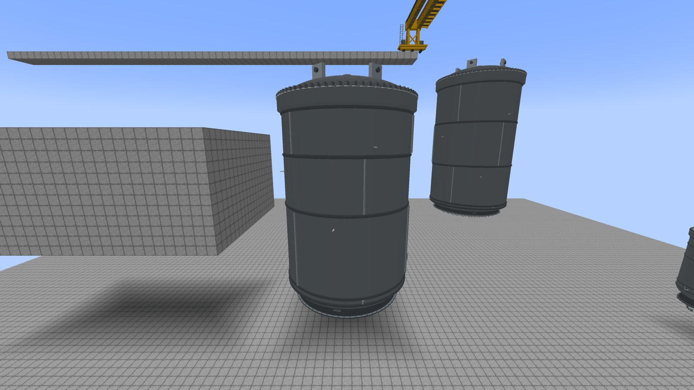

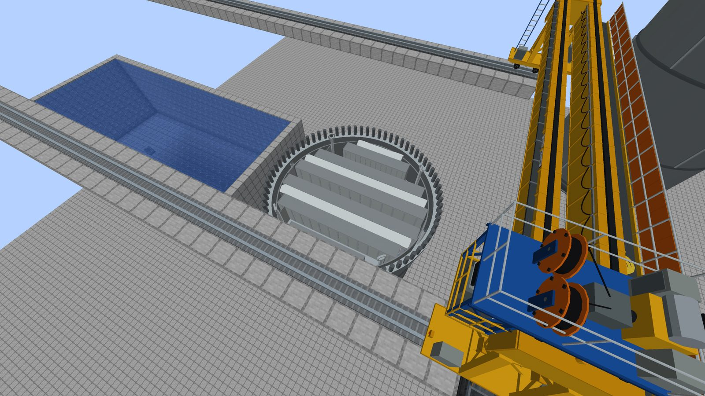


### Opening the vessel and refuelling

- **Stud tensioner and building crane.** The head is held on by studs. Detension them, then lift the
  head with the reactor building crane onto a head stand. The crane also lifts the steam dryer and the
  separators into a water pit. [BUILDING-CRANE.md](BUILDING-CRANE.md)
- **Shield plugs.** Put crane anchors on your shield plug concrete and split it into sections with the
  seam marker. With four anchors hooked up, the crane lifts a section off the well as one piece, hanging
  on four slings, and sets it down somewhere clear. The three plug concrete tiers weigh 2.4, 3.2 and
  4.0 t a block, and the crane is rated for 125 t. The head can't come off while plugs are still over
  the well.
- **Flooding the well.** Wall in the top of the vessel and a cavity seal forms, then pump water in until
  it stands over the flange. A drain port and a motor-operated valve take it back to the CST.
- **Refuelling bridge.** A bridge on rails over the open reactor and the spent fuel pool. Its mast grabs
  one assembly at a time and carries it under water through the transfer chute. Instant refuelling is a
  server option, off by default. [REFUELLING-BRIDGE.md](REFUELLING-BRIDGE.md)
- **Spent fuel pool.** Fuel you take out keeps making decay heat. The pool has racks, a cooling train
  and makeup water, and if you neglect it the water boils off and the fuel uncovers. A **new fuel
  elevator** on the pool rim lowers fresh assemblies down into the racks.
  [SPENT-FUEL-POOL.md](SPENT-FUEL-POOL.md)

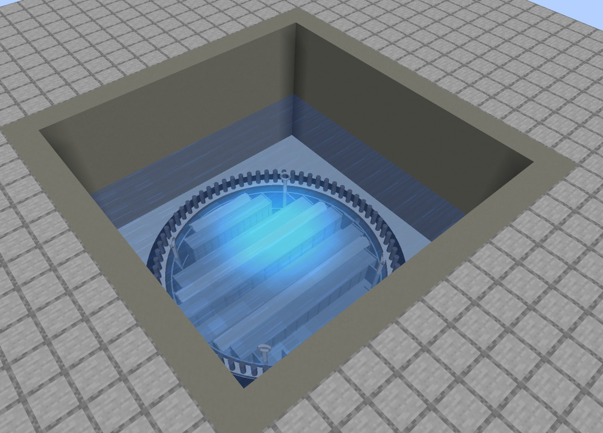

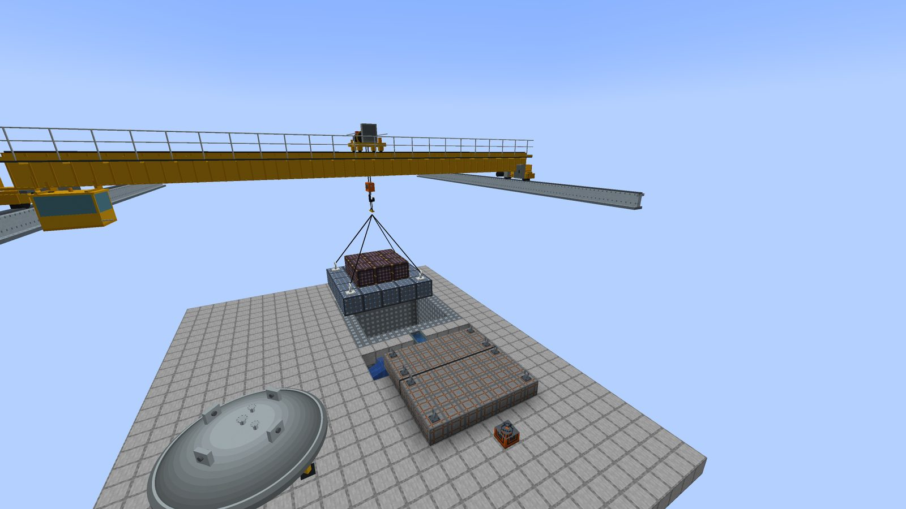

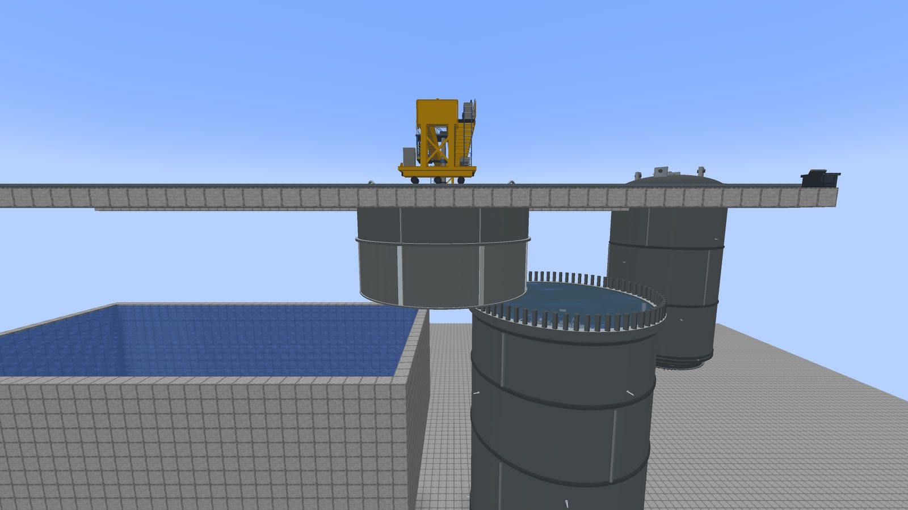

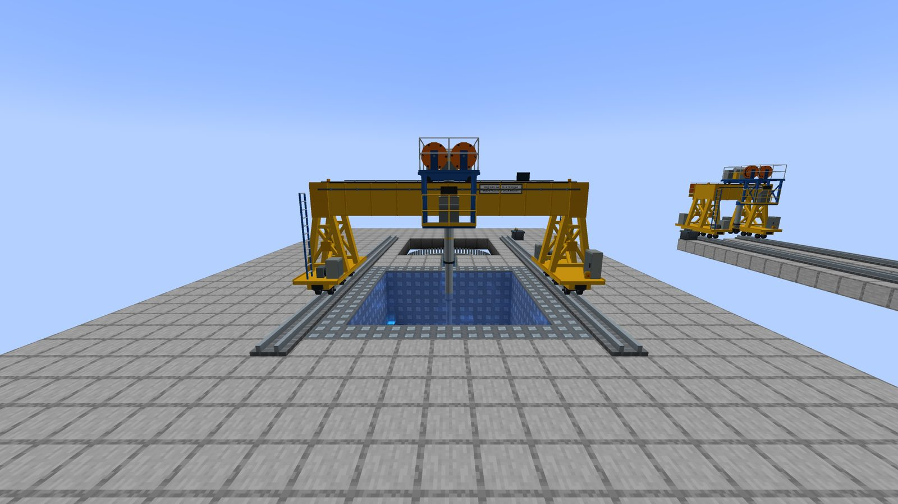

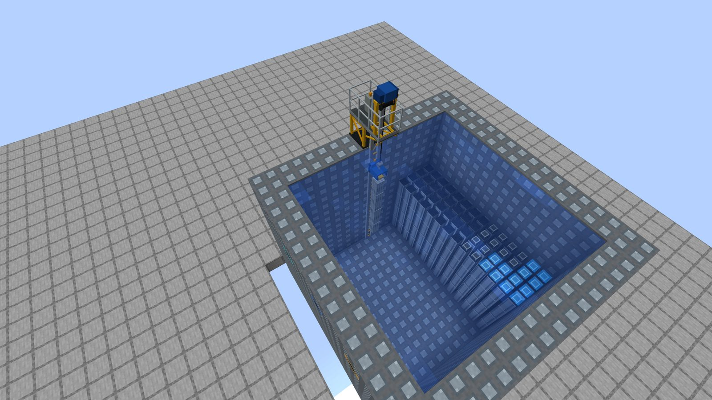

### Fuel, ore and isotopes

- **Uranium and thorium ore** with big veins, depending on the biome. Mining them also drops lead,
  radium, bismuth, rare earths and other byproducts. Only new chunks get the ore, and there's a server
  option to turn each one off. [URANIUM-ORE.md](URANIUM-ORE.md), [THORIUM.md](THORIUM.md)
- **Fuel Fabricator.** Put in uranium and steel, pick an enrichment (0.71 to 20 %), and get a fuel
  assembly. It uses real enrichment math, so 3.5 % fuel costs 29 uranium and 20 % costs 172. You get
  depleted uranium back. It also makes MOX and the three thorium fuels.
  [FUELS-AND-RODS.md](FUELS-AND-RODS.md)
- **Reprocessing Plant** takes spent fuel apart into plutonium, depleted uranium and fission product
  waste. The **Isotope Separator** pulls strontium-90, caesium-137 and americium-241 out of that waste.
- **Breeding targets.** Put target rods in the core to make cobalt-60, polonium-210, uranium-233,
  neptunium-237, plutonium-238, actinium-227, thulium-170, tritium and doped silicon. The guide book has
  a chapter with every breeding and decay path. [BREEDING-TARGETS.md](BREEDING-TARGETS.md)
- **RTGs.** A small RTG and a large 2 x 3 x 2 one that holds up to 1,000 kg of isotope. They turn decay
  heat into FE at about 5 %, like the real thing, and the output drops off with each isotope's
  half-life. [RTG.md](RTG.md)
- **Specialty rods**: boron carbide and hafnium absorbers and startup neutron sources.

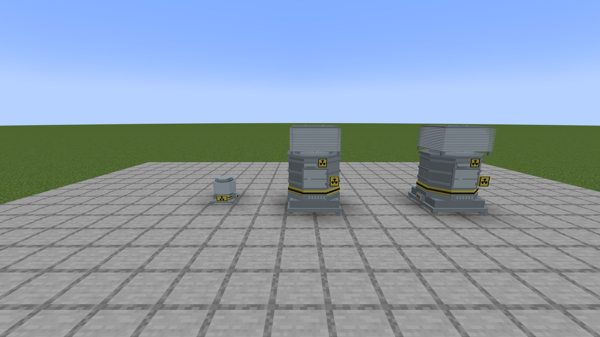


### Water and steam

- Electric and turbine-driven pumps with real-looking models: vertical can-type ECCS pumps like
  Columbia's, the recirc pumps, barrel feed pumps, the feed pump turbines, RCIC and HPCI.
  [PUMP-MODELS.md](PUMP-MODELS.md), [WATER-PLUMBING.md](WATER-PLUMBING.md)
- MSIVs, safety relief valves, steam stop and control valves, bypass valves, and motor-operated water
  valves. [MAIN-STEAM-VALVES.md](MAIN-STEAM-VALVES.md), [STEAM-VALVES.md](STEAM-VALVES.md)
- Modular HP and LP turbines and a generator up to 1,500 MW, with a condenser under each LP. The turbine
  has a lube oil system, a turning gear and a generator cooling skid. [MODULAR-TURBINES.md](MODULAR-TURBINES.md),
  [TURBINE-AUX.md](TURBINE-AUX.md)
- Natural-draft and Columbia-style mechanical-draft cooling towers, intakes, a full-size shell-and-tube
  RHR heat exchanger, a water outlet chute, and condensate storage tanks. [COOLING-WATER.md](COOLING-WATER.md)
- **RWCU.** The reactor water gets dirty over time (conductivity and crud). The cleanup system with a
  stainless steel filter keeps it clean. [RWCU.md](RWCU.md)

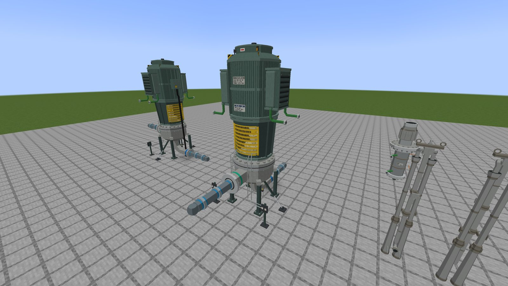

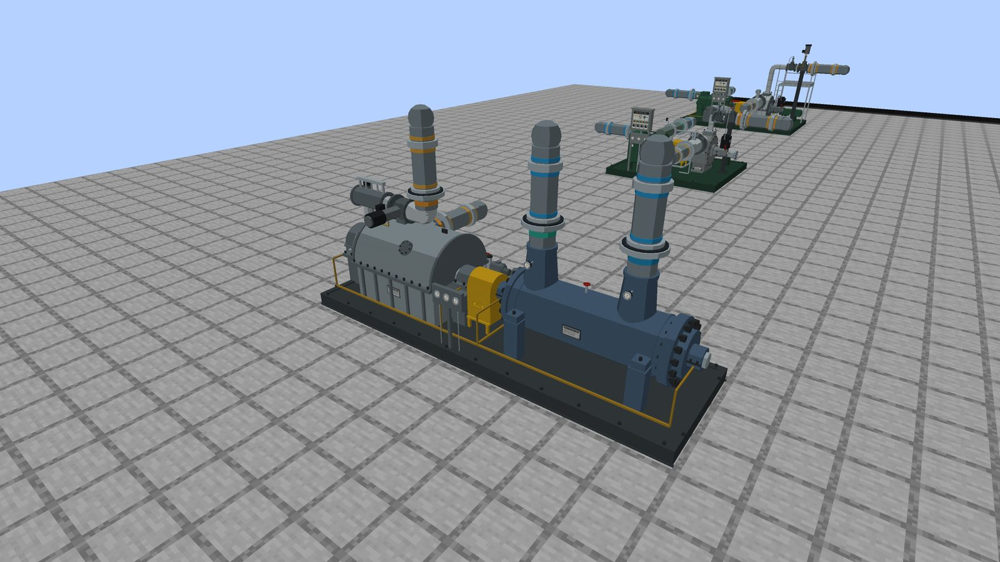

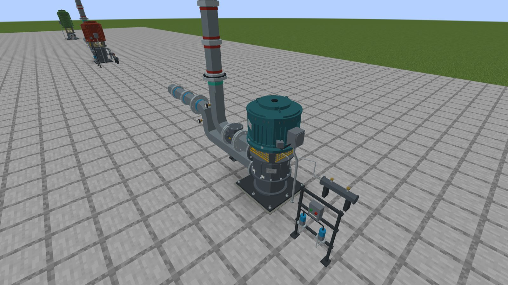

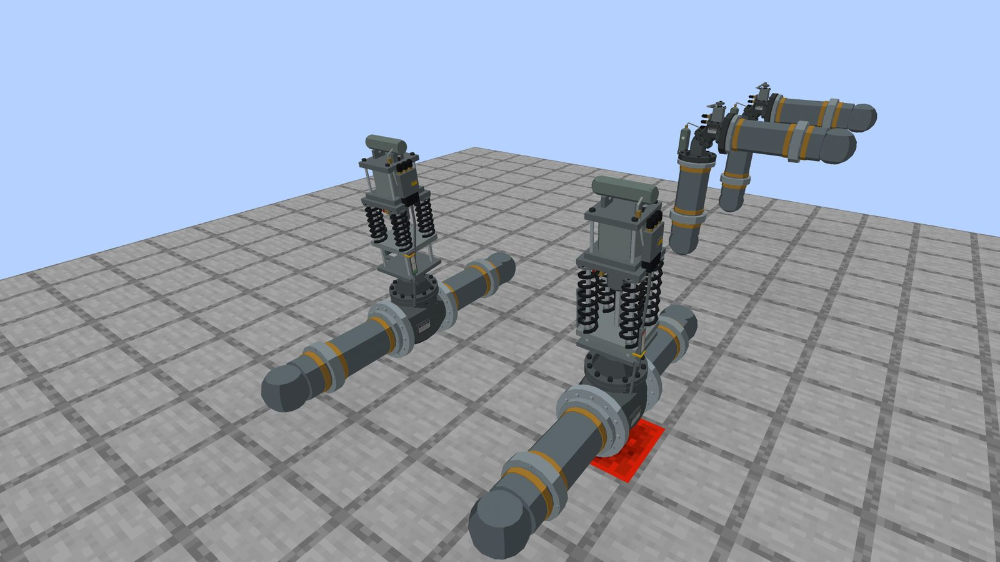

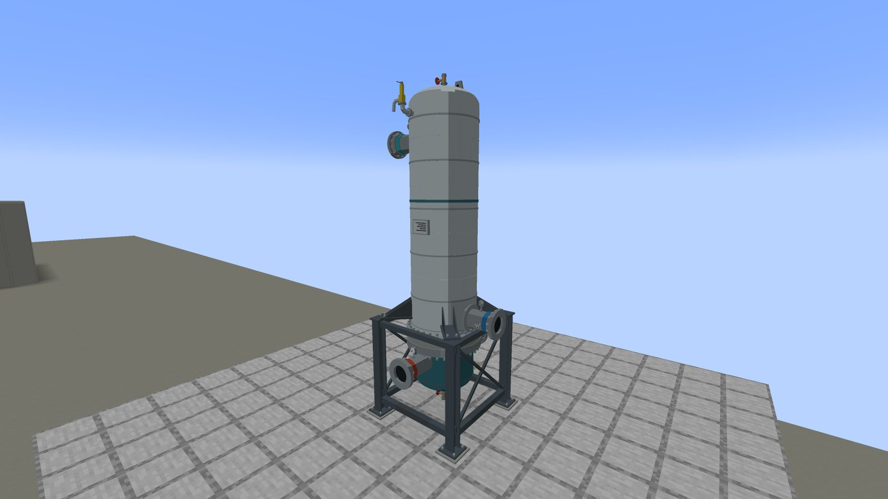

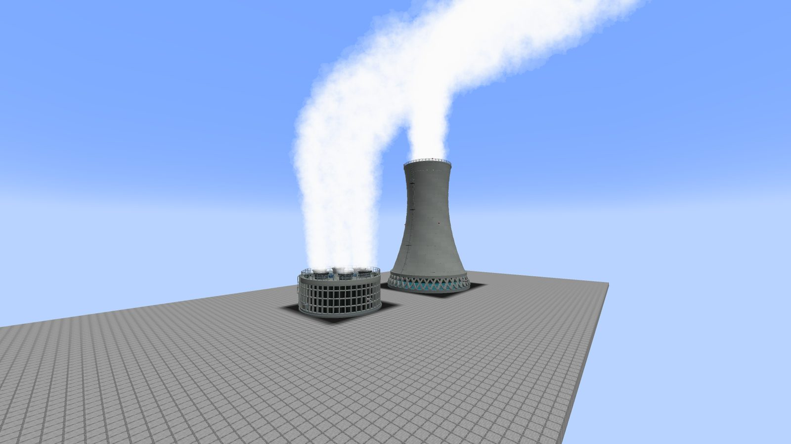

### Safety systems and accidents

- HPCS, LPCS, RHR/LPCI, RCIC, HPCI, SLC, safety relief valves, core spray, and suppression pools
  (including concrete basins you build). None of it does anything until you hook it up.
- Break a recirc, feedwater or steam line and you get a LOCA. Put the pipe back to seal it.
  [PORT-LOCA-UPDATE.md](PORT-LOCA-UPDATE.md)
- Severe accidents happen in order: cladding failure, core melt, lower head failure, corium on the floor,
  hydrogen burns. Explosions break blocks by their blast resistance, and a head failure can throw the
  vessel head. Shield plug concrete comes in three tiers that can stop it.
  [SEVERE-ACCIDENT-UPDATE.md](SEVERE-ACCIDENT-UPDATE.md)
- **Radiation.** A survey meter, area monitors, and your own dose. Blocks between you and a source shield
  you by real half-value layers (lead 1 cm, steel 2.5 cm, concrete 6 cm, water 10 cm), and there's a
  Block of Lead for shielding. Swimming near fresh fuel in the pool will hurt you, a lot.
  [RADIATION.md](RADIATION.md)
- **Containment** you build yourself, with penetrations, vault doors, airlocks, nitrogen and a wetwell vent.
  [CONTAINMENT-UPDATE.md](CONTAINMENT-UPDATE.md)

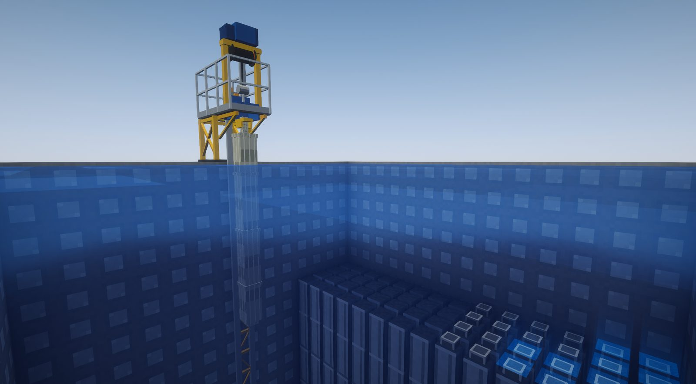

### Control room

You build panels and cover them with gauges, switches, lamps and annunciators, then wire them to the
plant, to redstone or to CC:Tweaked. A control only does something when somebody operates it.
[CONTROL-PANELS.md](CONTROL-PANELS.md)

- Vertical boards, benchboards, consoles, back panels and 1 m and 2 m control desks, in five paint
  colours, plus relay cabinets, operator desks and wall displays. [ROOM-FURNITURE.md](ROOM-FURNITURE.md)
- Instruments come in at twice real size, and real size is one Alt+click away.
- Dials, edgewise meters, bar gauges, control switches that spring back to normal, key switches, the
  guarded RPS trip, annunciators, controller stations with PID, a synchroscope, recorders, displays, a
  full core display, mimic tape, and a plant computer you program in Lua.
- The **Networking Wrench** shows a device's signals, lets you name it, and draws lines to what it's
  wired to. [SIGNALS.md](SIGNALS.md)
- Readouts can show metric, SI, imperial or US plant units (the `displayUnits` option).


### Lighting

Low and high pressure sodium and mercury lamps that warm up like the real ones, plus xenon floodlights,
xenon high-bays and HPS flat panels that light up a whole hall. They look good with shaders.
[LIGHTING.md](LIGHTING.md)

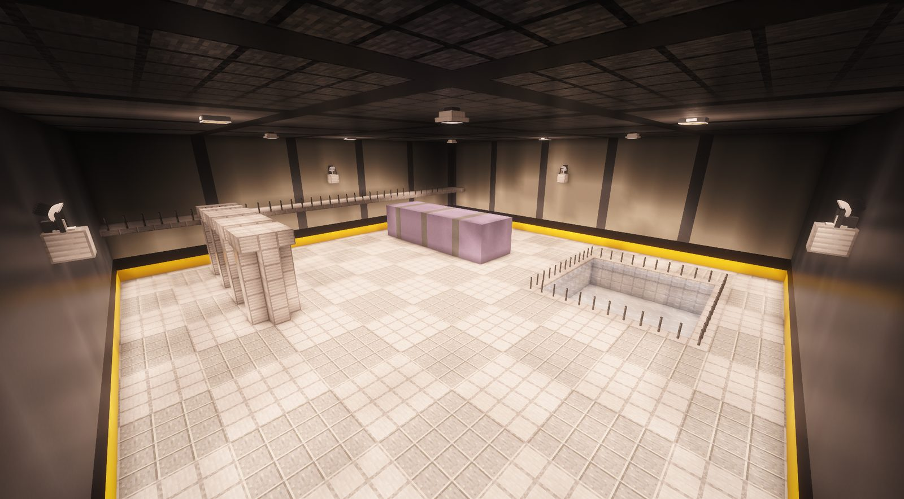

### Grid tie and CC:Tweaked

- A **Grid Tie** is a load on the generator with a breaker you close yourself. You bring the turbine up
  to speed and match phase before you close, and a bad close damages the generator. Nothing does it for
  you. [docs/grid-wiring.md](docs/grid-wiring.md)
- Most machines are CC:Tweaked peripherals. They give you numbers and actuators, never decisions. There
  are example programs for startup, a backup scram monitor, ECCS start, containment isolation and a
  panel display. [docs/lua/README.md](docs/lua/README.md)
- **House rule: nothing acts automatically.** There are no built-in trips and no auto ECCS. Scram
  setpoints and pump starts are your own wiring or Lua, and the build checks that the physics core has
  no protection logic in it.

## Getting started

There's a short version of this in game: the **Operator's Guide** book. You get one the first time you
join, or craft one from a book and a nameplate. See [GUIDE.md](GUIDE.md).

Everything in the plant has a crafting recipe, except the control-room parts (panels, desks, gauges, switches, lamps, displays), which you
make at a **Fabrication Desk** from materials in your inventory ([FABRICATION-DESK.md](FABRICATION-DESK.md)). If a vessel doesn't form, it tells you why in chat. With Mekanism installed the recipes
ask for Mekanism's steel, alloys, circuits, plastic and bronze instead of iron and redstone, and turbine oil comes out of a Mekanism machine;
without it nothing changes. The materials and every recipe are in [MEKANISM-RECIPES.md](MEKANISM-RECIPES.md).

1. **Vessel.** Build a closed shell of Reactor Vessel blocks, 5 to 21 blocks wide and deep inside and at
   least 8 tall, with one Reactor Controller in it. Add an RPV Steam Outlet, an RPV Water Injection Port
   and recirculation ports, all facing out. [PRESSURE-VESSEL.md](PRESSURE-VESSEL.md)
2. **Drives.** Under the floor, put one control rod drive per blade in the pattern from
   [COMPACT-CORE.md](COMPACT-CORE.md). Drives that touch share water and power.
3. **Recirculation.** Put in jet pumps and an external pump (or internal pumps). The INFO tab tells you
   what size you need. [RECIRCULATION.md](RECIRCULATION.md)
4. **Fuel.** Make assemblies in a Fuel Fabricator. Natural uranium won't go critical, so use 3.50 % (the
   default) or higher. To load them, detension the head studs, lift the head with the crane, flood the
   well, and move the fuel in with the refuelling bridge. Or turn on `instantHeadRemoval` and
   `instantRefuelling` and load it from the refuelling map. [BUILDING-CRANE.md](BUILDING-CRANE.md),
   [REFUELLING-BRIDGE.md](REFUELLING-BRIDGE.md)
5. **Steam.** Pipe the steam outlet through a stop valve and a control valve to the HP turbines, then the
   HP exhaust to the LP turbines, with a condenser six blocks under each LP. Turbines and the generator
   join with touching shafts at the same height. **New valves start closed.**
6. **Water.** Give the condenser cooling water (tower, circulating pump, intake, makeup). Send condensate
   to a tank, then a feed pump, then the injection port. [COOLING-WATER.md](COOLING-WATER.md)
7. **Load.** Connect something that uses power, or a Grid Tie, to the generator's terminal.
8. **Start up by hand.** Start the recirc pumps, reset the scram and pull rods a little at a time while
   you watch the SRM period. Open the stop valve, then bring up the control valve in 0.1 % steps.
9. **Add protection before you trust it.** ECCS pumps, relief valves, SLC and the suppression pool all
   exist, but they don't do anything until you wire them up.
10. **Build the control room.** Make a Panel Wrench, Panel Linker and Networking Wrench, and wire reactor
    pressure to a dial first. There's a worked example in
    [CONTROL-PANELS.md](CONTROL-PANELS.md#3-worked-example-a-small-reactor-control-room).

| Turbine module | Width x height x length | Capacity |
| --- | --- | --- |
| HP turbine | 5 x 5 x 9 | up to 2,200 kg/s |
| LP turbine | 7 x 5 x 7 | up to 750 kg/s |
| Nuclear generator | 5 x 5 x 9 | up to 1,500 MW electrical |

Server settings are in `serverconfig/bwr-gameplay.toml` and `bwr-grid.toml`. Panel limits are in
`bwr-panels.toml`, and client visuals and display units are in `bwr-visuals.toml`.

## Existing worlds

Old saves load. Most updates leave machines you already placed the way they were, so older pumps,
turbines, condensers and heat exchangers keep their old size and ports until you pick them up and place
them again. Update the client and the server together.

- Old turbine admission settings are ignored now. Put stop and control valves in front, and change CC
  scripts from `setAdmission` and `setRunning` to valve `setPosition`, `open` and `close`.
  [STEAM-VALVES.md](STEAM-VALVES.md#computercraft)
- Older reactors use the volume-based recirculation targets. Check the INFO tab to see what yours needs.
  [COMPACT-CORE.md](COMPACT-CORE.md)

## Build it yourself

Use JDK 21. From the repo root:

```bash
./gradlew build          # Windows: .\gradlew.bat build
```

The build runs the physics tests and takes a few minutes. The jar ends up at
`mod/build/libs/mod-<version>.jar`. The first build has to download the optional Cold Sweat API, so
it needs internet once.

## Development

- `core/` is the physics in plain Java with no Minecraft in it. `mod/` is the NeoForge side. `art/models/`
  has the Blender sources, and `tools-*.py` are the asset exporters and audits (Python 3.11+).
- Main checks:

```bash
./gradlew check build
python tools-check-test-registration.py
./gradlew :mod:runTurbineGameTest
./gradlew :mod:runPeripheralCheck
python tools-audit-assets.py
python tools-check-jar.py
```

[TESTING.md](TESTING.md) has the full list, including the screenshot checks and the dedicated server runs.
Found a bug? Put it on the [issue tracker](https://github.com/OldGunslingerWildBill/bwr-mod/issues).

## More reading

**Overview:** [SPEC.md](SPEC.md), [CHANGELOG.md](CHANGELOG.md), [REFERENCE-DATA.md](REFERENCE-DATA.md),
[ADVANCEMENTS.md](ADVANCEMENTS.md)

**Reactor and fuel:** [COMPACT-CORE.md](COMPACT-CORE.md), [RECIRCULATION.md](RECIRCULATION.md),
[INTERNAL-PUMPS.md](INTERNAL-PUMPS.md), [JET-PUMP-INSTALLATION.md](JET-PUMP-INSTALLATION.md),
[PRESSURE-VESSEL.md](PRESSURE-VESSEL.md), [RPV-REFERENCE.md](RPV-REFERENCE.md), [VESSEL-HEIGHT.md](VESSEL-HEIGHT.md),
[COLUMBIA-CORE-REFERENCE.md](COLUMBIA-CORE-REFERENCE.md), [ROD-MOTION.md](ROD-MOTION.md),
[FUELS-AND-RODS.md](FUELS-AND-RODS.md), [BREEDING-TARGETS.md](BREEDING-TARGETS.md), [RTG.md](RTG.md)

**Refuelling:** [BUILDING-CRANE.md](BUILDING-CRANE.md), [REFUELLING-BRIDGE.md](REFUELLING-BRIDGE.md),
[SPENT-FUEL-POOL.md](SPENT-FUEL-POOL.md)

**Recipes:** [MEKANISM-RECIPES.md](MEKANISM-RECIPES.md), [FABRICATION-DESK.md](FABRICATION-DESK.md)

**Water and steam:** [WATER-PLUMBING.md](WATER-PLUMBING.md), [PUMP-MODELS.md](PUMP-MODELS.md),
[MODERN-PUMPS-AND-PIPES.md](MODERN-PUMPS-AND-PIPES.md), [PIPES.md](PIPES.md), [TERRY-TURBINES.md](TERRY-TURBINES.md),
[STEAM-VALVES.md](STEAM-VALVES.md), [MAIN-STEAM-VALVES.md](MAIN-STEAM-VALVES.md),
[MODULAR-TURBINES.md](MODULAR-TURBINES.md), [TURBINE-AUX.md](TURBINE-AUX.md),
[CONDENSER-AND-MSIV.md](CONDENSER-AND-MSIV.md), [COOLING-WATER.md](COOLING-WATER.md),
[CONDENSATE-TANK.md](CONDENSATE-TANK.md), [RWCU.md](RWCU.md), [PLANT-TRANSPORT.md](PLANT-TRANSPORT.md)

**Safety and accidents:** [ALPHA-HARDWARE.md](ALPHA-HARDWARE.md), [CORE-SPARGERS.md](CORE-SPARGERS.md),
[SUPPRESSION-BASIN.md](SUPPRESSION-BASIN.md), [STEAM-AND-ACCIDENT-UPDATE.md](STEAM-AND-ACCIDENT-UPDATE.md),
[PORT-LOCA-UPDATE.md](PORT-LOCA-UPDATE.md), [SEVERE-ACCIDENT-UPDATE.md](SEVERE-ACCIDENT-UPDATE.md),
[CONTAINMENT-UPDATE.md](CONTAINMENT-UPDATE.md), [RADIATION.md](RADIATION.md)

**Control room and grid:** [CONTROL-PANELS.md](CONTROL-PANELS.md), [ROOM-FURNITURE.md](ROOM-FURNITURE.md),
[SIGNALS.md](SIGNALS.md), [FULL-CORE-DISPLAY-SPEC.md](FULL-CORE-DISPLAY-SPEC.md),
[GRID-TIE-SPEC.md](GRID-TIE-SPEC.md), [docs/grid-wiring.md](docs/grid-wiring.md),
[docs/lua/README.md](docs/lua/README.md), [PLANT-COMPUTER.md](PLANT-COMPUTER.md)

**Client:** [docs/shader-packs.md](docs/shader-packs.md), [LIGHTING.md](LIGHTING.md),
[MACHINE-RENDERING.md](MACHINE-RENDERING.md)

## Credits

- **nectariich** made the CAD models for the control room parts: the selector and control switches, the
  bar gauge, the pushbutton and the RPS trip assembly. Thank you!
- I made the control panel, the back panel and the 1 m and 2 m control desks myself.
- Reference data comes from the public Columbia Generating Station FSAR and NRC documents, cited in each
  doc. Manufacturer names are only there to show what inspired a model and don't mean anyone endorses
  this mod. More in [THIRD-PARTY-NOTICES.md](THIRD-PARTY-NOTICES.md).

## License and credit

**Realistic BWR by OldGunslingerWildBill**

Original project: <https://github.com/OldGunslingerWildBill/bwr-mod>

What I own uses the custom **[Realistic BWR Source-Available License 1.0](LICENSE)**. Because some uses
need my approval, it's **source-available**, not open source under the
[Open Source Initiative definition](https://opensource.org/osd).

| Use under the new license | Permission |
| --- | --- |
| Read, download, build, run, or edit privately | Allowed |
| Share an unchanged project/release, including an unchanged JAR in a modpack | Allowed with credit and all required notices |
| Publish modified source, modified forks/patches, or modified JARs | My written approval first |
| Copy or adapt project code/assets into another distributed project | My written approval first |
| Remove attribution or claim you created the original project | Not allowed |

Any redistribution has to include [LICENSE](LICENSE) and [NOTICE](NOTICE), visibly credit
**OldGunslingerWildBill**, and link back here. Approved changes have to be marked as yours. Crediting me
isn't the same as getting permission. Ask for approval on the
[issue tracker](https://github.com/OldGunslingerWildBill/bwr-mod/issues).

**Older releases keep their rights.** Up to commit
[`19a7424`](https://github.com/OldGunslingerWildBill/bwr-mod/tree/19a742408e2cd7ef8cee42a26157e8662daa340b),
the core was MIT and the mod was MPL-2.0. Those grants still stand for that older material. See
[LICENSE §6](LICENSE) and the [historical and third-party notices](THIRD-PARTY-NOTICES.md).

Lua programs players write and unrelated mods belong to their authors. Third-party parts keep their own
licenses. This is a summary; the full license is what counts.
