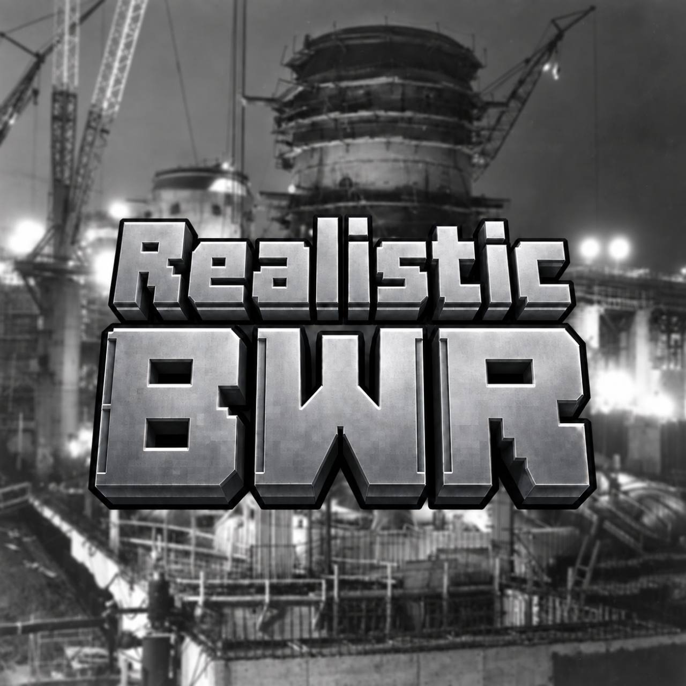
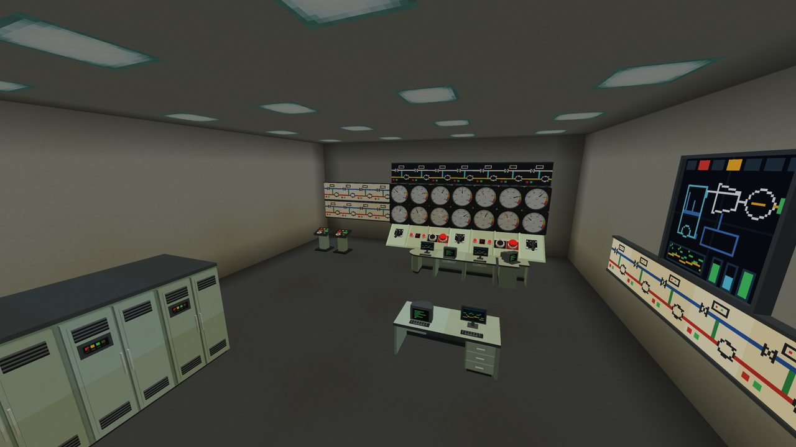
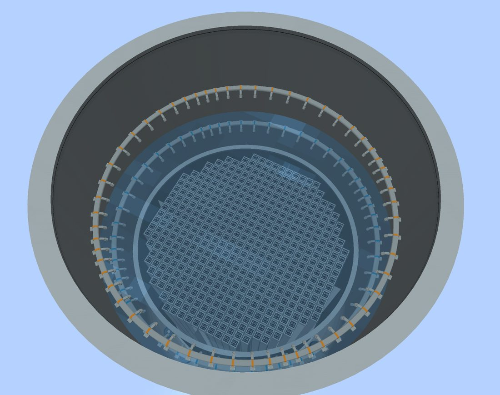
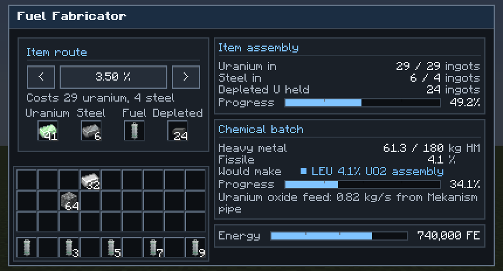
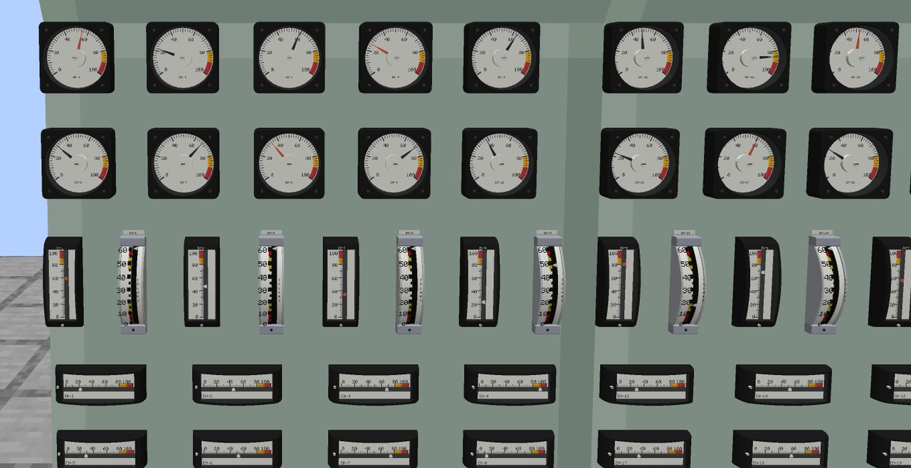
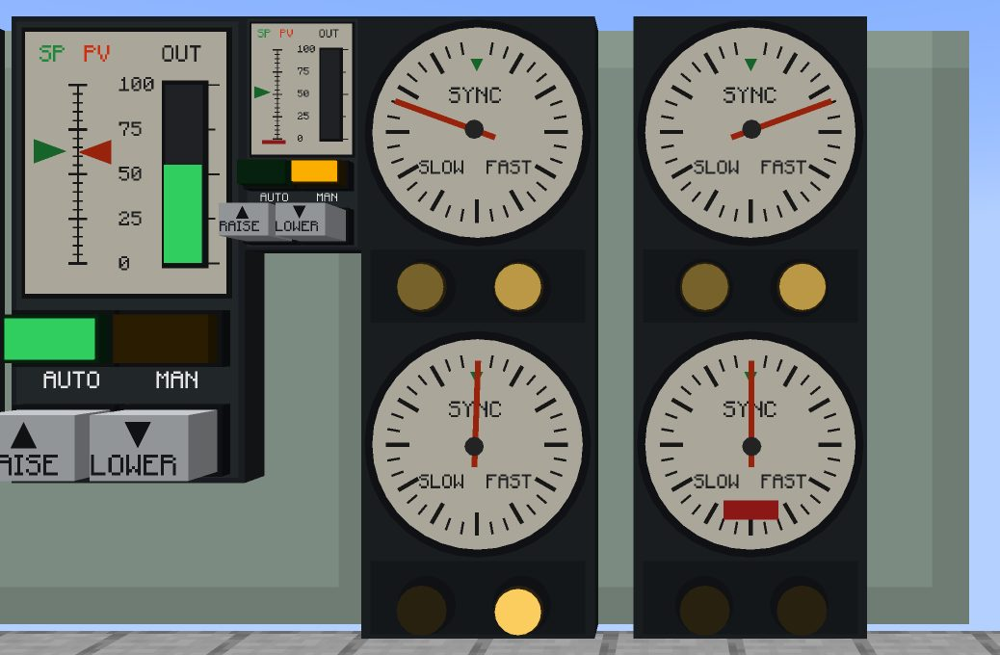

# Realistic BWR

<p align="center"></p>

**By [OldGunslingerWildBill](https://github.com/OldGunslingerWildBill)**

Realistic BWR adds a boiling water reactor to Minecraft 1.21.1 (NeoForge), with the plant around it:
pumps, steam lines, turbines, a condenser, cooling, emergency cooling, containment and a grid connection.
Power emerges from neutronics. You move control rods and change recirculation flow, and the core decides
what it does. There is no commanded burn rate, and nothing in the plant acts on your behalf: you run it
from a control room you build yourself.



## Status

**Early alpha preview. Current version: `0.1.0-alpha.53`.** Expect rough edges and changes between
releases. **Back up your worlds before updating.** History is in [CHANGELOG.md](CHANGELOG.md).

Source is publicly readable under the custom
[Realistic BWR Source-Available License](LICENSE). Modified redistribution
and copying code/assets into another project require written approval, subject
to the preserved rights for earlier MIT/MPL releases. Permitted redistribution
must credit **OldGunslingerWildBill**. See [license and credit](#license-and-credit).

## Requirements

| | Version | Notes |
| --- | --- | --- |
| Minecraft | 1.21.1 | |
| NeoForge | 21.1.248 or newer | |
| Java | 21 | |
| Mekanism | 10.7 or newer, optional | Pipes that connect to the plant's water and steam ports; uranium and steel items; the fabricator's chemical route; the fuel assembly crafting recipe; with Mekanism Generators, tritium processing |
| CC:Tweaked | 1.111 or newer, optional | Lua control of nearly every machine, and CC port bindings for panels |

Both optional mods are installed separately and are never bundled. The mod loads and runs without them.
Without Mekanism, the fuel fabricator's item route still needs some mod that tags `c:ingots/uranium`
and `c:ingots/steel`. Sodium and Iris also work, with or without a shader pack
([notes](docs/shader-packs.md)).

## What is in it

### Reactor and core
- Delayed-neutron kinetics, rod worth, spatial flux, void and temperature feedback, xenon, burnup, decay
  heat, vessel inventory, pressure and damage. Rods move continuously between notches (labels 0 to 48).
  See [SPEC.md](SPEC.md), [REFERENCE-DATA.md](REFERENCE-DATA.md) and [ROD-MOTION.md](ROD-MOTION.md).
- Vessels from 7 x 7 outside (5 x 5 inside) up to 23 x 23. A 17 x 17 vessel holds 764 fuel assemblies
  with 185 control rod drives, one drive per blade. [COMPACT-CORE.md](COMPACT-CORE.md)
- Recirculation sized by vessel volume: jet assemblies with external DVSS pumps, or internal pumps.
  The reactor screen's INFO tab says what a vessel needs. [RECIRCULATION.md](RECIRCULATION.md),
  [INTERNAL-PUMPS.md](INTERNAL-PUMPS.md)
- A reactor screen (flux map, rods, INFO) and a refuelling map with zoom and multi-select. The vessel
  renders its real core with the head off. [PRESSURE-VESSEL.md](PRESSURE-VESSEL.md)



### Fuel cycle
- **Fuel Fabricator.** Put uranium and steel items in, choose an enrichment (0.71 to 20 %), get a fuel
  assembly. Richer fuel costs more uranium by real enrichment arithmetic: 4 uranium for natural, 29 for
  3.5 %, 172 for 20 %, plus 4 steel each. Hoppers and pipes can feed it. A Mekanism chemical route is
  still there. [FUELS-AND-RODS.md](FUELS-AND-RODS.md)
- **Depleted uranium.** Enrichment returns the uranium that did not become product as depleted uranium
  ingots. Four of them with four steel make a blanket assembly that absorbs neutrons at first and breeds
  plutonium as it burns.
- **Reprocessing Plant.** A spent assembly goes in. Plutonium nuggets, depleted uranium and
  fission-product waste come out, in amounts worked out from that assembly's own burnup. Fresh and
  thorium assemblies are refused. It needs no Mekanism.
- **Uranium ore.** The mod's own uranium: large veins plus small blobs, richest in deserts and
  badlands, rare in oceans. Only new chunks get it; a server option turns it off.
  [URANIUM-ORE.md](URANIUM-ORE.md)
- **Spent fuel pool.** A discharged assembly keeps its decay heat, and the reprocessing plant waits
  until it has cooled. The pool is a lined box with full-height racks, a cooling train you run and
  makeup water you supply; let it go and the water boils off and the fuel uncovers.
  [SPENT-FUEL-POOL.md](SPENT-FUEL-POOL.md)
- **Refuelling bridge.** A bridge on rails over the open reactor and the pool. Its mast latches one
  assembly and carries it under water through a gated cattle chute, in real time; lift fuel out of
  the water and the survey meter spikes. Instant refuelling is a server option, off by default.
  [REFUELLING-BRIDGE.md](REFUELLING-BRIDGE.md)
- **Reactor building crane.** A stud tensioner detensions the vessel head's 74 closure studs; an overhead
  crane on high runway rails lifts the head onto a head stand, then the steam dryer and the separators into
  their storage pool. The refuelling bridge moves fuel only. The old head button is the server option
  `instantHeadRemoval`, off by default. [BUILDING-CRANE.md](BUILDING-CRANE.md)
- **MOX.** The fabricator also makes MOX (4.50, 7.00 and 9.50 %) from plutonium and depleted uranium.
- **Specialty rods.** Boron carbide and hafnium absorbers, three startup neutron sources, and cobalt,
  tritium and silicon irradiation targets. [FUELS-AND-RODS.md](FUELS-AND-RODS.md#specialty-rods)



### Water and steam plant
- Electric and steam-driven pumps with round flanges, pump panels, and separate pipe systems for
  high-pressure water and steam. Pipes can be dyed. Transport is cached, not ticked.
  [WATER-PLUMBING.md](WATER-PLUMBING.md), [PUMP-MODELS.md](PUMP-MODELS.md),
  [MODERN-PUMPS-AND-PIPES.md](MODERN-PUMPS-AND-PIPES.md), [PLANT-TRANSPORT.md](PLANT-TRANSPORT.md)
- MSIVs, steam stop and control valves, and a bypass valve. [STEAM-VALVES.md](STEAM-VALVES.md),
  [CONDENSER-AND-MSIV.md](CONDENSER-AND-MSIV.md)
- Modular HP and LP turbines and a generator of up to 1,500 MW. LP exhaust goes to a condenser fitted
  under it. [MODULAR-TURBINES.md](MODULAR-TURBINES.md)
- Turbine auxiliaries: a lube oil system (main oil tank, AC and DC pumps, a shaft-driven pump, oil coolers), the
  generator's turning gear and a generator cooling skid that needs power. [TURBINE-AUX.md](TURBINE-AUX.md)
- Cooling towers (natural-draft and circular mechanical-draft), circulating and makeup pumps, a lake
  or river intake, and scalable cylindrical condensate tanks. [COOLING-WATER.md](COOLING-WATER.md),
  [CONDENSATE-TANK.md](CONDENSATE-TANK.md)

### Safety systems and accidents
- Emergency cooling hardware: HPCS, LPCS, RHR/LPCI with heat exchangers, RCIC and HPCI Terry turbine
  pumps, SLC boron injection, safety/relief valves and an ADS bank, with core spray rings inside the
  vessel. [TERRY-TURBINES.md](TERRY-TURBINES.md), [ALPHA-HARDWARE.md](ALPHA-HARDWARE.md),
  [CORE-SPARGERS.md](CORE-SPARGERS.md)
- Suppression pools, including player-built concrete basins with spray and passive cooling.
  [SUPPRESSION-BASIN.md](SUPPRESSION-BASIN.md)
- Break a recirculation, feedwater or steam line anywhere up to its first closed valve and you get a
  loss-of-coolant accident, with leak rate set by pressure, head and nozzle height. Put the pipe back
  to seal it. [PORT-LOCA-UPDATE.md](PORT-LOCA-UPDATE.md)
- Severe accidents unfold in order: cladding failure, core melt, relocation to the lower plenum,
  lower-head failure, corium on the concrete, hydrogen burns or detonation, contamination. Blasts
  break blocks by their blast resistance: glass goes first, a detonation breaches the weakest wall.
  [SEVERE-ACCIDENT-UPDATE.md](SEVERE-ACCIDENT-UPDATE.md)
- **Radiation tools.** A handheld survey meter (dose rate on your HUD, a Geiger click, your own
  dose) and area radiation monitors that drive gauges and annunciators. [RADIATION.md](RADIATION.md)
- **Containment** you build: a solid-walled room that a controller surveys for volume, leaks and its
  weakest wall. Rated penetrations, vault doors, airlocks, a nitrogen supply and a wetwell vent.
  [CONTAINMENT-UPDATE.md](CONTAINMENT-UPDATE.md)

### Control room
Panels are boards you cover with instruments and controls, then wire to the plant, to each other, to
redstone or to CC:Tweaked. A control commands the plant only when someone operates it.
[CONTROL-PANELS.md](CONTROL-PANELS.md)

- **Boards, desks and trim.** Vertical, bench, console, back and duplex bodies, plus 1 m and 2 m control
  desks, end caps, header strips, plinths and corners, in five paint finishes. A board blueprint places
  eight blank shapes in one click. Relay cabinets, operator desks and wall displays fill the room.
  [ROOM-FURNITURE.md](ROOM-FURNITURE.md)
- **Real-size parts.** Most instruments start at twice real size, and exact real size is one pick away.
  Alt+click a part item to open the size picker, a list of every size in cells and centimetres.
- **Gauges.** Round dials, edgewise meters, curved bar gauges and bar graphs, with colour bands, units,
  and Text size and Tick size sliders. A gauge can be limited to one kind of signal (level, pressure,
  and so on), and shows FE as W, kW or MW.
- **Switches and lamps.** Control switches (General Power and Westingapartment styles) that spring back to NORMAL, key
  switches, selectors, toggles, push-to-turn switches, a joystick switch, pushbuttons, the guarded
  two-button RPS trip, and lamps.
- **Annunciators.** Windows that flash until acknowledged, then hold steady until the condition clears,
  grouped into one box, with an ACK, RESET, SILENCE and TEST module.
- **Controller station.** A manual/auto station with process-variable and setpoint pointers, a demand
  bar, AUTO and MAN, RAISE and LOWER. In AUTO, and only after you select it, a built-in PID with
  editable tuning moves the demand to hold the measured value at the setpoint; a wired outside
  demand overrides it.
- **Synchroscope.** A rotating pointer for phase and slip, with two dark-lamp synchronising lamps
  (dark in phase, brightest at 180°), wired to a grid tie.
- **Plant computer.** A safety parameter display: built-in reactor pages, or pages, trends and
  status tiles your CC program draws. It cannot act on the plant. [PLANT-COMPUTER.md](PLANT-COMPUTER.md)
- **Recorders and displays.** A paperless recorder (Yokogawa DX1000 and DX2000 style, up to 48
  channels), strip charts and a two-pen recorder, seven- and sixteen-segment displays, LCD and graphic
  displays, a full core display, a rod select matrix and an LED rod pattern display.
- **Mimic.** Mimic tape draws flow lines and arrows across a board, and mimic symbols show valves,
  pumps and tanks. They indicate only.
- **Wiring.** The **Networking Wrench** selects a device, shows its signals, lets you name it (RHR-1),
  and draws see-through lines from a component to what it reads and commands. The Panel Linker makes
  the same bindings. [Networking Wrench](CONTROL-PANELS.md#the-networking-wrench),
  [signal and command keys](SIGNALS.md)





### Grid tie and load following
- A **Grid Tie** is a controllable export load on a generator, with a breaker you close yourself. Set a
  fixed demand, follow a daily demand curve, or take a remote value. **FE Meters** sit inline and
  report MW.
- Before closing you bring the turbine to speed with its control valve and match phase and slip. A bad
  close still happens, and it damages the generator. No automatic governor, synchroniser or trip is
  supplied. [docs/grid-wiring.md](docs/grid-wiring.md), [GRID-TIE-SPEC.md](GRID-TIE-SPEC.md)

### Automation with CC:Tweaked
- Most machines are peripherals that expose measurements and actuators, never judgements. Five example programs cover startup, a backup scram monitor, ECCS start, containment
  isolation and a panel display driver. [docs/lua/README.md](docs/lua/README.md)
- **House rule: nothing acts automatically.** There are no built-in trips, no automatic ECCS start and
  no protection logic. Scram setpoints, pump starts and load shedding are the player's own panel
  wiring or Lua. The build checks that no such logic exists in the physics core.
- A Realistic BWR advancement tab records plant milestones. It awards nothing and operates nothing.
  [ADVANCEMENTS.md](ADVANCEMENTS.md)

## Getting started: a first working plant

There is a short version of this section in the game: the **Operator's Guide** (a book and a nameplate; each player is also given
one on first joining, a server option) opens with a right-click. See [GUIDE.md](GUIDE.md).

All plant blocks have crafting recipes. Only items the plant itself produces do not. A vessel that fails
its structure check says why in chat. Each step's detail is in the linked guide.

1. **Vessel.** Build a closed shell of Reactor Vessel blocks, 5 to 21 blocks wide and deep inside and at
   least 8 tall, with one Reactor Controller in it. Add an RPV Steam Outlet, an RPV Water Injection Port
   and recirculation ports, all facing outward. [PRESSURE-VESSEL.md](PRESSURE-VESSEL.md)
2. **Drives.** Under the floor, place one control rod drive per blade, in the pattern in
   [COMPACT-CORE.md](COMPACT-CORE.md). Touching drives share one water and one FE connection.
3. **Recirculation.** Install jet assemblies and an external pump (or internal pumps) to the size the INFO
   tab asks for. [RECIRCULATION.md](RECIRCULATION.md)
4. **Fuel.** Make assemblies in a Fuel Fabricator, or craft them with Mekanism yellow cake. Natural
   uranium will not sustain a chain reaction here, so choose 3.50 % (the selector's default) or higher.
   Open the vessel (detension the studs with a Stud Tensioner, then lift the head with the reactor building crane; [BUILDING-CRANE.md](BUILDING-CRANE.md), or turn on `instantHeadRemoval`), flood the well (wall it in so the cavity seal forms, then run the feed pumps until the water stands over the flange; [REFUELLING-BRIDGE.md](REFUELLING-BRIDGE.md#the-reactor-well-and-the-cavity-seal)), and move the assemblies in with the refuelling bridge
   ([REFUELLING-BRIDGE.md](REFUELLING-BRIDGE.md)), or turn on the server option `instantRefuelling`
   and load the core from the refuelling map.
5. **Steam.** Pipe the steam outlet through a stop valve and a control valve to the HP turbines, then the
   HP exhaust to the LP turbines, with one condenser six blocks below each LP. Join turbines and the
   generator with touching shafts at one height. **New valves start closed.**
6. **Water.** Feed the condenser cooling water (tower, circulating pump, intake, makeup). Return
   condensate to a tank, then a feedwater pump, then the injection port.
   [COOLING-WATER.md](COOLING-WATER.md), [WATER-PLUMBING.md](WATER-PLUMBING.md)
7. **Load.** Connect a consumer, or a Grid Tie, to the generator's copper terminal.
8. **Start up by hand.** Start the recirculation pumps, reset the scram and withdraw rods in small steps
   while watching the SRM period. Open the stop valve, then raise the control valve in 0.1 % steps.
   Valve opening sets steam supply, not a fixed electrical power. A full energy buffer or blocked
   exhaust limits flow.
9. **Add protection before you trust it.** ECCS pumps, relief valves, SLC and a suppression pool exist
   but do nothing until you wire them to switches or write the logic.
10. **Build the control room.** Make a Panel Wrench, Panel Linker and Networking Wrench, set boards and
    parts, and wire the reactor's pressure to a dial first. The worked example is in
    [CONTROL-PANELS.md](CONTROL-PANELS.md#3-worked-example-a-small-reactor-control-room).

| Turbine module | Width x height x length | Capacity |
| --- | --- | --- |
| HP turbine | 5 x 5 x 9 | up to 2,200 kg/s |
| LP turbine | 7 x 5 x 7 | up to 750 kg/s |
| Nuclear generator | 5 x 5 x 9 | up to 1,500 MW electrical |

Server settings live in `serverconfig/bwr-gameplay.toml` ([defaults](PHASE-L1-REVIEW.md)) and
`bwr-grid.toml`. Panel limits are in `bwr-panels.toml` and client visuals in `bwr-visuals.toml`.

## Existing worlds

Old saves load. Most updates keep saved machines as they were, so older pumps, turbines, condensers and
reactors keep their size and ports until you pick them up and replace them. Two changes need action:

- Older turbine admission settings are ignored. Install upstream stop and control valves, and change CC
  scripts from `setAdmission` and `setRunning` to valve `setPosition`, `open` and `close`.
  [STEAM-VALVES.md](STEAM-VALVES.md#computercraft)
- Existing reactors use the volume-based recirculation targets. Check the INFO tab for the jets and
  drives your vessel needs. To move to the compact core layout, shut down, defuel, replace the
  controller and rebuild the drive layer. [COMPACT-CORE.md](COMPACT-CORE.md)

Update the client and server together, since the GUI network protocol changes between releases. Further
per-feature notes: [ALPHA-HARDWARE.md](ALPHA-HARDWARE.md), [PHASE-ONE-FIXES.md](PHASE-ONE-FIXES.md),
[ROD-MOTION.md](ROD-MOTION.md).

## Build and install

Use JDK 21. From the repository root:

```bash
./gradlew build          # Windows: .\gradlew.bat build
```

The build runs the physics acceptance suite and takes several minutes. Put
`mod/build/libs/mod-<version>.jar` in your instance's `mods` folder with NeoForge. The physics core is
inside it. Install Mekanism and CC:Tweaked yourself if you want them. Neither is bundled.

## Development and verification

- `core/` is pure Java physics with no Minecraft dependency. `mod/` holds the NeoForge blocks, screens,
  networking and integrations. `art/models/` holds editable Blender sources. `tools-*.py` are
  reproducible asset exporters and audits (Python 3.11 or newer).
- The main checks:

```bash
./gradlew check build
python tools-check-test-registration.py
./gradlew :mod:runTurbineGameTest
./gradlew :mod:runPeripheralCheck
python tools-audit-assets.py
python tools-check-jar.py
```

[TESTING.md](TESTING.md) lists the full gate set, the client screenshot checks, the dedicated server runs
(with and without CC:Tweaked and Mekanism) and the CI workflow. [HANDOFF.md](HANDOFF.md) is the
developer handoff, and [BUILD-STATUS.md](BUILD-STATUS.md) records results. Report problems on the
[issue tracker](https://github.com/OldGunslingerWildBill/bwr-mod/issues).

## Further reading

**Overview:** [SPEC.md](SPEC.md), [CHANGELOG.md](CHANGELOG.md), [REFERENCE-DATA.md](REFERENCE-DATA.md),
[ADVANCEMENTS.md](ADVANCEMENTS.md)

**Reactor and fuel:** [COMPACT-CORE.md](COMPACT-CORE.md), [RECIRCULATION.md](RECIRCULATION.md),
[INTERNAL-PUMPS.md](INTERNAL-PUMPS.md), [JET-PUMP-INSTALLATION.md](JET-PUMP-INSTALLATION.md),
[PRESSURE-VESSEL.md](PRESSURE-VESSEL.md), [OPEN-REACTOR-UPDATE.md](OPEN-REACTOR-UPDATE.md),
[COLUMBIA-CORE-REFERENCE.md](COLUMBIA-CORE-REFERENCE.md), [ROD-MOTION.md](ROD-MOTION.md),
[FUELS-AND-RODS.md](FUELS-AND-RODS.md)

**Water and steam:** [WATER-PLUMBING.md](WATER-PLUMBING.md), [PUMP-MODELS.md](PUMP-MODELS.md),
[MODERN-PUMPS-AND-PIPES.md](MODERN-PUMPS-AND-PIPES.md), [TERRY-TURBINES.md](TERRY-TURBINES.md),
[STEAM-VALVES.md](STEAM-VALVES.md), [MODULAR-TURBINES.md](MODULAR-TURBINES.md), [TURBINE-AUX.md](TURBINE-AUX.md),
[CONDENSER-AND-MSIV.md](CONDENSER-AND-MSIV.md), [COOLING-WATER.md](COOLING-WATER.md),
[CONDENSATE-TANK.md](CONDENSATE-TANK.md), [PLANT-TRANSPORT.md](PLANT-TRANSPORT.md)

**Safety and accidents:** [ALPHA-HARDWARE.md](ALPHA-HARDWARE.md), [CORE-SPARGERS.md](CORE-SPARGERS.md),
[SUPPRESSION-BASIN.md](SUPPRESSION-BASIN.md), [STEAM-AND-ACCIDENT-UPDATE.md](STEAM-AND-ACCIDENT-UPDATE.md),
[PORT-LOCA-UPDATE.md](PORT-LOCA-UPDATE.md), [SEVERE-ACCIDENT-UPDATE.md](SEVERE-ACCIDENT-UPDATE.md),
[CONTAINMENT-UPDATE.md](CONTAINMENT-UPDATE.md), [CONTAINMENT-SPEC.md](CONTAINMENT-SPEC.md),
[RHR-CONTAINMENT-SPEC.md](RHR-CONTAINMENT-SPEC.md)

**Control room and grid:** [CONTROL-PANELS.md](CONTROL-PANELS.md), [ROOM-FURNITURE.md](ROOM-FURNITURE.md),
[SIGNALS.md](SIGNALS.md), [FULL-CORE-DISPLAY-SPEC.md](FULL-CORE-DISPLAY-SPEC.md),
[GRID-TIE-SPEC.md](GRID-TIE-SPEC.md), [docs/grid-wiring.md](docs/grid-wiring.md),
[docs/lua/README.md](docs/lua/README.md)

**Client:** [docs/shader-packs.md](docs/shader-packs.md), [GPU-VISUALS-UPDATE.md](GPU-VISUALS-UPDATE.md),
[MACHINE-RENDERING.md](MACHINE-RENDERING.md)

## License and credit

**Realistic BWR by OldGunslingerWildBill**

Original project: <https://github.com/OldGunslingerWildBill/bwr-mod>

Current original material uses the custom
**[Realistic BWR Source-Available License 1.0](LICENSE)**. These approval
restrictions mean it is **source-available**, not open source under the
[Open Source Initiative definition](https://opensource.org/osd).

| Use under the new license | Permission |
| --- | --- |
| Read, download, build, run, or edit privately | Allowed |
| Share an unchanged project/release, including an unchanged JAR in a modpack | Allowed with credit and all required notices |
| Publish modified source, modified forks/patches, or modified JARs | Owner's prior written approval required |
| Copy or adapt project code/assets into another distributed project | Owner's prior written approval required |
| Remove attribution or claim you created the original project | Not permitted |

Every permitted redistribution must include [LICENSE](LICENSE) and
[NOTICE](NOTICE), visibly credit **OldGunslingerWildBill**, and link to this
repository. Approved changes must be identified separately. Credit is not a
substitute for permission. Request written approval through the
[GitHub issue tracker](https://github.com/OldGunslingerWildBill/bwr-mod/issues).

**Earlier releases retain their rights.** Through commit
[`19a7424`](https://github.com/OldGunslingerWildBill/bwr-mod/tree/19a742408e2cd7ef8cee42a26157e8662daa340b),
the core was MIT and the mod was MPL-2.0. This change does not revoke those
grants or prevent reuse of that previously released material under its earlier
terms. The new restrictions cannot override an independent earlier license
covering the same material. See [LICENSE §6](LICENSE) and
[historical and third-party notices](THIRD-PARTY-NOTICES.md).

Independent player-written Lua programs and unrelated mods remain their
authors' work. Third-party components keep their own licenses. This summary
does not replace the full license.
