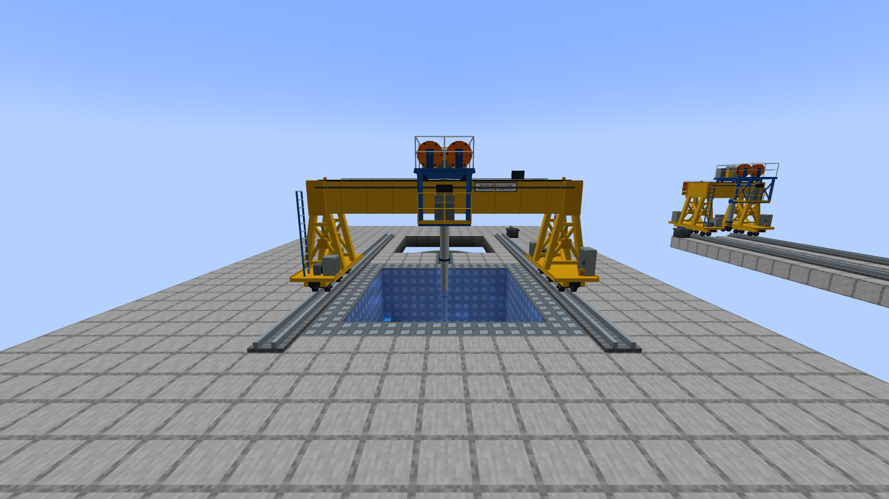
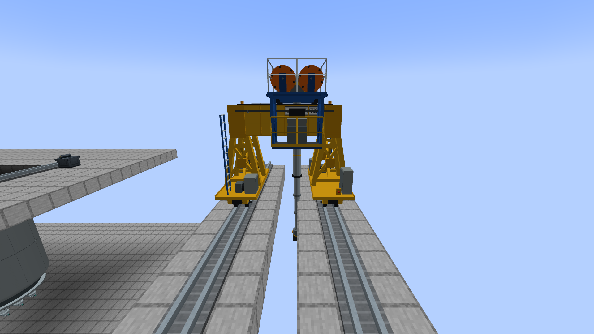
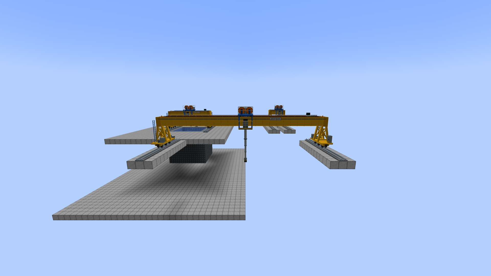
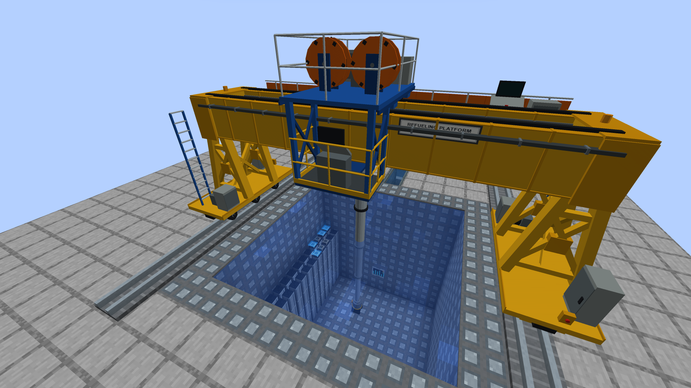
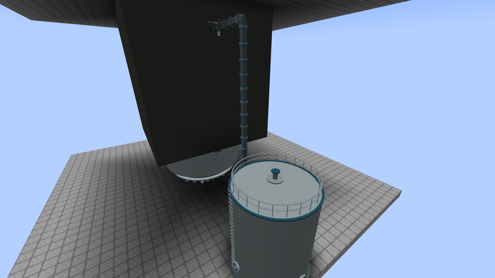
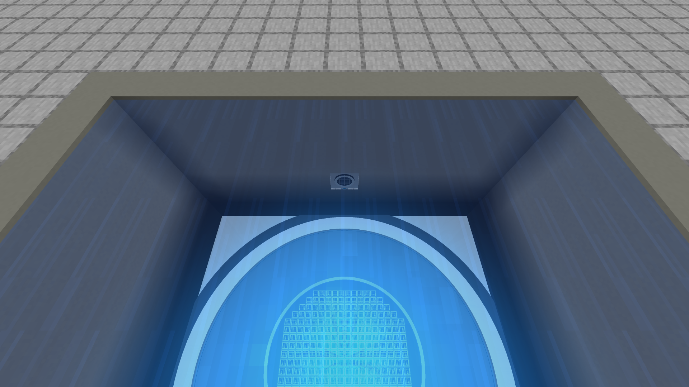
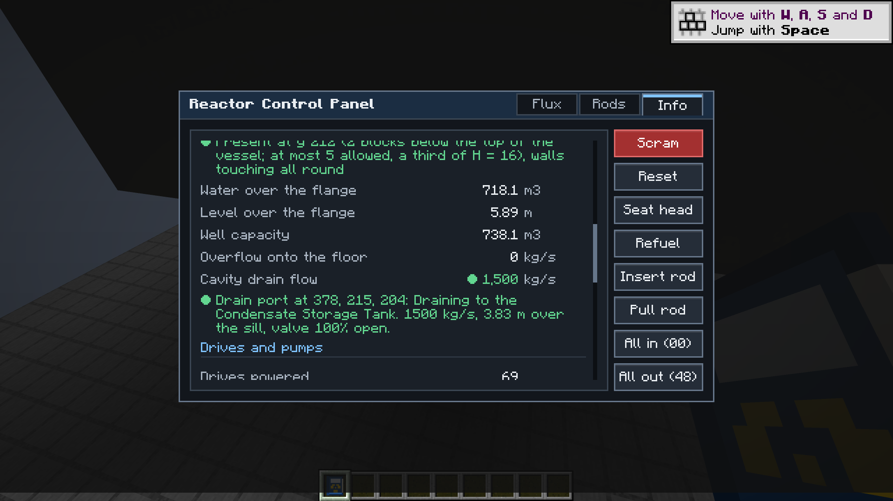
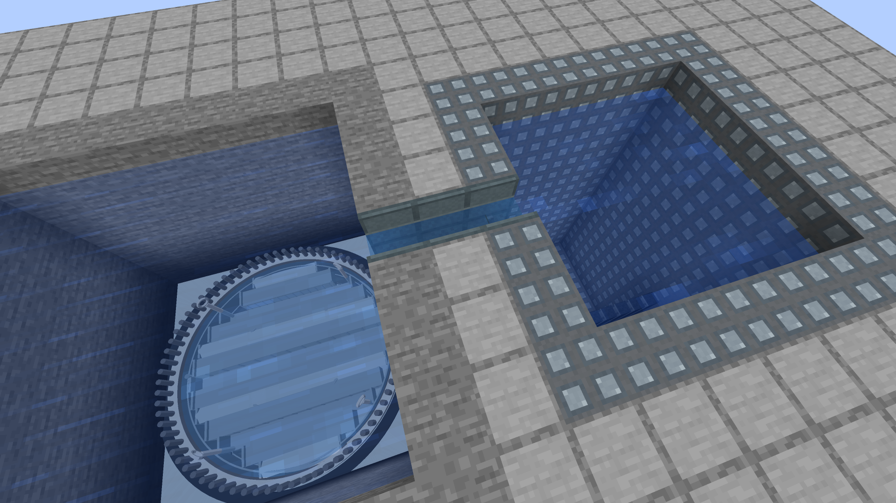
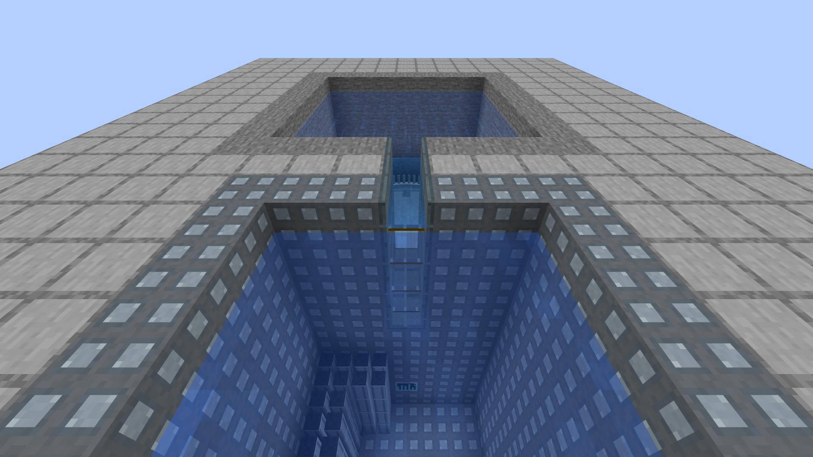
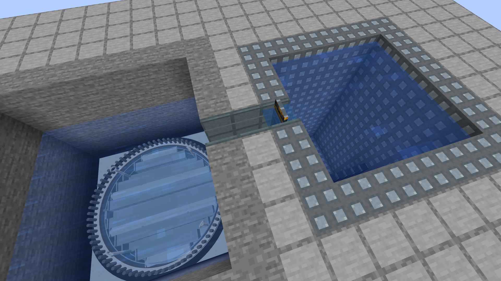

# The refuelling bridge and the cattle chute

Fuel used to move by clicking the refuelling map: one click, one assembly, instantly, from the core into your pocket. A
real plant does not do that. A **refuelling bridge** rides rails across the refuel floor, over the open reactor cavity and
the spent fuel pool; a telescoping mast lowers a grapple, latches the handle of **one** assembly, lifts it, carries it, and
sets it down in a core position or a pool rack. The whole way the fuel stays under water, and the cavity and the pool are
joined by a water-filled slot with gates, the **cattle chute** (plant slang for the transfer canal). Nothing in it moves
unless a player, or their program, says so. **The bridge moves fuel only.** The vessel head, the steam dryer and the separator assembly are
lifted by the [reactor building crane](BUILDING-CRANE.md), a separate overhead crane on its own high rails.

The old instant map is the server option `instantRefuelling` (`bwr-gameplay.toml`), **off by default**. With it off, the
refuelling map still opens and still shows the whole core (burnup, k-inf), but its buttons stay dark and say how fuel moves
now; with it on, it works exactly as it did. Existing worlds keep their fuel either way.

## Building one

All blocks are in the Realistic BWR creative tab (iron and gray concrete; the console also wants a comparator and glass panes).

1. **Rails.** Two parallel runs of **Refuelling Rail**, on the refuel floor, at the same height, up to 40 blocks apart, overlapping
   along their length by at least two blocks. A rail has an axis (the way you face when you place it); the bridge runs along it.
   The reactor's interior and the pool's interior must both lie between the rails (inside their overlap, along the rails, and
   between them, across). The reactor needs its head off (the refuelling vessel state); the pool needs to be formed.
2. **The cattle chute.** Build it as a real plant's transfer canal: a **slot** cut through the pool wall and the well wall in a row both
   interiors share, Transfer Canal stacks in it from the rim down, and canal stacks in every column between, with a gate stack in the
   pool-wall slot. Flood the well to the pool's level, then open the gate: the pool, the canal and the well are one body of water (see
   [the slot](#the-cattle-chute-as-a-slot-one-body-of-water)). The old chute still works exactly as before: a straight row of **Transfer Canal**
   blocks from the reactor shell to the pool wall, in a row that both interiors share, filling every column between the two shells, the pool's
   lining left solid. It is a **trench**: a 4.5 m assembly stands upright in it, so the
   canal blocks are stacked (the lowest has the floor, the highest the water surface; the model joins them as you place them). The
   top block is at the height of the rails or up to four blocks below them, and the trench must be deep enough for the assembly
   to hang clear of its floor (in the test world, 9 blocks; the bridge halts with the figures if it is not). One or more **Canal Gate**
   blocks stand in the row (a gate is a canal block with a plate across it, raised when closed and sunk when open; stack gates to
   make a gate the full depth: the bridge counts the row closed if any gate block in it is). A bucket fills or drains the whole stack it is used on.
   An old chute meets the cavity and the pool at their walls, and the model takes the assembly through the pool's lining at that depth;
   a slot chute takes it through the slot.
3. **The console.** A **Refuelling Bridge Console** beside any rail block. Right-click it for the control screen; sneak-click for
   what the bridge sees (rails, reactor, pool, chute, state).

Gate and canal are player actions: an empty hand opens or closes a gate; a bucket drains or fills a canal. Nothing else ever does.

## Using it

The console opens the refuelling map as the bridge's control. Pick a core position on the map (click it), pick a rack cell
(the arrows and the EMPTY and FUEL jumps step through the pool's racks, four cells to a rack), and queue the move:

| Button | Does |
|---|---|
| TO POOL | the assembly in the selected core position goes to the chosen free rack cell |
| TO CORE | the assembly in the chosen rack cell goes to the selected empty core position |
| SET DOWN | after a halt, the assembly still on the grapple goes to the chosen free rack cell |
| ABORT | stops where it is, forgets the queue (an assembly on the grapple stays on it) |
| RESUME | after a halt (a closed gate, the hoist limit, a destination that filled up) tries the step again |
| OVERRIDE | overrides the hoist limit (see below) |

The screen shows the phase, the time left in it, the queue, the water over the core and over the racks, the chute (open, closed,
drained, absent), what is on the grapple, and the reason for a halt. Up to 16 moves queue; they run one at a time.
A move is refused at once, with the reason, if it cannot be done: no reactor or pool under the bridge, the head is on, the
source is empty, the destination is taken, a position is out of reach, the chute is absent, or a gate is shut.

### A move, phase by phase

| Phase | What happens | Time |
|---|---|---|
| travel | the bridge runs along the rails and the trolley across them, mast retracted | the slower of 1.0 m/s along the rails and 0.6 m/s across |
| lower | the mast telescopes down until the grapple sits on the handle | 0.6 m/s |
| latch | the grapple closes. **Just before it the hoist limit is checked.** At its end the assembly leaves its seat (the reactor's own `unloadAssembly`, which stamps `bwr:discharge_time`; or the pool's `extractFrom`) and is on the grapple | 4 s |
| lift | the assembly is raised 1.0 m off its seat | 0.3 m/s (loaded) |
| carry | the loaded trolley goes to the other body of water, one leg per waypoint, through the chute between cavity and pool, all three axes together | 1.0 / 0.6 / 0.3 m/s |
| set down | the assembly is lowered onto its new seat | 0.3 m/s |
| release | the grapple opens; the assembly goes in (the reactor's `loadAssembly`, the pool's `insertAt`) | 4 s |
| retract | the mast goes back up | 0.6 m/s |

The speeds are real-ish: a bridge runs at fractions of a metre a second and a loaded hoist at about 10 cm/s; the game compresses them
about threefold and keeps the ratios. Measured in the GameTests with a 5 x 5 reactor and the smallest pool, 11 m from the core to the racks: **49 s** core to rack and **46 s** rack to core
(travel, lower, latch 4 s, lift, carry, set down, release 4 s, retract). A larger reactor with the pool further away takes proportionally longer; a queue of moves runs one after another.

The bridge is drawn from the console's synced state (no entities, no per-tick packets: one update when a phase begins,
the client advances the pose with its own clock). The operator's seat is the console beside the rails; riding the gantry was not built.

## The model

The bridge is drawn as the real machine looks, a refuelling platform: a bright yellow steel gantry on the two rails, an A-frame with
X bracing at each end down to a wheeled end truck, two deep box girders between the ends with a walkway along one of them (tubular
handrails, an orange skirt hung on them, a console, cabinets and a hose coil on the deck, a cable festoon along the girder, a maker's
plate), and a blue trolley on the girder tops carrying an operator platform with yellow rails and a console on the other side, two
orange cable reels, an auxiliary hoist, cabinets and the telescoping grey mast with its grapple. It is not a block and not an entity:
the block entity renderer draws cached meshes. Visual only: the blocks, the survey, the motion, the saves and the protocol are as before.



**Parts.** Blender, headless (`blender.exe --background --python art/models/refuelling_bridge/build_models.py`, which also saves
`refuelling_bridge.blend` and Workbench review renders); `python tools-export-refuelling-bridge.py` bakes the OBJ models into
`assets/bwr/models/block/refuelling_bridge/<part>/` (`--check` verifies them byte for byte). Flat colours from the mod's material
approach (a white tile tinted by the material colour), except the two textured parts: the maker's plate (generic, no brand:
"REFUELING PLATFORM, MAIN HOIST / AUX HOIST", `refuelling_bridge_plate.png`) and the carried assembly. Colours: safety yellow
structure, blue trolley, grey mast, orange shroud and reels, galvanised handrails.

| Part | What | Triangles |
|---|---|---:|
| `end_truck` | wheeled carriage, sill, two A-frames with X and portal bracing, end beam, ladder, drive motor, cabinets (one per rail; the second is the same part turned half a turn) | 1,176 |
| `girder_plain` | one metre of everything plain and straight: two box girders, flanges, trolley rails, walkway deck, edge beam, handrails, orange skirt, festoon track; **stretched** along the span | 224 |
| `girder_tile` | one metre of the detail: stiffeners, a deck outrigger, a handrail post, a skirt seam, the festoon cable; **tiled** once per metre | 172 |
| `deck_clutter` | the walkway console with its monitor, two cabinets, a hose coil (only on a span of 6 blocks or more) | 460 |
| `plate` | the maker's plate on the girder, 30 % along the span (a span of 3 or more) | 14 |
| `trolley` | bogie and wheels, deck, hangers and braces, the operator platform with its yellow rails and console, reel stands, the auxiliary hoist, the mast head, cabinets, deck handrails | 1,668 |
| `reel` | an orange cable reel with its black winding; two, turned by the renderer | 396 |
| `mast_outer` | the fixed outer tube from the trolley down to 1.32 m over the rails, with flanges and depth bands | 372 |
| `mast_tube`, `mast_collar` | a unit tube and a unit ring, scaled into each of three inner sections and their joints | 60 + 60 |
| `grapple_head`, `grapple_jaw` | the grapple at the tip; one jaw (the renderer swings it, and turns it half a turn for the other) | 216 + 52 |
| `assembly` | the carried fuel assembly, hanging from the tip | 84 |

**How the span scales.** The rails can be 1 to 40 blocks apart (`cHigh - cLow`, already synced in the bridge's geometry), so the model
is parts, not a picture. The girder mesh is built once per span length (a cache key of the span; nothing is rebuilt for a span that has
been drawn): the plain section is stretched to the span (only plain straight sections stretch, as the jet-pump models do) and the
detailed tile is repeated once per metre, so detail never stretches. The end trucks are drawn at the two rail centre lines, whatever the
distance; the trolley and the mast move across the girders. The whole thing is 4.2 m long along the rails and **6.2 m tall above the
floor of the rail block** (the girders' underside is 3.5 m up, the walkway 3.8 m), so the room needs that much head space, or the
bridge pokes through the ceiling. Triangles for a span of 4 / 10 / 24 / 40 blocks: 6,430 / 7,922 / 10,330 / 13,082 (the extended mast
and a carried assembly add 444). The old picture was 11 boxes.

| Narrow, 4 blocks | Wide, 24 blocks |
|---|---|
|  |  |

**Animation (all from the synced leg; nothing new on the wire).** The bridge travels along the rails (the frame's position along them),
the trolley across (the frame's offset from the first rail), the mast telescopes (the outer tube is fixed; the three inner sections each
come out a third of the way, drawn as a unit tube scaled by the pose, with the normal matrix kept unscaled so the lighting does not change
with the length), the grapple's jaws swing open and shut with the latch and release phases (as the old jaws moved), and the cable reels turn
with the hoist (the cable paid out equals the height the grapple has moved) and stand still when it does. The assembly hangs from the
tip with the same blue glow in the water as before. Rails along Z turn the frame a quarter turn.

**Drawing.** Each part is a vertex buffer in `MachineMeshCache` (`MachineMeshCache.draw`, the path the reactor, tanks and towers use),
uploaded once and drawn with a pose; there is nothing per frame but about 17 draws (the girders, two trucks, trolley, two reels, the
outer mast, up to six scaled pieces of the inner mast, the grapple head, two jaws and the assembly). The check
(`-PbwrRefuellingBridgeCheck`) fails if any mesh is uploaded again while a picture is standing still, and logs the cached draws per frame
and the frame rate. The renderer's bounds reach 8 m above the rails.



## The steam dryer and the separator assembly (alpha.53, lifted by the crane)

Fuel sits under two big removable assemblies: the **steam dryer** (six vane banks on a support ring, a skirt down into the water)
and, under it, the **shroud head with its standpipes and steam separators**. A real plant lifts both into the dryer/separator
storage pool with the reactor building crane before it moves fuel; so does the mod. Nothing moves by itself. (In alpha.53 the
refuelling bridge did these lifts; the crane has taken them over, see [BUILDING-CRANE.md](BUILDING-CRANE.md).)

* **Fuel waits for both.** With the head off, a fuel move (the bridge, the instant map, a program) is refused while the dryer or
  the separator assembly is in the vessel, and says which. The server option `instantRefuelling` skips the machinery, these two included.
* **Order.** The dryer comes out first (it sits over the separators) and goes back last. The separators go back first. The head goes on last of all.
* **Only from a flooded vessel.** The head must be off and the vessel flooded to its flange (collapsed level at least +59 in; the
  physics' lip is +60 in). A sealed, flooded well above it is the usual way.
* **Equipment Storage Pad** (iron and gray concrete). One assembly per pad. Place two on the floor of a pit of water the
  crane reaches (between its rails): the plant's dryer/separator storage pool, built of vanilla water. A pad holding an assembly
  cannot be broken by hand. Right-click it to see what it holds and the water over it.
* **The lift.** The crane console's buttons **DRYER OUT / DRYER IN** and **SEPS OUT / SEPS IN** (or `queueInternalOut("dryer")`,
  `queueInternalIn("separator")` on the crane's peripheral) queue an ordinary crane lift: run to the vessel's centre, lower the hook
  onto the lifting eyes, hook on (5 s), raise out of the water to the hook's rest height, carry across in
  the air, lower onto the nearest free pad (or back onto the seat), unhook, raise. The crane draws the assembly hanging from the hook.
  ABORT leaves it on the hook; the same button continues from there.
* **The runway must be high enough.** Hanging from the raised hook, the assembly must clear the vessel's lip before it moves
  sideways: the crane refuses with the rail height to build to.
* **Dose.** A lifted assembly is a gamma point source (`RadiationSources`): about 0.2 W for the dryer and 10 W for the separator
  assembly (game-scale estimates, roughly 0.1 Sv/h and several Sv/h at 1 m in air). Over the vessel it is shielded by the water
  you see (the drawn vessel and well); lifted above it, the Survey Meter spikes. On its pad, the vanilla water standing on the pad
  shields it (`e^(-7.07 x depth)` over the assembly's middle): a full pit is quiet, a dry pad is not.
* **Consequences.** With either assembly out the reactor is **not operable**: the head cannot go back on (so the vessel cannot
  hold pressure) until the separators and then the dryer are back. The INFO tab ("Head, studs, dryer and separators") and
  `reactor.getInternals()` say where each one is.
* **Saves.** Old worlds load with both installed. The reactor writes `InternalsOut` (where each is) only while one is out, the
  pad writes what it holds only while it holds something, the crane console what its hook holds only while it holds it. Breaking the
  console under a hanging assembly sets it back in its vessel rather than losing it.
* **The bridge refuses these lifts.** `queueInternal`, the console's buttons and the peripheral's `queueInternalOut` / `queueInternalIn` say that the bridge moves
  fuel only and the crane lifts the head, the dryer and the separators. A load already on its hoist (a world saved mid-lift in alpha.53) can still be set down:
  the console's DRYER DOWN / SEPS DOWN buttons (lit only while the hoist holds that assembly) and the same calls do it.

CC:Tweaked: the crane's peripheral `bwr_building_crane` has `queueInternalOut(name)` and `queueInternalIn(name)` (`"dryer"` or `"separator"`,
returning `{ok, message}`); `getStatus()` there adds `carried`, `dryerInstalled` and `separatorInstalled`. The reactor adds
`getInternals()`: `dryerInstalled`, `separatorInstalled`, `dryerAt` / `separatorAt` ({x, y, z} while out), `operable`, `summary`. The pad has its own
`bwr_equipment_pad` face: `getStatus()` gives `holding` (`"none"`, `"dryer"`, `"separator"`), `reactor` and `waterOverM`.
The bridge's own peripheral keeps `queueInternalOut` / `queueInternalIn`: they refuse, except to set down a load already on its hoist.

## The reactor well and the cavity seal

A formed reactor's vessel is round and its block footprint is square, so a gap is left round the vessel wall and the concrete that
surrounds it. In a real plant that gap is the **drywell**; it stays dry. Above the vessel is the **reactor well** (the cavity), a
concrete shaft up to the refuel floor, and at flange height a **cavity seal** (a bellows and a seal plate) bridges the vessel flange to
the wall of the well. With the head off, the water is raised out of the vessel over the flange and up the well, and the seal holds it
above the drywell. The mod does the same, and the bridge reads the result.

### The seal (formed with the vessel)

The seal is part of the vessel's picture, a steel plate with a dark collar drawn from the round flange out to the square footprint and
the surrounding blocks (the corner gaps included). It is **not a block a player places**: you build the wall, the seal appears.

**The gap rule.** At one elevation (one row of blocks), looking outward from the vessel's block footprint all the way round the ring,
corners included:

* a full, solid block **touching** the vessel (gap 0) or **one block away** (gap 1) closes the ring at that column;
* the ring closes at that row only if **every** column round it finds such a block;
* more than one block of air anywhere round the ring: that row does not close. No seal forms at a row where it does not.

**Where it forms.** Scanning down from the flange (the top of the vessel's body once the head is off; the dome rows above it go with the head), the
**highest row that closes** takes the seal. It may be below the flange. It must be in the **upper third** of the vessel: at most `round(H / 3)` blocks below the
top shell row, where H is the formed vessel's total height in blocks (the shell included) and `round` is to the nearest block (H = 10: 3 below the top; 11: 4;
13: 4; 14: 5; the default 17 x 17 x 28: 9). A ring that closes only deeper than that is no seal. No row from the flange to that depth closes: no seal at all,
and the INFO tab and the computer say which side is how many blocks too far, and where.

*Why one third and not one quarter.* The owner's fallback was `round(H / 4)` if a third caused a real problem (a seal at or below the top of the active fuel or a port row,
or annulus water clashing with the nozzle models). Checked: the top of the active fuel is 5.5 above the bottom of the smallest vessel (7 x 7 x 10, H = 10) and its deepest
seal row is 6 above the bottom; on the default 17 x 17 x 28 the fuel top is 11 above the bottom and the deepest row is 18; on the largest (23 x 23 x 131) the fuel top is 11 and the
deepest row 86. So a seal is never at or below the fuel. Port rows are the player's to place, so the rule cannot rule a clash out: the seal forms at the **highest** closing row, which is
the flange for a shaft that closes all the way up (the steam outlets of the test vessels sit one to three rows below the flange), and only a wall the player builds open down to a deeper row
would put the plate below a nozzle. Nothing needed the quarter; a third was used.

Canal and gate blocks of the cattle chute count as wall (the chute meets the cavity there). Pipes and other partial blocks do not.

**When it is surveyed.** A survey starts on formation and whenever the reactor revalidates, which it does when a block next to the controller changes and on
the five-second sweep it already did; never per block. It is **spread over the ticks that follow**, at most 4000 block reads a tick
(`CavitySeal.READS_PER_TICK`, about 0.65 ms), so no tick pays for the whole well: the worst case, a 23 x 23 x 62 vessel with a 48 layer well, is 124 000 reads, 9.5 ms
in one go (the cost every sweep would have been) and 32 ticks of at most 0.65 ms spread. Until a survey finishes the last answer stands (the drawn seal and the
vessel's well stay as they were); a newer revalidation replaces one still running. A block in an unloaded chunk leaves the last answer standing too (no chunk is
ever loaded for it). Nothing of the seal is saved: an old world surveys it on its first tick. The result goes to the clients inside the
vessel's picture, only when there is a seal.

### The well

From the seal row up, layer by layer: the vessel's footprint (the shell is gone with the head, and above the vessel a block over the footprint is
a ceiling that ends the well) and every open cell joined to it within three blocks. A layer that leaks ends the well; its top is the top of the last closed
layer, where the refuel floor is. The well is usable only if it reaches the flange.

* **Water over the flange.** The model's flange lip stands at collapsed level **+60 in** (the top of the narrow range band, where the drawn vessel's lip has
  always been). Below it the inventory and the level are exactly what they were. Above it the inventory first fills the **annulus** (outside the vessel
  body, from the seal plate up to the lip: the level in the vessel *holds at the lip* while it fills), then rises through the well layer by layer, each layer its own
  cross-section in m2 (one block is one metre). The collapsed level, the inventory (`liquidMassKg`) and `VesselWaterGeometry` stay one thing: the level above
  the lip is `60 in + rise / 0.0254`, and the drawn surface is the same rise above the drawn lip.
* **Head replaced while flooded.** Nothing moves. The water over the flange stays where it is, the level reads where it was, and it comes down only as the level
  falls (the plant's own drains, boil-off). Closing the head is not refused and does not drain anything; it just stops the spill described next.
* **Without a seal**, or with a seal under a wall that opens below the flange, or when the well is full: the head is off and the vessel can not hold the water, so it
  leaves at the rate it arrives, up to **4000 kg/s** (`PressureVessel.WELL_SPILL_KG_PER_S`, twice the rated feedwater flow): into the drywell (no usable well: a refuelling seal failure)
  or onto the refuel floor (over the top of a full well). The level holds at the lip (or the top). The INFO tab and `getCavity()` show the rate and where it goes.
  With the head on there is no spill: the vessel is closed.
* **Nothing floods by itself.** Only the player's feed, condensate and residual heat removal pumps (and a program's commands) put water in.

### Draining the well: the Cavity Drain Port

Nothing drains the well by itself, and the vessel body below the flange is drained the existing ways (RHR shutdown cooling, the recirculation outlet). To bring the well's water
down again, build a **Cavity Drain Port** into the wall or floor of the well and pipe it back to a **Condensate Storage Tank**:

```text
well (water) | Cavity Drain Port | High-Pressure Water Pipe | Motor-Operated Water Valve | pipe | Condensate Storage Tank
```

* **Where it goes.** The port's flange (`FACING`, the side the pipe takes) points *out* of the well; place it looking out of the well. The block behind the flange, the wet cell, must be a
  cell of the surveyed well's water (the survey that finds the cavity seal), and the port must stand **at or above the seal row**. It is a wall block (the seal survey still counts it as wall)
  or a floor block (flange down). A port facing up, one whose wet face is outside the well, or one below the seal row passes nothing; the INFO tab says which.
* **The sill and the stop.** The sill is the floor of the wet cell (the seal plate's height at the lowest). Water over the sill drains; **draining stops when the level reaches the sill**: the well's water
  and the vessel's inventory (`liquidMassKg`, so `WellInventoryKg` and the level mapping) fall together, never below the sill's level. Below it the water stays (the plant's own drains take it from there).
* **The flow law (gravity):** `Q = Cd A rho sqrt(2 g H) x opening`, `Cd = 0.6`, `A = 0.2 m2` (a 0.5 m bore), `rho = 1000 kg/m3`, capped at **1,500 kg/s** (7.5 m/s in the bore, reached
  at about 8 m of head). `H` is the driving head: **the depth of water over the sill plus the line's elevation difference**, the sill's height less the height of the tank's inlet flange (its block centre).
  1 m of head passes 531 kg/s, 4 m 1,063 kg/s. If the tank's inlet is above the water there is no head and no flow (the line is a siphon with no lift). `opening` is the opening of the
  **narrowest Motor-Operated Water Valve on the route**, proportional (a 50 % valve passes half).
* **It needs the player's valve.** A line with no motor-operated water valve on it passes nothing (the valve is the drain's isolation: realistic, and the smallest rule); a closed one passes nothing. The
  valve moves only when the player moves it (redstone, a panel, a computer; 20 s a stroke, [WATER-PLUMBING.md](WATER-PLUMBING.md#motor-operated-water-valve)).
* **It goes to the CST.** The line must reach a Condensate Storage Tank (an assembled one through a flange, or an old single block). A full tank stops the flow; room starts it again. The water goes in
  at the vessel's coolant temperature (at most 100 C) and mixes by enthalpy like any water the tank takes. What leaves the vessel is exactly what the tank accepts.
* **Nothing per tick but the reactor's.** The port has no ticker; the formed reactor steps the ports in its well area once a tick (a single comparison when there are none) and re-reads the list only when a port
  came or went or the well was surveyed again. It reads the pipe survey the same way a pump does (a cached graph and a memoised route walk; no chunk is loaded). Nothing of the port is saved.







### What the screen and the computers say

INFO tab, "Cavity seal and well": the survey's verdict (present at y, row, H and the lowest allowed row, touching or with a gap; or absent, with the closest row and which side is
how many blocks from the vessel at which x, z), the water over the flange, the level over the flange, the well's capacity and the leak (or overflow). With drain ports in the well it adds the **cavity drain flow** and a line per port: where it is, what its line is doing (draining, no valve, valve closed, no tank, tank full, down to the sill ...), the flow, the metres over the sill and the valve's opening. CC:Tweaked
`reactor.getCavity()` returns the same as a table (`sealPresent`, `sealReason`, `vesselHeight`, `lowestSealRowY`, `flangeRowY`, `sealRowY`, `gapSides`, `tooWideSide`,
`tooWideGapBlocks`, `wellUsable`, `waterOverFlangeM3`, `levelOverFlangeM`, `wellCapacityM3`, `spillKgPerS`, `spillTo`, and the drain ports: `drainCount`, `drainKgPerS`, `drains`, one table per port with `x`, `y`, `z`, `state` (`draining`, `no_valve`, `valve_closed`, `no_receiver`, `receiver_full`, `at_sill`, `no_water`, `no_head`, `not_in_well`, `below_seal`, `no_well`, `no_reactor`), `flowKgPerS`, `depthOverSillM`, `headM`, `valveOpening`, `valves`, `totalKg`). The port has its own `bwr_cavity_drain_port` face with `getStatus()`.

### Drawing

The plate and collar are built into the vessel's cached mesh (one rebuild when the seal changes). The water in the well and the annulus is one translucent surface at the level the
server sends (only while there is water over the lip), over the cells of the well at that height, in the pool's water tint: no water blocks. The core's Cherenkov glow reaches up to it.

## Water, depth and dose

The top of the carried assembly, its handle where the grapple holds it, is the point that matters. The bridge tracks the metres of water
over it, `cover = surface - handle`, at every tick of a move, in whichever body it is over:

* **cavity**: the top of the drawn core plus the metres of water the reactor model has above the top of active fuel,
  `(collapsed level - TAF) x 0.0254` (the same number `RadiationField` uses for an open head). A freshly formed cold vessel has only 1.2 m
  over the fuel, so **the player floods the cavity before refuelling** (the normal operating level is 4.4 m over the fuel); the hoist limit
  below says so when the water is too shallow. Water over the vessel flange in a sealed well is part of that level (see
  [the reactor well and the cavity seal](#the-reactor-well-and-the-cavity-seal)), so a flooded well adds its rise to the cover metre for metre;
* **pool**: its own level, `floor + levelM`, so a boiled-down pool shows up at once;
* **chute**: the surface of its top canal block (13/16 of the block) for an old chute, the connected level the canal shows for a slot chute; none if any column of its row is drained.

**Registered radiation sources** (`RadiationSources`, so the Survey Meter and the Area Radiation Monitor read them):

* the **carried assembly**: gamma power `0.5 x decay heat` (`AssemblyDecayHeat`, from its burnup and its discharge stamp, the model's
  `GAMMA_FRACTION_OF_DECAY_HEAT`), a point source at the handle, through `e^(-7.07 x cover)` (`DoseModel.waterTransmission`, the law the
  reactor model applies to an open head), nothing in air. Registered while it is carried, cleared when it is set down, the console is broken or the chunk unloads;
* the **pool's stored fuel**: each rack with fuel is a point source at the middle of its top, the same gamma share of the decay heat of what it holds, through the water over
  the rack top (none when the water has fallen below it). One provider for every pool in the level.

For a just-discharged 45 GWd/t assembly (315 kW, 157 kW gamma) seen from the deck 4.5 m above its rack (`theDoseRisesWhenTheAssemblyIsLiftedAndSpikesOutOfTheWater`): **4.1 uSv/h**
seated under 3 m of water, **8.0 mSv/h** lifted a metre (2 m over the handle), and **2.8e8 mSv/h** with the handle out of the water a few metres from the observer (the survey meter picture reads
906 Sv/h from 9 m away). Each metre of water is a factor of 1,200.
Looking down is the conservative case: the model has the point source at the handle and counts only the water straight above it.
A person **in** the water of the pool or of a flooded well is a different case: the shielding is the water on the line between them and the fuel, with no credit for the water above them, and it hurts ([RADIATION.md](RADIATION.md#water-between-you-and-the-source-and-swimming)). The new fuel elevator ([SPENT-FUEL-POOL.md](SPENT-FUEL-POOL.md#the-new-fuel-elevator)) puts fuel into the pool with the same water rules and the same hoist limit.

### The hoist limit

The bridge **refuses to lift an assembly higher than leaves 1.5 m of water over its handle** (the check is made for the whole route, every waypoint,
just before the grapple latches, so a refusal leaves the assembly on its seat). It halts with the figures and waits. The player may **override** it
(OVERRIDE on the screen, `setOverride(true)` from a program): the bridge then lifts the real 4.5 m, the whole length of the assembly, which in
this game's shallow water brings the handle out of it, and the survey meter spikes. This is the machine's own limit, a player-facing interlock; it
protects nothing in the plant and nothing reads it. It is not in the physics module: the `core` physics scan (`ReactorCoreTickTest.test07`) objected to a method
named for it, and the decision now lives in the block entity (the core only measures the cover).

Normal carries lift 1.0 m (game scale: the real lift is 4.5 m under 7 m of water); in the chute the assembly is held 2.0 m under the lowest of the three
surfaces (cavity, pool, canal). With a 3 m full pool the cover is 2 m over a rack seat; with the cavity flooded to 3 m, 2 m over the core. The mast
can only raise the grapple as high as its rest position (1 m over the rails), so even an overridden lift stops there: the handle then hangs in air
if the surface is lower than that.

### The cattle chute as a slot: one body of water

A real plant's transfer canal (Columbia's, for one) is a gated slot through the walls: with the gates open, the fuel pool, the canal and
the flooded reactor well are one connected body of water. Build it that way and the mod makes it so.

**The slot through the pool wall.** Transfer Canal and Canal Gate blocks may stand **in a side wall of the pool**, in place of the lining:

* one straight stack in one column, **from the rim down** (the wall's top row), turned to run **through** the wall (place the blocks facing the wall);
* in a side wall, **never the floor**, and **not at a corner**;
* its lowest block **at least one block above the top of the racks** (a rack is 4 blocks on the floor, so the sixth row above the floor block or higher;
  `SpentFuelPoolLayout.SLOT_SILL_ABOVE_RACKS`). With the gate open and the well drained, the pool can only lose the water over the slot's floor, so
  the racks keep more than a metre of water over them: a real plant's gate sill sits above the fuel for the same reason.

The pool forms with the slot (it is part of its shell), and the controller's report lists it: column, rows, sill. A slot that breaks a rule stops
the pool forming and says which rule: *cut through a side wall, never the floor*, *cannot be cut at a corner*, *one straight stack from the rim down;
the column has a gap at y*, *turn the canal block to run through the wall*, *goes too deep: ... its lowest canal block at y N or higher*.

**The slot through the well wall.** The canal row from the slot runs on to the vessel: every column between the pool's wall and the vessel's
footprint is a canal stack, and the last of them stands **in the well's wall**. Canal and gate blocks have always counted as wall for the cavity
seal and the well survey, so the seal and the well are surveyed as before: a canal is a lined, watertight trough, not a hole to the drywell. The
slot's floor must stand **at or above the cavity seal row** (a canal below the seal would open the well under the plate: refused, `below_seal`),
and at or below the top of the well.

**The water.** With **every gate in the row open**, the pool's controller passes water through the slot once a tick (`CanalExchange`; no canal block
ticks, a pool without a slot does nothing). The **sill** is the top of the canal's highest floor (the slot's, normally). Only water **over the sill**
moves, from the higher surface to the lower, by the drain port's gravity law with the slot's cross-section (`CanalFlow`):

`Q = Cd A rho sqrt(2 g H)`, `Cd = 0.6`, `A = 0.75 m x` the slot's height from the sill to the top of the lowest-topped canal column (the trough is 12/16 of a
block wide inside), `rho = 1000 kg/m3`, `H` = the high surface less the low one, or less the sill when the low side is under it (the water falls over
the sill), capped at **20,000 kg/s**. Through a slot 1.875 m high (the GameTest's) 1.5 m of head passes **4,577 kg/s**; 0.5 m through a 2 m slot about
2,800 kg/s; 1 m through 7 m about 14,000. The test's pool (25 m2) at its rim and a well (49 m2) 1.5 m lower are level in **10.4 s**.

* **Mass is exact.** What leaves one inventory enters the other, in whole kilograms: the pool's water (`SpentFuelPool`) and the vessel's
  `liquidMassKg` (the well's water over the flange is part of it) add up to the same before and after every step. Water from the well goes into the
  pool at the coolant's temperature (at most 100 C) and mixes; water from the pool joins the vessel's inventory (the vessel's own model gives it its
  temperature).
* **Never past level, never under the sill, never over the rim.** A step never moves more than brings the two surfaces level (the two bodies'
  real shapes: the pool's floor area, the well's layers and annulus), never more than stands over the sill, and never more than the lower side has room
  for (the pool's rim, the well's top). Within 1 mm the surfaces count as level and the water over the sill as gone.
* **A closed gate is no flow.** Any closed gate block in the row isolates the pool from the well; the levels stay where they are.
* **The canal's water follows.** Each canal column holds water to the level of the side it is open to (with the gates open, the higher of the pool
  and the well; with a gate shut, the slot and the gate's column the pool's, the columns behind it the well's), drawn at that height in sixteenths
  of a block (the blocks' `fill` state). A column is drained only when that level is under its floor: with the gates open, **both** sides under it.
  Drain a column with a bucket and it refills on the next tick from whichever side stands over its floor; pour a bucket into a column whose sides
  are both under its floor and it runs out again. (The canal's own few cubic metres are not counted in either inventory.)
* **Nothing acts by itself.** This is physics: nothing opens or closes a gate (a player's empty hand does, or a program through the bridge's
  `setGate`), nothing reacts to a level. The head must be off (`head_on`) and the reactor needs a usable well (`no_well`); a chunk that is not
  loaded moves nothing and changes no block (`waiting`), and no chunk is ever loaded for it.
* **What it says.** The pool controller's report (sneak-click) has a line per slot and the exchange's state (`no_slot`, `no_row`, `no_reactor`,
  `head_on`, `no_well`, `below_seal`, `above_well`, `waiting`, `gate_closed`, `below_sill`, `level`, `to_well`, `to_pool`, `full`), the sill, both
  surfaces and the flow. The bridge console's report says when the chute runs through a slot, with its water surface and floor.
* **Saves.** Nothing new is saved: the pool's water and the vessel's inventory are saved as they always were, so a world saved mid-exchange carries
  on where it was. The canal blocks' `fill` state defaults to 0, which is the old look (13/16 in the top block), so old worlds and old chutes are
  unchanged.

**The bridge through the slot.** The bridge finds the chute as before (the columns between the vessel and the pool's wall); when the pool's wall
column in that row is a slot, it is part of the chute: its gates count (a closed gate in the slot closes the chute), its floor is the chute's floor
(the too-shallow check uses it), and the chute's surface is the connected level the canal shows. The route goes through the slot at the chute's
depth (2 m under the lowest surface). All the refusals stay: a closed gate, a drained chute, a chute too shallow for the assembly to hang clear of its
floor, the hoist limit. A slot that keeps a metre over the racks and a 4.5 m assembly hanging 2 m under the water need a deep pool: the surface at least
6.5 m over the sill, so 12 m or more of water over the pool's floor (13 blocks of wall), as in the GameTest's pool of 15.







### The old chute, and why it couples nothing

An old chute (the canal row between the walls, the pool's lining left solid) is unchanged: an open gate is a path, not a pipe. Nothing joins the
pool's water to the well's through it: the pool's lining is in the way, so there is no opening for the water to pass, and the mod does not invent one.
The cavity's water stays the reactor vessel's inventory and the pool's its own lumped body, each with the level the bridge reads. (Water does pass
through a slot: that is the pool's wall cut open, physics, not something the gate does by itself.) So, for an old chute:

* a **closed gate** isolates the pool from the cavity for the bridge: the move is refused (and a gate shut during a move stops the bridge in front of it,
  with the assembly on the grapple, until a player opens it and resumes);
* the chute is a third body of water with its own level (its blocks'): drain one column with a bucket and the chute is **drained**; the bridge halts at the hoist limit
  (nothing would shield the assembly) and an overridden carry makes the meter spike as it passes through;
* the chute must be deep enough that the assembly does not hang through its floor (a shape rule, not an override): in the GameTest world 9 stacked blocks.

## Performance, chunks, saves

* **One ticker while moving, none idle.** The console has no block entity ticker. A move schedules ordinary block ticks, one per game tick, only until the queue is empty or the
  bridge halts. An idle or halted bridge has nothing scheduled (`aBridgeThatIsNotMovingHasNothingScheduledAndTicksOnlyWhileItMoves`). The reactor and the pool are read through their registries.
* **Chunk safe.** It never loads or forces a chunk: if a chunk of the reactor or pool it works with is not loaded it waits where it is (time does not run for it), and the survey reads only loaded blocks.
* **Saves.** The state of a move (phase, ticks done, the leg, the route, the queue, the assembly on the grapple) is saved with the console, only when non-default; an old world has none of it and loads as before.
  Breaking the console drops what the grapple holds.
* **Fuel is never duplicated or lost.** The assembly is in exactly one of: a core position, a rack cell, the grapple. It leaves its seat when the grapple latches and enters its new one when the grapple releases.
  If the destination has filled up the bridge halts with the assembly on the grapple (SET DOWN or RESUME).

## Computers

CC:Tweaked peripheral `bwr_refuelling_bridge` on the console (every method runs on the server thread):

| Method | Returns |
|---|---|
| `getStatus()` | `ready`, `problem`, `phase`, `busy`, `halted`, `progress`, `secondsLeftInPhase`, `queued`, `override`, `holding`, `carried`, `carriedCoverM`, `grapple {x,y,z}`, `haltReason`, `chute`, `reactorFound`, `poolFound`, `cavityWaterM`, `coreSlots`, `coreReady`, `poolWaterOverRacksM`, `rackCells`, `move` |
| `getRacks()` | one table per rack: position, and four `cells` (`cell` number, `occupied`, `decayHeatKW`) |
| `isCoreOccupied(index)` | whether core position `index` (the refuelling map's numbering, 0 in the middle) holds fuel |
| `queueCoreToPool(coreIndex, cellIndex)`, `queuePoolToCore(cellIndex, coreIndex)`, `queueSetDown(cellIndex)` | `{ok, message}`; cell numbers are `rack * 4 + cell`, counting from 0 |
| `abort()`, `resume()` | the same as the buttons |
| `setOverride(bool)`, `getOverride()` | the hoist-limit override |
| `setGate(open)`, `getChute()` | opens or closes every gate of the chute (returns how many); `"absent"`, `"open"`, `"closed"` or `"drained"` |

```lua
local bridge = peripheral.find("bwr_refuelling_bridge")
local r = bridge.queueCoreToPool(12, 0)       -- the program's choice, nothing else queues a move
if not r.ok then print(r.message) end
while bridge.getStatus().busy do sleep(1) end
```

## Pictures (1920 x 1080, `art/refuelling-bridge/` and `art/refuelling-bridge-model/`)

The model's own set is in `art/refuelling-bridge-model/`: `model-over-pool.png`, `model-walkway-side.png`, `model-trolley-pool.png`, `model-over-vessel.png`,
`model-trolley-closeup.png`, `model-grapple-open.png`, `model-span-narrow.png`, `model-span-wide.png` and the side by side with the reference photographs
(`side-by-side-*.png`); the Workbench review renders of the Blender parts are in `art/models/refuelling_bridge/`.

`chute-open-floor.png` and `chute-closed-floor.png` (the chute from the refuel floor, gate sunk and raised), `chute-open-side.png` and `chute-closed-side.png` (from the side),
`bridge-span.png` (the gantry over the chute between the cavity and the pool), `mast-in-core.png` (the mast lowered into the core), `assembly-through-chute.png` (a hot assembly glowing
in the water of the chute, seen from inside the trench), `assembly-in-rack.png` (just set into a rack), `control-screen.png` (the map as the bridge's control, mid move),
`survey-meter-spike.png` (the Survey Meter HUD at 906 Sv/h with the handle out of the water), and the four screens of the GUI check (`gui-*.png`).
The slot (`-PbwrChuteSlotCheck`): `slot-open-from-floor.png`, `slot-open-from-pool.png`, `slot-open-from-well.png` (the gate open, the pool and the well level through it) and `slot-gate-closed.png` (the gate's plate raised in the slot, the pool above the well).

## Tests

Core (`:core:acceptance`): `BridgeMotionTest` (legs take as long as the slowest axis, the water over the handle and the dose law against `DoseModel`, routes and the least cover, the chute floor margin).
GameTests (`ChuteSlotTests`, same namespace, 11 tests): the flow law; a pool forms with a slot in its wall and the well keeps its seal; slots in the floor, at a corner, not from the
rim, turned along the wall and too deep are refused with the reason; an open gate levels the pool and the well both ways with the mass exact at every step;
a closed gate holds the levels apart and the pool's own tick runs the water once it opens; water under the sill does not move and a pool over the sill drains
to it and no further; a drained canal refills and a canal whose sides are both under its floor drains; a slot below the seal row is refused; an exchange saved
half way carries on after the pool and the reactor are reloaded; the bridge carries an assembly from the core through the slot to a rack (and a closed gate
in the slot refuses); an old chute is left as it was and still carries fuel. Client check `-PbwrChuteSlotCheck` (`ChuteSlotClientCheck`) saves four pictures of the slot.
GameTests (`RefuellingBridgeTests`, namespace `bwrbridge`, `-PbwrOnlyBridge`): a full move from the core to the pool and back (phases in order, fuel conserved every tick, burnup and discharge stamp kept, minutes of
travel); a closed gate refuses a move, stops a move in progress and resumes once opened; the hoist limit halts with the assembly still on its seat and an override continues; the dose rises when lifted and spikes out of the water;
a drained chute halts and, overridden, spikes in the chute; a destination that fills up halts holding the assembly (set down elsewhere, abort); a move saved halfway and loaded again finishes the same job; an idle bridge has nothing scheduled
and a moving one ticks once a tick on the real scheduler; the instant option on and off (the map says how to use the bridge when off); the screen's commands and snapshot. Client check `-PbwrRefuellingBridgeCheck`
(`RefuellingBridgeClientCheck`) saves the pictures in `art/refuelling-bridge/`; the screens are in `-PbwrGuiScreenCheck`.

## Honest limits

* The operator does not ride the gantry; the console is beside the rails. The platform and walkway are pictures only: nothing can stand on them. A walkable deck would be more than collision boxes: the bridge and the
  trolley move, so it needs a moving collider (a carrier entity or a rule that carries a player standing on it), not boxes fixed in the world; not built.
* The model is 6.2 m tall and 4.2 m along the rails: a refuel floor with a lower ceiling, or something built along the rails closer than that to the bridge, is drawn through. At the
  ends of the rails the bridge overhangs by up to 2 m, because the survey lets the grapple reach the ends.
* The bodies of water are drawn as they always were (the vessel's compressed water, the pool's surface, the canal block's water body) and the bridge's numbers are the physical ones: the drawn cavity surface and the
  physical one can differ by a metre or two in a given build.
* No collision: the assembly does not hit the rack tops it passes over; the lift is the game-scale 1 m.
* One reactor and one pool per bridge (the nearest of each to the console between the rails). A pool-to-pool move works; a bridge with no reactor has no screen (the peripheral works).
* Specialty inserts (rods, sources) move between core positions; the pool racks take fuel assemblies only.
* Two consoles on the same rails are two independent bridges; the second does not know where the first is (nothing stops them sharing a column).
* In an old chute the assembly crosses the pool's lining at the depth of the chute (see the build notes); a slot chute has the cut. The vessel's shell
  is never cut: the canal ends at the vessel's footprint, in the well.
* The slot's flow is one lumped law per tick: no waves, no slope along the canal (each column shows the level of the side it is open to), and the
  canal's own water is a flag, not counted in either inventory. Water put into the vessel from the pool takes the vessel's own temperature.
