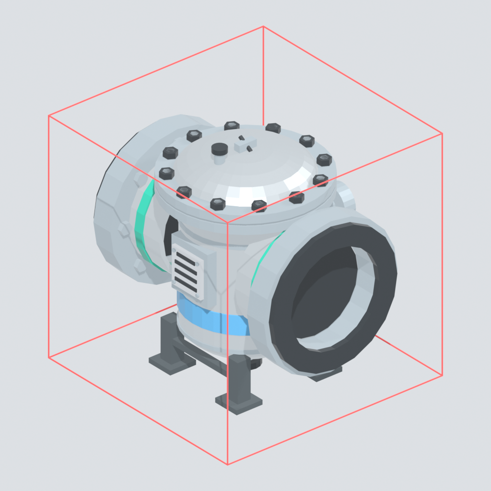
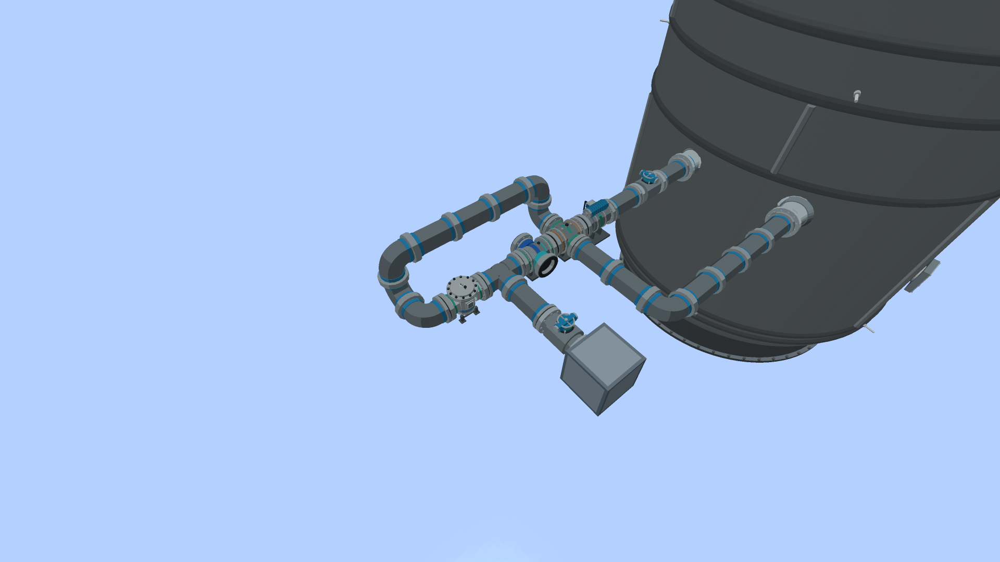
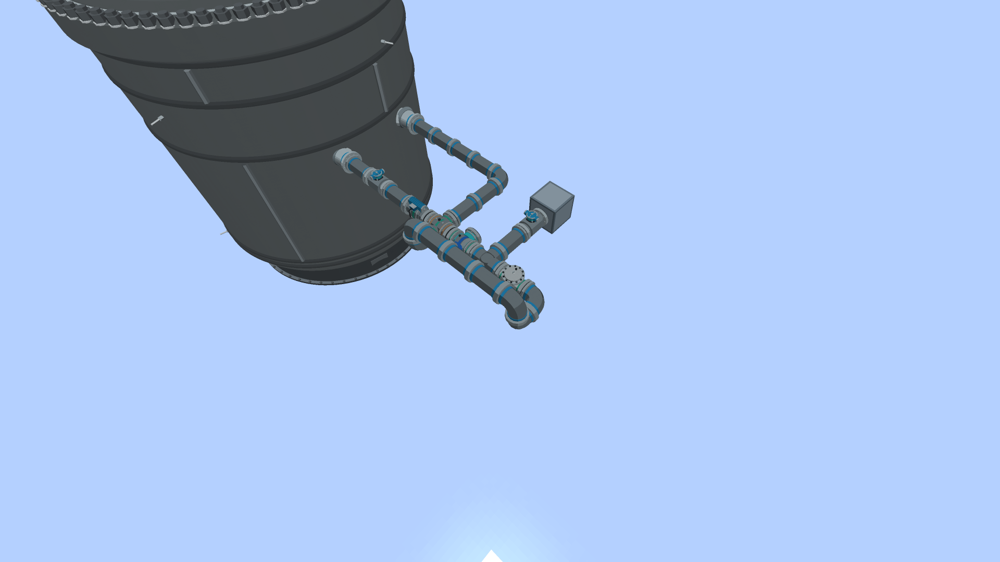
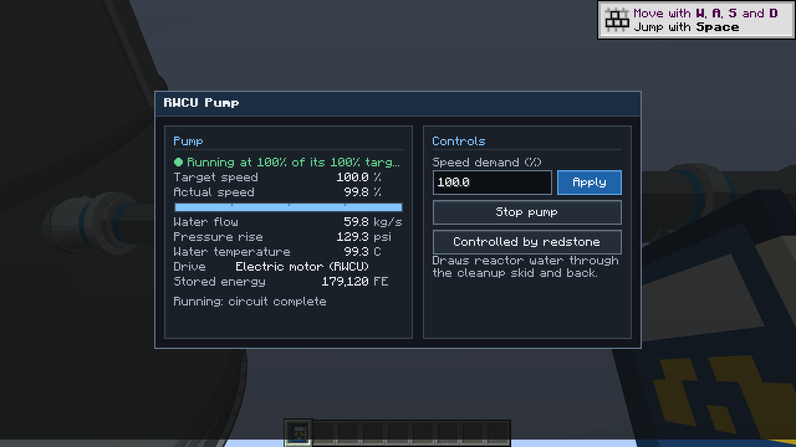
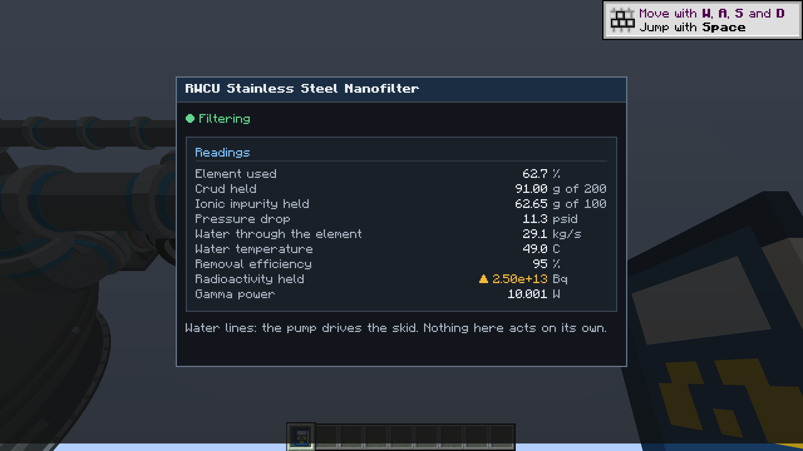
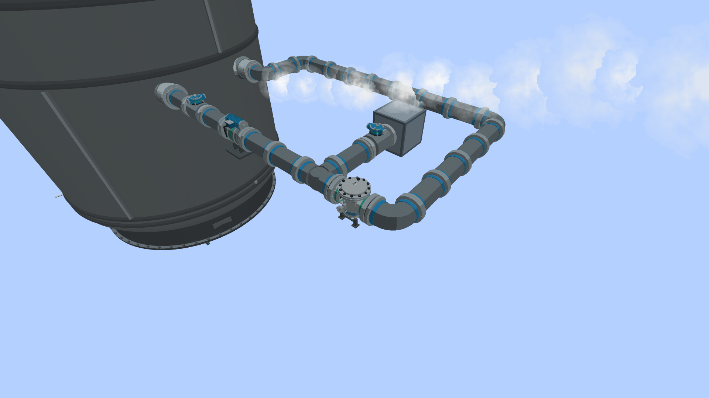
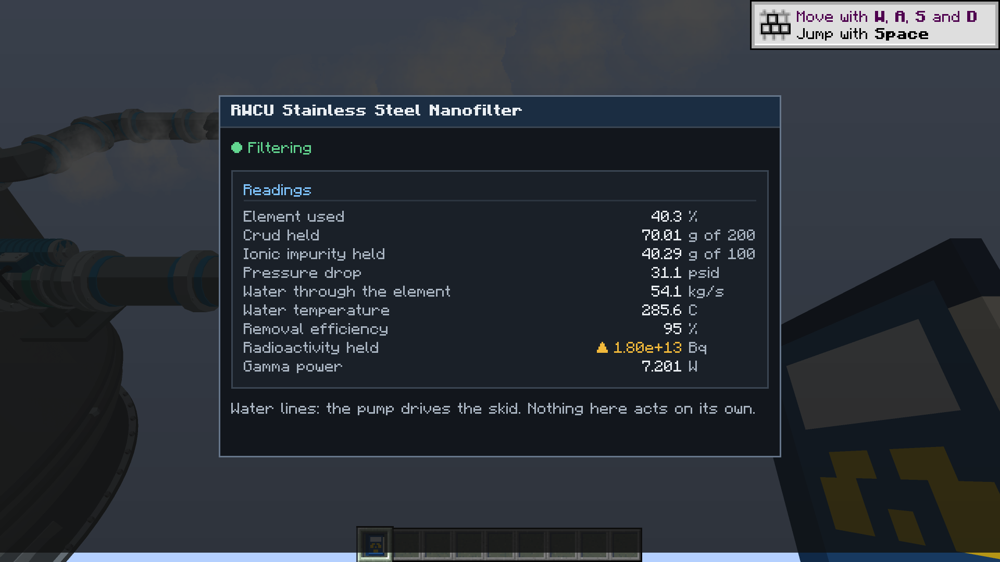
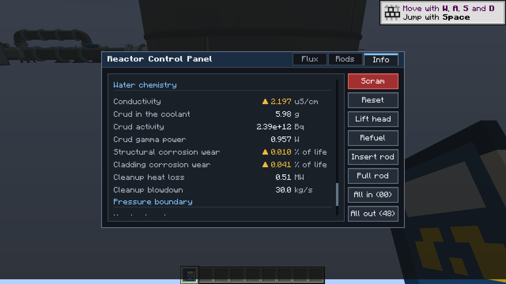

# Reactor water cleanup (RWCU) and coolant chemistry

Two things arrive together: the reactor coolant now has **chemistry** (conductivity and a crud inventory that picks up
activity), and there is a **cleanup skid** to take it out and to drain the vessel in a controlled way. Nothing here acts on the
plant by itself: the pump starts when you start it and nothing isolates anything.

Since alpha.55 the skid's cleanup unit is the **RWCU Stainless Steel Nanofilter**. It replaced the resin filter-demineralizer
(same block id, same saves) and works at full reactor temperature, so the two heat exchangers that used to cool the water
for the resin are now **optional**. A resin bed's 140 F limit, and the damage it did, are gone.

## Coolant chemistry

| Quantity | Meaning |
| --- | --- |
| Conductivity, uS/cm | `0.06 + 2.0 x ppm` of ionic impurity (NaCl equivalent) in the vessel water. A new or old-save plant starts at **0.10 uS/cm**. |
| Crud, g | corrosion product circulating with the water |
| Crud activity, Bq | activity the crud has picked up in the core flux; equilibrium is 1e12 Bq per gram at rated power, reached with a 2 h time constant, decaying only with the Co-60 half life |
| Structural / cladding corrosion wear | two counters, 1 is one life |

**Sources** (all in `dev.bwr.core.chemistry.CoolantChemistry`, calibration, not measurement):

* feedwater: 2 ppb ionic impurity and 0.2 ppb iron times the feedwater flow (at rated 1950 kg/s: 14 g/h and 1.4 g/h);
* condenser in-leakage: 1.5e-4 g/s while the condenser takes its 1900 kg/s reference steam, scaled by what it takes (the mod has no
  river-cooled-condenser tube-leak hook, so this is the "small constant source"; `setCondenserInleakageGPerS` overrides it);
* corrosion of the circuit: 5e-5 g/s of ions and 1e-5 g/s of crud, the crud rising with each uS/cm over 1.

With no cleanup an hour at rated power raises conductivity from 0.10 to about 0.20 uS/cm (the acceptance test measures 0.198) and
makes 1.4 g of crud. With RWCU running at 57 kg/s through a good element it settles near 0.2 uS/cm (0.213 after 24 h).

**Consequences, gentle on purpose.**

* Above **1 uS/cm** (the usual action level) the circuit wears: `(kappa - 1) / 9 x 1e-6` per second of structural wear, added as
  stress to every unbroken exposed pressure-boundary component (so 10 uS/cm is 0.36 of a failure-grade stress per 100 h). It only
  uses up margin: nothing breaks below the overpressure gate. Clean plants add exactly zero.
* Above **0.3 uS/cm** the fuel cladding wears: `(kappa - 0.3) / 3.6e6` per second, a counter only (no model consumes it yet).
* **Activated crud is a radiation source.** Its gamma (`4e-13 W per Bq`) is shared over the vessel's water ports and read through
  `RadiationSources`, behind 0.15 of transmission, so the survey meter and the area monitors read it beside the coolant lines.

Readouts: the reactor screen's **INFO** tab has a *Water chemistry* section (conductivity with caution above 1 and alarm above 10
uS/cm, crud, its activity and gamma, both wear counters, the cleanup's heat loss and blowdown), and the computer has
`reactor.getCoolantChemistry()`: `conductivityUsPerCm`, `ionicImpurityG`, `crudG`, `crudActivityBq`, `crudGammaWatts`,
`structuralWear`, `claddingWear`, `cleanupHeatLossMW`, `cleanupBlowdownKgPerS`. The nanofilter's own readings are on its screen, its
computer peripheral and its Networking Wrench signals (below); the INFO tab does not carry a line for it, because the vessel does not
know which element the pump is pushing water through.

## The equipment

| Block | Flanges (facing north; they rotate with the block) |
| --- | --- |
| **RWCU Pump** (FE, 60 kg/s at 130 psid, 120 kW) | suction south, discharge north |
| **RWCU Stainless Steel Nanofilter** (id `rwcu_filter_demineralizer`) | in north, out south |
| **RWCU Regenerative Heat Exchanger** (optional) | hot in north, hot out south, cold in west, cold out east |
| **RWCU Non-Regenerative Heat Exchanger** (optional, 8 MW) | process in north, out south, cooling water in west (blue), out east (cyan) |
| **RPV Bottom Head Drain Port** | a vessel port for the lowest two rows of a side wall, flange facing out |
| **Stainless Steel Nanofilter Element** (craftable: iron ingots, iron nuggets and iron bars; item id `demineralizer_resin`) and **Spent Nanofilter Element** (radioactive waste; item id `spent_resin`) | |

The nanofilter is a vertical filter housing with a bolted top closure, an inlet and an outlet flange, a differential-pressure gauge, a
nameplate and a capped drain at the bottom (the real units backwash; this one is changed out, see below).

```text
vessel (recirculation outlet and/or bottom drain port) -> [valve] -> pump
  -> [ regenerative HX (hot side) ] -> [ non-regenerative HX ] -> tee -> nanofilter
  -> [ regenerative HX (cold side) ] -> a feedwater (water injection) port of the same vessel
                       tee -> [valve] -> Condensate Storage Tank or condenser   (blowdown)
```

The two exchangers are optional (square brackets) but come in this order: regenerator, then cooler, then the nanofilter. A regenerator
used on its hot side must be used on its cold side too (the nanofilter's outlet goes through it); without one, the nanofilter's
outlet pipes straight to the feedwater port. The blowdown tee may hang off any hop ahead of the nanofilter. A pipe that ends at the wrong
machine face makes the circuit invalid and the pump moves nothing (its screen says why). Valves in a hop (Motor-Operated Water Valves)
throttle the flow by their opening.
The pump finds its circuit with the same cached pipe survey every machine uses, and only in loaded chunks; there is no ticker on
the exchangers or the nanofilter (the pump's tick steps them), and the cooler's ticker only pushes its heated cooling water out.

**Control.** Redstone, the panel screen (right-click the pump: speed and start/stop, "Controlled by redstone / this panel /
a computer"), or a computer (`bwr_rwcu_pump`: `start`, `stop`, `setSpeed`, `releaseControl`, `getStatus`).

## Physics

All on one enthalpy balance (`dev.bwr.core.chemistry.RwcuLoop`). The pump draws `F` kg/s of saturated vessel water at `h_v`. All of it
goes through the hot side of the regenerative exchanger (effectiveness 0.92 on the lower capacity rate, if there is one) and the
non-regenerative one (if there is one), which cools it to `h_x`. A share `B` is rejected at the tee (blowdown, split by the valve
openings: `B = F x o_reject / (o_bed + o_reject)`; the flow is throttled by `min(1, o_bed + o_reject)`); the rest, `F - B`, goes through
the nanofilter at `h_x`, back through the cold side (re-heated to `h_ret`) and into the vessel through the feedwater port.

```text
Q_r   = eps (F - B) (h_v - h_x)              eps is 0 with no regenerator
h_x   = h_v - Q_c / (F - eps (F - B))        Q_c is what the cooler can remove: at most the rating, the cooling water it holds,
                                             and no more than brings the water to 120 F; 0 with no cooler
h_ret = h_x + Q_r / (F - B)
F h_v = (F - B) h_ret + B h_x + Q_c          (energy closes)
```

**What the vessel is charged** (no double counting): the water drawn and returned is not a flow; the blowdown `B` leaves as saturated
liquid like any other liquid sink (it is a separate input, `ReactorCore.addCleanupLoop`, and is not water on the drywell floor); the heat is
`(F - B)(h_v - h_ret)`, the same sink channel the RHR loop uses. At 285 C and the pump's rated 60 kg/s, a cooler that can supply its duty
returns the water at 267 C and the vessel loses **4.96 MW** (62 MW without the regenerator); all of it goes to the cooling water.
If cooling water is short `h_x` rises: with 2 MW of cooling the nanofilter sees about 190 C, with none, vessel temperature.

**Without the exchangers.** A loop with no regenerator and no cooler is the simplest one: the pump, the nanofilter and the return pipe.
The water goes round at reactor temperature and **the vessel loses no heat at all** (`h_x = h_v = h_ret`, nothing for the cooling
water). A cooler without a regenerator takes up to its 8 MW from the vessel and the nanofilter sees the water it could not cool; a
regenerator without a cooler has nothing to recover (both sides are as hot as the vessel). The exchangers buy only the heat the cleanup
returns to the vessel (4.96 MW lost instead of 62 MW at full cooling) and a cooler nanofilter; the nanofilter itself does not care.

**What the element removes.** The element removes 95% of the dissolved ionic impurity and 90% of the crud passing it, at any water
temperature, until it is full: it holds 100 g of ions (its ion efficiency fades out over the last fifth) and 200 g of crud. An element that has taken
its 100 g of ions removes no ions, and one full of crud takes no more crud. The blowdown takes impurity out with its water, in proportion.
The removed crud's activity stays in the element.

**Pressure drop.** The cake of crud on the fibres costs pressure: a new element is 5 psid at the pump's rated 60 kg/s and one full of
crud 100 psid, in proportion to the crud it holds and quadratic in flow. Dissolved ions add none. The pump meets it on its own curve (the
loop is a system curve; the filter's resistance adds to it), so a crud-loaded element lowers the flow through the whole loop: a full one
costs about a fifth of it (49 kg/s of 60) and does not stop it. The readout shows the pressure drop at the current flow.

**Changing the element.** Right-click the nanofilter with a Stainless Steel Nanofilter Element. The old one comes out as a **Spent
Nanofilter Element**: radioactive waste that carries the activity of the crud it caught (the survey meter reads it on whoever carries it,
and the element in service is a gamma source too). A new element is left alone. Nothing disposes of the waste for you.

**No temperature limit.** The 140 F limit of the resin, the permanent damage above it, the release of what the bed held, and the
"hot resin" warnings are gone. If the cooler loses its cooling water, the nanofilter simply works on hot water (the screen shows the
temperature, with no alarm).

**Real plants and this one, honestly.** In real plants dissolved ions need ion exchange; the mod's nanofilter does both (ions and crud) for
simplicity. The owner wanted one cleanup unit with no temperature trap, so the mod gives it one element that takes both at 285 C. See the
REFERENCES below for what is real: sintered stainless steel is, and so is a titanium-oxide inorganic adsorber for cobalt at 285 C; a
"nanometal particle" BWR cleanup technology is not something this research found, and the mod does not claim it.

## Bottom drain and blowdown

Open the reject valve and the vessel level falls: the rejected water goes to the Condensate Storage Tank (or condenser) in whole
millibuckets with the remainder carried, and a full tank blocks the reject. The water is delivered **at the temperature it has at the
tee**: 49 C behind a working cooler, vessel temperature in a loop without exchangers. A real hot blowdown into a tank at atmospheric
pressure would flash to steam; the mod keeps no steam in a tank and does not model it, so hot blowdown just fills the tank with hot water.
With the bottom drain port as the pump's suction the vessel can be
drained below the recirculation outlets, right down to the port: **a suction port draws nothing once the water has fallen to its
elevation** (geometry, the same mapping the LOCA code uses), so a recirculation outlet in the upper half of the wall stops drawing
sooner than the drain port.

## Pressure boundary

The RWCU lines are boundary lines to the LOCA code exactly as the recirculation and feedwater lines are, because they attach to the
same vessel ports: the **suction** to a recirculation outlet (a recirculation line break) and the **return** to a water injection
port (a feedwater line break). A pipe taken out anywhere between the port and the pump (or the regenerator's cold outlet, or the
nanofilter's outlet in a loop without one) drains the vessel through that port until a closed Motor-Operated Water Valve between the
break and the vessel isolates it; opening it starts the leak again; putting the pipe back seals it. The **bottom drain port** counts as
a feedwater-class line with a small bore (a quarter of a feedwater nozzle's opening, labelled *RWCU bottom drain line*); an overpressure
failure never picks it as the broken nozzle while any other feedwater port exists.

## Readouts and signals

* The nanofilter's **screen** (right-click): element used, crud held, ionic impurity held, pressure drop, water through it, water
  temperature, removal efficiency, radioactivity held and its gamma power, with a headline (filtering, idle, spent, no element).
* **Computer:** `bwr_rwcu_filter_demineralizer` (the id kept) reports the same, and `elementUsed`, `elementPresent`, `ionicLoadG`,
  `crudLoadG`, `pressureDropPsid`, `activityBq`, `gammaWatts`. The pump's `getStatus` adds `filterPressureDropPsid`. (`resinUsed`,
  `heatDamage` and `overTemperature` of alpha.54 are gone with the resin.)
* **Networking Wrench / panels:** signals `element_used`, `crud_held`, `ions_held`, `pressure_drop`, `flow`, `water_temperature`,
  `activity`, `gamma_power`, `element_present`, `spent`, `filtering` (see SIGNALS.md). They only read.

## Saves and old worlds

The chemistry is saved beside the core (key `Chemistry`, only when it differs from a clean plant) and old saves load clean at
0.10 uS/cm. The nanofilter saves its element only when it is not new and the cooler its cooling water only when it holds some; a
new nanofilter has a new element. **Alpha.54 worlds load:** the block id, the item ids and the NBT key `Bed` (five numbers: present, ions,
crud, activity, and the resin's heat damage) are unchanged, so a saved filter-demineralizer with a resin bed loads as a nanofilter with the same
loading (the damage number is read and dropped, and a resaved element writes 0 there). A Demineralizer Resin item in an inventory is now a
Stainless Steel Nanofilter Element and a Spent Demineralizer Resin a Spent Nanofilter Element, with the activity it carried. The item
ids were kept rather than adding new items: nothing in a world had to be converted, a recipe and an icon changed, and there is one
item pair, not two.

## Tests

* `:core:acceptance`: `ReactorWaterCleanupTest` (rise without cleanup, balance with it, exhaustion, an element that works at 285 C and is
  not damaged, the regenerator, energy closure, lost cooling, the finite cooling water, blowdown and heat in the core, crud gamma,
  conductive wear, clean restore) and `NanofilterTest` (ions and crud at 285 C, no temperature effect, loading raising the pressure drop and
  lowering the loop flow, spent at capacity, the loop with no exchangers and its energy balance, an old resin bed loading).
* GameTests `RwcuTests`: the whole skid on a real vessel, each behaviour above, the line breaks and isolation, saves and old saves; the
  loop with no exchangers and with each exchanger alone, hot blowdown, the pressure drop and flow, the spent element, a saved alpha.54 bed.
* Models: `art/models/rwcu/build_models.py` (headless Blender) and `python tools-export-rwcu.py [--check]`; the item textures,
  `python tools-make-nanofilter-assets.py`.




In the game (client check `:mod:runTurbineModelCheck -PbwrRwcuClientCheck`, 1920 x 1080): the skid piped to the vessel and to its feedwater
port, with the reject valve and tank; the pump's screen with the loop running; the nanofilter's screen with a loaded element; the INFO
tab's water chemistry; and a second loop with no exchangers, the nanofilter on reactor-hot water, with its screen.









## REFERENCES

The owner asked for a filter that survives 500 F and more, "with nanometal particles like in some new plants". What the search found
(all pages read, none of them a binary download; vendor figures are vendor claims, not independent tests):

**Real: sintered stainless steel as the filter medium in RWCU.** Sintered 316L metal is a real RWCU filter material. The plants'
"filter-demineralizer" is a *precoat* unit: powdered resin is laid on a porous septum, and the septum is sintered stainless steel.

* Graver Technologies, advanced stainless steel backwashable precoat septa for reactor water cleanup: 316L sintered metal (Poroplate),
  pores 2 to 200 micron, operating temperature to 1000 F.
  <https://www.gravertech.com/blog/graver-technologies-introduced-new-line-of-advanced-stainless-steel-backwashable-precoat-septa-for-reactor-water-cleanup>
* Porvair Filtration Group, Sinterflo MC septa marketed for nuclear use including RWCU: 316L sintered mesh, pores 1 to 200 micron,
  -50 C to 550 C (Filtration + Separation trade-press news item, and the maker's catalogue).
  <https://www.filtsep.com/content/news/porvair-releases-filter-elements-for-nuclear-power> and
  <https://pdf.directindustry.com/pdf/porvair/sinterflo-mc/57896-946855.html>
* Bekaert, Bekipor sintered metal fibre media (316L, Inconel, Fecralloy; to 1000 C in hot-gas service) used for nuclear safety
  filtration "for more than 30 years"; its HEPA grade is rated at 0.1 to 0.3 micron. This is the real "fine metal fibre" medium, but the
  nuclear references are for gas filters, not RWCU water.
  <https://www.bekaert.com/en/filtration/resources/product-sheets/leading-the-way-to-safe-nuclear-filtration> and
  <https://www.bekaert.com/en/products/basic-materials/filtration/bekipor-hepa-ulpa-filter-media>

What these are **not**: they take particles. They are not ion exchangers, and the normal plant cools the water to about 50 to 60 C first
because the resin precoat on them is destroyed above about 60 C. A Hitachi patent states the problem plainly: the heat resistant temperature of the
ion exchange resin is about 60 C, so the reactor coolant (about 280 C in a BWR) is cooled, cleaned and reheated, which complicates
the plant and loses heat. <https://patents.google.com/patent/US4587232>

**Real: a hot inorganic adsorber, for cobalt, not a general demineraliser.** Hitachi's titanium oxide on sponge titanium is an inorganic
adsorbent for cobalt in hot reactor water: the patent reports cobalt adsorption at 285 C about 20 times that at room temperature and
decontamination factors of 1000 or more for Co-58 and Co-60 in a column test; Kawamura, Funabashi, Kikuchi and Ohsumi tested it for
285 C and 70 kg/cm2 and in plant tests with real reactor water (Nuclear Technology, vol. 65, no. 2, 1984, pp. 332 to 339).
<https://wx1.ans.org/pubs/journals/nt/a_33415> and <https://patents.google.com/patent/US4587232>. It takes Co2+, Ni2+ and Cu2+; it does not
remove salts the way a mixed resin bed does, so it does not stand in for the demineraliser in a real plant. A 1990 report of titanium-based
inorganic sorbent filters for corrosion products in 150 to 300 C coolant, with a unit at the Beloyarsk plant (iron removal 50 to 95%, Co-60
50 to 70%), is a hot-filtration precedent for a different reactor. <https://inis.iaea.org/records/22j97-e8261> (record only; the full text
was not available).

**Real, and tried: high-temperature magnetic filtration** of BWR crud (magnetite and nickel ferrite are magnetic): K. Harding, "High
temperature magnetic filtration of crud from primary circuit coolant of BWRs", Water Chemistry of Nuclear Reactor Systems, British Nuclear
Energy Society, 1978 (a prototype unit was built and run; the chapter is paywalled, so only its headings were read).
<https://www.emerald.com/books/book/10837/chapter/80490466/38-High-temperature-magnetic-filtration-of-crud>. Hot filtration of crud also appears
in a US patent on crud scavenging, which notes it would need an expensive retrofit of existing plants: <https://patents.google.com/patent/US4842812>.

**Not found: nanometal particles.** No BWR cleanup technology that uses metal nanoparticles turned up. The "nano" that is real is the crud:
in a study of BWR condensate (Nuclear Technology, ANS abstract) most particles by number were submicron and colloidal (about 75% under
0.1 micron), while particles over 1 micron made most of the mass, so a filter that holds about a micron catches most of the mass and passes
many of the particles. <https://wx1.ans.org/pubs/journals/nt/a_34833> The titanium oxide above is a micro-porous coating, not a nanoparticle suspension. The
zirconia particles of the crud-scavenging patent are 10 micron. So the mod's **Stainless Steel Nanofilter** takes its metal from
sintered stainless fibre (real) and its name from the owner; the "nano" does not describe a real BWR product, and the element's ability to take dissolved ions
as well as crud at 285 C is a deliberate game simplification, not a real plant's.
