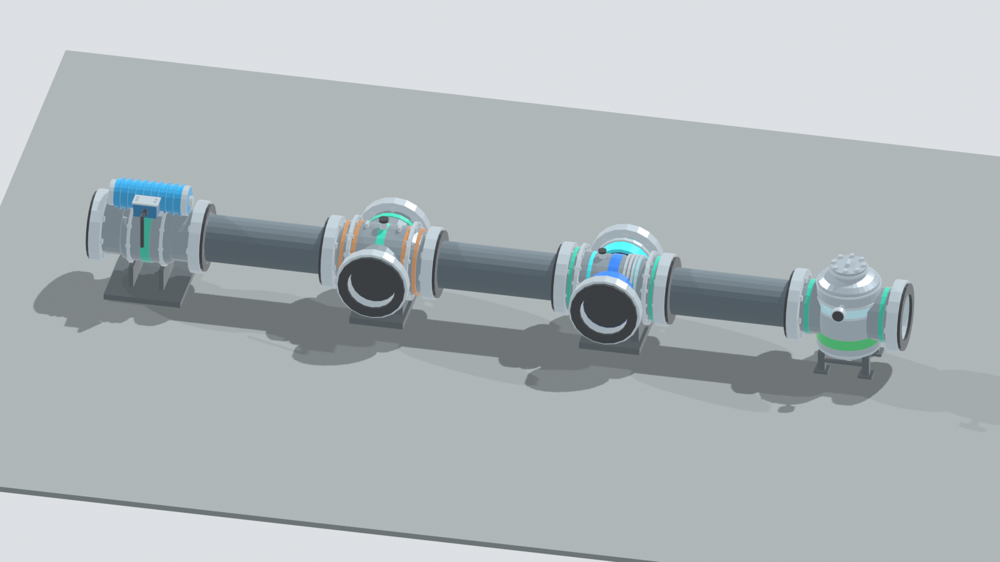

# Reactor Water Cleanup (RWCU) and coolant chemistry

Two things arrive together: the reactor coolant now has **chemistry** (conductivity and a crud inventory that picks up
activity), and there is a **cleanup skid** to take it out and to drain the vessel in a controlled way. Nothing here acts on the
plant by itself: the pump starts when you start it, nothing isolates anything, and an overheated resin bed is a
consequence, not a trip.

## Coolant chemistry

| Quantity | Meaning |
| --- | --- |
| Conductivity, uS/cm | `0.06 + 2.0 x ppm` of ionic impurity (NaCl equivalent) in the vessel water. A new or old-save plant starts at **0.10 uS/cm**. |
| Crud, g | corrosion product circulating with the water |
| Crud activity, Bq | activity the crud has picked up in the core flux; equilibrium is 1e12 Bq per gram at rated power, reached with a 2 h time constant, decaying only with the Co-60 half life |
| Structural / cladding corrosion wear | two counters, 1 is one life |

**Sources** (all in `dev.bwr.core.chemistry.CoolantChemistry`, calibration, not measurement):

* feedwater: 2 ppb ionic impurity and 0.2 ppb iron times the feedwater flow (at rated 1950 kg/s: 14 g/h and 1.4 g/h);
* condenser in-leakage: 1.5e-4 g/s while the condenser takes its 1900 kg/s reference steam, scaled by what it takes (the mod has no
  river-cooled-condenser tube-leak hook, so this is the "small constant source"; `setCondenserInleakageGPerS` overrides it);
* corrosion of the circuit: 5e-5 g/s of ions and 1e-5 g/s of crud, the crud rising with each uS/cm over 1.

With no cleanup an hour at rated power raises conductivity from 0.10 to about 0.20 uS/cm (the acceptance test measures 0.198) and
makes 1.4 g of crud. With RWCU running at 57 kg/s through a good bed it settles near 0.2 uS/cm (0.213 after 24 h).

**Consequences, gentle on purpose.**

* Above **1 uS/cm** (the usual action level) the circuit wears: `(kappa - 1) / 9 x 1e-6` per second of structural wear, added as
  stress to every unbroken exposed pressure-boundary component (so 10 uS/cm is 0.36 of a failure-grade stress per 100 h). It only
  uses up margin: nothing breaks below the overpressure gate. Clean plants add exactly zero.
* Above **0.3 uS/cm** the fuel cladding wears: `(kappa - 0.3) / 3.6e6` per second, a counter only (no model consumes it yet).
* **Activated crud is a radiation source.** Its gamma (`4e-13 W per Bq`) is shared over the vessel's water ports and read through
  `RadiationSources`, behind 0.15 of transmission, so the survey meter and the area monitors read it beside the coolant lines.

Readouts: the reactor screen's **INFO** tab has a *Water chemistry* section (conductivity with caution above 1 and alarm above 10
uS/cm, crud, its activity and gamma, both wear counters, the cleanup's heat loss and blowdown), and the computer has
`reactor.getCoolantChemistry()`: `conductivityUsPerCm`, `ionicImpurityG`, `crudG`, `crudActivityBq`, `crudGammaWatts`,
`structuralWear`, `claddingWear`, `cleanupHeatLossMW`, `cleanupBlowdownKgPerS`.

## The equipment

| Block | Flanges (facing north; they rotate with the block) |
| --- | --- |
| **RWCU Pump** (FE, 60 kg/s at 130 psid, 120 kW) | suction south, discharge north |
| **RWCU Regenerative Heat Exchanger** | hot in north, hot out south, cold in west, cold out east |
| **RWCU Non-Regenerative Heat Exchanger** (8 MW) | process in north, out south, cooling water in west (blue), out east (cyan) |
| **RWCU Filter-Demineralizer** | in north, out south |
| **RPV Bottom Head Drain Port** | a vessel port for the lowest two rows of a side wall, flange facing out |
| **Demineralizer Resin** (craftable item: slime ball, charcoal, quartz makes 2) and **Spent Demineralizer Resin** (radioactive waste) | |

```text
vessel (recirculation outlet and/or bottom drain port) -> [valve] -> pump
  -> regenerative HX (hot side) -> non-regenerative HX -> tee -> filter-demineralizer
  -> regenerative HX (cold side) -> a feedwater (water injection) port of the same vessel
                       tee -> [valve] -> Condensate Storage Tank or condenser   (blowdown)
```

Machines may stand directly against each other or be piped; a pipe that ends at the wrong machine face makes the circuit invalid
and the pump moves nothing (its screen says why). Valves in a hop (Motor-Operated Water Valves) throttle the flow by their opening.
The pump finds its circuit with the same cached pipe survey every machine uses, and only in loaded chunks; there is no ticker on
the exchangers or the demineraliser (the pump's tick steps them), and the cooler's ticker only pushes its heated cooling water out.

**Control.** Redstone, the panel screen (right-click the pump: speed and start/stop, "Controlled by redstone / this panel /
a computer"), or a computer (`bwr_rwcu_pump`: `start`, `stop`, `setSpeed`, `releaseControl`, `getStatus`).

## Physics

All on one enthalpy balance (`dev.bwr.core.chemistry.RwcuLoop`). The pump draws `F` kg/s of saturated vessel water at `h_v`. All of it
goes through the hot side of the regenerative exchanger (effectiveness 0.92 on the lower capacity rate) and the non-regenerative one,
which cools it to `h_x`. A share `B` is rejected at the tee (blowdown, split by the valve openings: `B = F x o_reject / (o_bed + o_reject)`;
the flow is throttled by `min(1, o_bed + o_reject)`); the rest, `F - B`, goes through the resin at `h_x`, back through the cold side
(re-heated to `h_ret`) and into the vessel through the feedwater port.

```text
Q_r   = eps (F - B) (h_v - h_x)
h_x   = h_v - Q_c / (F - eps (F - B))        Q_c is what the cooler can remove: at most the rating, the cooling water it holds,
                                             and no more than brings the water to 120 F
h_ret = h_x + Q_r / (F - B)
F h_v = (F - B) h_ret + B h_x + Q_c          (energy closes)
```

**What the vessel is charged** (no double counting): the water drawn and returned is not a flow; the blowdown `B` leaves as saturated
liquid like any other liquid sink (it is a separate input, `ReactorCore.addCleanupLoop`, and is not water on the drywell floor); the heat is
`(F - B)(h_v - h_ret)`, the same sink channel the RHR loop uses. At the rated 285 C and 57 kg/s, a cooler that can supply its duty
returns the water at 267 C and the vessel loses **4.96 MW** (62 MW without the regenerator); all of it goes to the cooling water.
If cooling water is short `h_x` rises: with 2 MW of cooling the resin sees about 190 C, with none, vessel temperature.

**Impurity.** The bed removes 95% of the ionic impurity and 90% of the crud passing it, until it is full: it holds 100 g of ions
(its efficiency fades out over the last fifth) and 200 g of crud. A bed that has taken its 100 g removes nothing. The blowdown
takes impurity out with its water, in proportion. The removed crud's activity stays in the bed.

**Hot resin.** Above 140 F (60 C) the resin decomposes at `(dT / 40 K)^2 / 600 s` of the bed per second: that share of its capacity is lost
for good and the share of the captured impurity it can no longer hold is released into the water. No alarm acts on the plant;
the demineraliser's screen, the pump's status and the computer say so.

## Bottom drain and blowdown

Open the reject valve and the vessel level falls: the rejected water goes to the Condensate Storage Tank (or condenser) in whole
millibuckets with the remainder carried, and a full tank blocks the reject. With the bottom drain port as the pump's suction the vessel can be
drained below the recirculation outlets, right down to the port: **a suction port draws nothing once the water has fallen to its
elevation** (geometry, the same mapping the LOCA code uses), so a recirculation outlet in the upper half of the wall stops drawing
sooner than the drain port.

## Pressure boundary

The RWCU lines are boundary lines to the LOCA code exactly as the recirculation and feedwater lines are, because they attach to the
same vessel ports: the **suction** to a recirculation outlet (a recirculation line break) and the **return** to a water injection
port (a feedwater line break). A pipe taken out anywhere between the port and the pump (or the regenerator's cold outlet) drains
the vessel through that port until a closed Motor-Operated Water Valve between the break and the vessel isolates it; opening it starts
the leak again; putting the pipe back seals it. The **bottom drain port** counts as a feedwater-class line with a small bore (a quarter of
a feedwater nozzle's opening, labelled *RWCU bottom drain line*); an overpressure failure never picks it as the broken nozzle while any other
feedwater port exists.

## Saves and old worlds

The chemistry is saved beside the core (key `Chemistry`, only when it differs from a clean plant) and old saves load clean at
0.10 uS/cm. The demineraliser saves its bed only when it is not fresh and the cooler its cooling water only when it holds some; a new
demineraliser has a fresh bed. No existing block, ID or NBT key changed.

## Tests

* `:core:acceptance`: `ReactorWaterCleanupTest` (rise without cleanup, balance with it, exhaustion, hot-resin damage, the regenerator,
  energy closure, lost cooling, the finite cooling water, blowdown and heat in the core, crud gamma, conductive wear, clean restore).
* GameTests `RwcuTests`: the whole skid on a real vessel, each behaviour above, the line breaks and isolation, saves and old saves.
* Models: `art/models/rwcu/build_models.py` (headless Blender) and `python tools-export-rwcu.py [--check]`.


