# Enclosed suppression tanks and RHR cooling

Build a hollow concrete tank with a complete floor, four walls and a roof.
The concrete panels, water flanges, new steam flange and exchanger models are
authored in Blender. Existing open concrete and dug pools remain compatible.

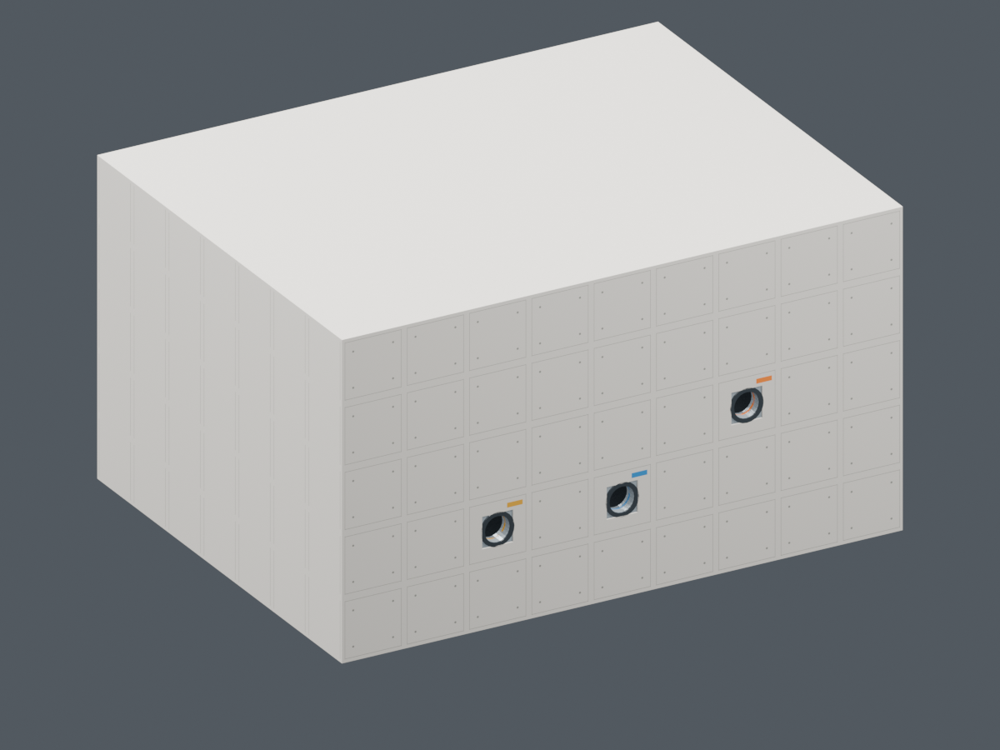

## Build the tank

1. Build the shell from **Suppression Pool Concrete**. Outside width/depth:
   **5–25 blocks** each; outside height: **4–16 blocks**. Use at least **64
   hollow interior cells**, so not every minimum-dimension combination qualifies.
2. Replace one shell block with a **Suppression Pool Controller**.
3. Fit a **Suppression Tank Steam Inlet**, **Suppression Pool Suction Port**
   and **Suppression Pool Return / Fill Port** in the side walls. Flanges must
   face outward, above the floor and below the roof. Multiple ports share storage.
4. Leave the inside empty. The tank forms automatically, normally within a
   second after a shell edit; allow five seconds if it was previously unformed.
   Sneak-click the controller for build details. Keep different tank shells separate.
5. New tanks start **empty**. Pump water into the amber return/fill port.
   Minecraft water sources inside do not fill the metered inventory.
6. Connect **High-Pressure Steam Pipe** or optional **Mekanism Pressurized Tube**
   to the steam inlet's round front flange. An internal sparger is represented
   by this port; separate submerged quencher blocks are unnecessary in a tank.

A **9 wide × 5 high × 7 deep** tank has 7 × 3 × 5 interior cells and **105,000 kg**
capacity. Each cell adds 1,000 kg. Use pumped water above the 5% suction floor
for a submerged relief-valve/pump-exhaust path. An empty tank is not a heat sink.

The controller receives actual steam enthalpy from BWR lines; incoming steam
heats the water and condensed mass joins the tank. Mekanism chemicals carry no
temperature, so that boundary uses saturated atmospheric steam. A shared
**10,000 kg steam buffer** accepts at most **2,000 kg/s** across all wall inlets.
Stop/control valves govern direct steam lines; relief valves retain their own
discharge accounting. The same steam cannot be claimed twice through an inlet.

Breaking a required wall or roof disables ports until repaired and leaves the
other construction blocks in place. Water, heat, buffered steam and spray supply
survive repair and controller replacement. All tank chunks must be loaded.
An established enclosed tank cannot become an open basin by breaking its roof.
Existing open pools can be upgraded by adding a complete roof and steam port.

The GUI reports **Steam received**, **Steam inlet buffer** and water temperature
to two decimal places. CC:Tweaked `getStatus()` additionally exposes
`enclosed`, `steamPorts`, `steamInKgPerS` and `steamBufferKg`.

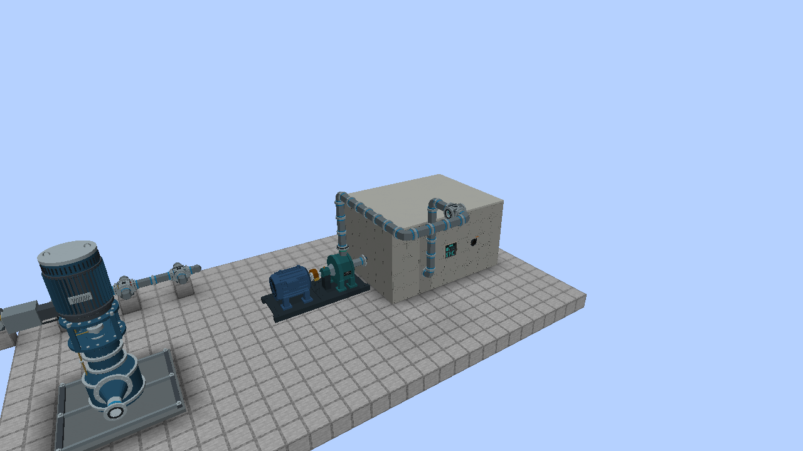

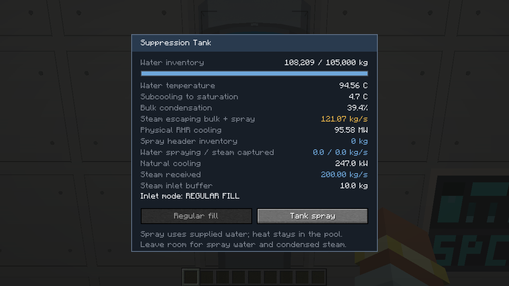

## Regular fill and tank spray

The spray hardware operates inside the enclosed shell; legacy open pools show
the overhead spray rail above their water surface.

Right-click the controller or a water/steam port and choose an inlet mode:

- **Regular fill:** incoming water mixes directly into the pool.
- **Tank spray:** the same inlet supplies the modeled riser and overhead
  nozzle rail. A shared **6,000 kg header** meters up to **600 kg/s** into the
  pool. The header is finite and reserves space against the basin's capacity;
  extra return ports do not multiply its flow or storage limits.

Cold droplets can capture part of the steam that the hot bulk pool fails to
condense. Capture is limited by incoming steam, actual spray-water mass and the
water's heat margin to one degree below local saturation. Warm supply captures
less; supply at/above that temperature captures none. Spray water and captured
steam join the pool with their heat. Spray does **not** destroy heat or replace
RHR cooling. Switching back to fill drains held spray water into the pool without
losing it. Leave capacity for incoming water and condensate; a full basin refuses
new supply. Condensation above nominal capacity is retained in the inventory,
with the rendered surface capped below the rim; spilling is not simulated.

The panel reports water level, temperature, bulk condensation, escaping steam,
physical RHR cooling, header inventory, spray flow and steam captured. CC:Tweaked:

```lua
pool.setFillMode("fill")  -- or "spray"; operator-selected, no automatic start
print(pool.getFillMode())
local status = pool.getStatus()
print(status.sprayHeaderKg, status.sprayFlowKgPerS, status.sprayCondensedKgPerS)
```

Supply water uses its transported temperature; untagged external water enters
at **13 C**. BWR water pipes preserve the supplied enthalpy. The spray
calculation handles currently arriving steam escaping the bulk pool; there is
no stored containment steam atmosphere or containment-pressure simulation yet.
The physical closed RHR/exchanger circuit remains a separate heat-removal path;
it does not count as externally supplied spray water.

## Natural cooling

A formed pool now loses heat gradually to a fixed **25 C ambient** while its
chunks are ticking. No pump, power, water injection or operator command is
required. Hotter water loses heat faster; exposed water area, wetted walls/floor
and stored water mass determine the rate. Cooling slows as the pool approaches
ambient and never takes it below ambient. Colder supplied water is not warmed
by this cooling-only approximation.

This is a simple game model: effective surface and shell conductances are
100 and 25 W/(m2 K), respectively. It does not simulate evaporation, water loss,
biome temperature, warming containment air or cooling while unloaded. Enclosed tanks exchange heat through the shell and roof, without the open-water surface term. Both
concrete and legacy dug pools receive passive cooling. Concrete wetted wall
area follows the pumped level; legacy boundary areas are cached during scans.

For scale, a full **open** 9x5x7 basin containing 105,000 kg at 80 C cools to approximately
**77.3 C after one simulated hour**, with no incoming heat. RHR is still the
much stronger cooling path during steam discharge. The panel shows **Natural
cooling** in kW; CC:Tweaked exposes `getStatus().passiveCoolingMW` and
`getStatus().ambientTemperatureC`. RHR energy accounting remains separate.

## Direct LPCI/RHR connection

Connect the **blue suction flange** to the modeled **LPCI/RHR pump's suction**,
either touching it directly or using High-Pressure Water Pipe.

- For reactor injection, connect the pump discharge to an RPV Water Injection
  Port and use the pump's vessel-injection mode.
- For direct pool circulation, connect discharge to the **amber basin return**,
  choose suppression-pool suction and pool-cooling mode, supply FE, then start
  the pump. **Direct circulation adds no cooling of its own**; the pool's slow
  natural cooling continues independently.
- The basin return accepts ordinary water; the suction port only allows
  extraction above the pool's existing suction floor. Both expose directional
  NeoForge water capabilities, including for Mekanism Mechanical Pipes.

## Shell-and-tube heat exchanger (four flanges)

The single-block RHR heat exchanger (every exchanger placed before alpha.55; new placements build the [full-size unit](#full-size-exchanger-3-x-8-x-3-multiblock)) is drawn as a horizontal shell-and-tube exchanger: a cladded shell on two saddles, a
bolted channel head (bonnet) at each end, a flanged nozzle on every circuit, a vent on top, a drain underneath, lifting
lugs and a plain nameplate. It keeps the registry id `bwr:rhr_heat_exchanger`, the same four flange faces and the same
saved data as the plate exchanger it replaced, so exchangers already standing in a world take the new model and keep
every pipe connected to them.

| Identification band | Side | Circuit | Connection |
| --- | --- | --- | --- |
| Red | Tube side, channel head nozzle | Pool or vessel water IN | RHR pump discharge |
| Amber | Tube side, channel head nozzle | Pool or vessel water OUT | Return to the same suppression basin (or vessel) |
| Blue | Shell side, shell nozzle | Cooling water IN | Makeup pump from the screened intake, or any cold supply |
| Cyan | Shell side, shell nozzle | Cooling water OUT | **Water Outlet Chute** back to the river or lake, or a line to a cooling tower |

When its red flange faces north, amber faces south, blue west and cyan east. Placement rotates all four together. Top and
bottom are not water connections (the vent and drain are only drawn).

```text
pool suction -> powered RHR pump -> RED [tube side] AMBER -> pool return
                                            || heat (shell and tube wall)
river -> screened intake -> makeup pump -> BLUE [shell side] CYAN -> water outlet chute -> river
```

Use **BWR High-Pressure Water Pipe for the complete primary pool loop**. The
exchanger recognizes a running modeled RHR pump and a return to that same basin;
its primary circuit circulates pool water without creating another copy of the
pool inventory. Primary exchanger flanges do not expose generic fluid tanks.
Use one RHR pump per exchanger; parallel cooling trains can share the basin.

The shell-side flanges accept BWR water pipes or NeoForge-compatible fluid pipes,
including Mekanism. Supply cold water to blue and drain heated water at cyan.
The exchanger pushes its hot outlet into an adjacent accepting pipe or tank;
it does not pull water from an unpumped remote source. Keep the two circuits
separate when routing pipes. Crossed or incomplete primary plumbing stops RHR
delivery. No water crosses between the circuits.

The exchanger is passive and needs no FE of its own. RHR pumping and any
cooling-water pump/fan still require their usual energy and player commands.
Right-click the exchanger for the tube-side and shell-side inlet and outlet
temperatures, both flows, the duty in MW, the water held on each side and a
warning when the heated cooling water is backing up. Right-click a basin water port to open its pool panel.
The concrete pool panel displays physical exchanger cooling instead of the old
abstract cooling-duty slider. Existing pump local and CC controls still apply.

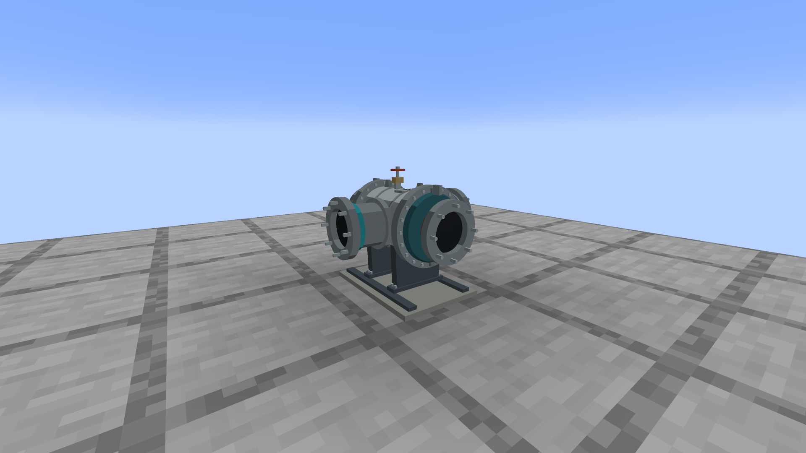
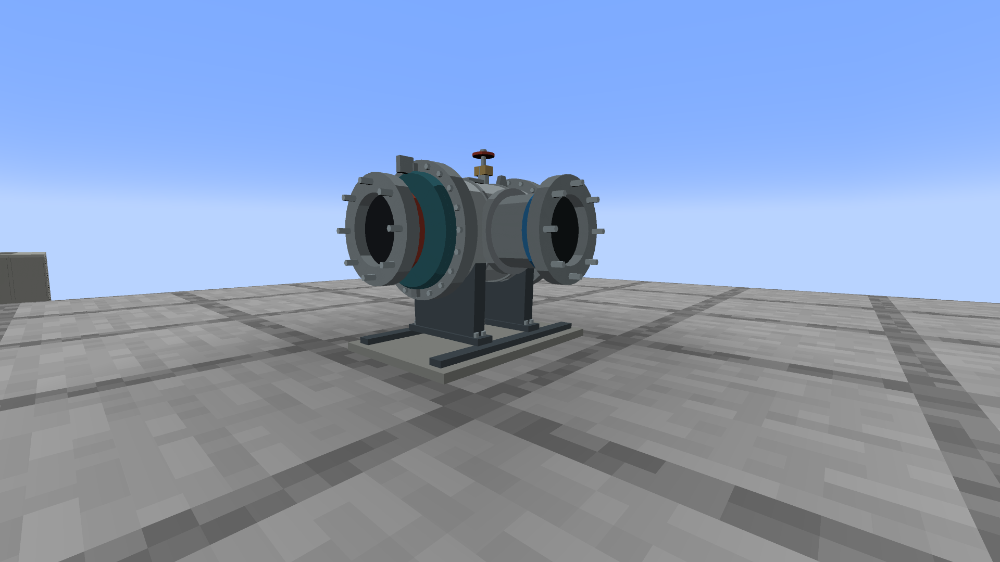
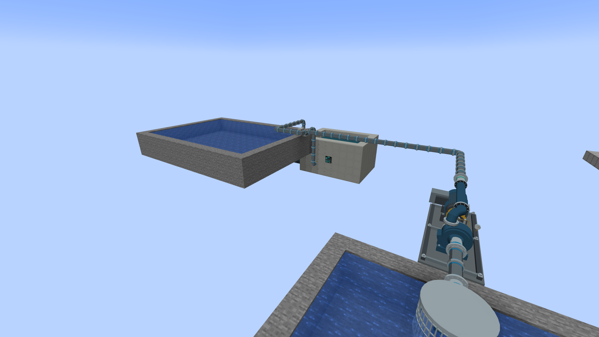
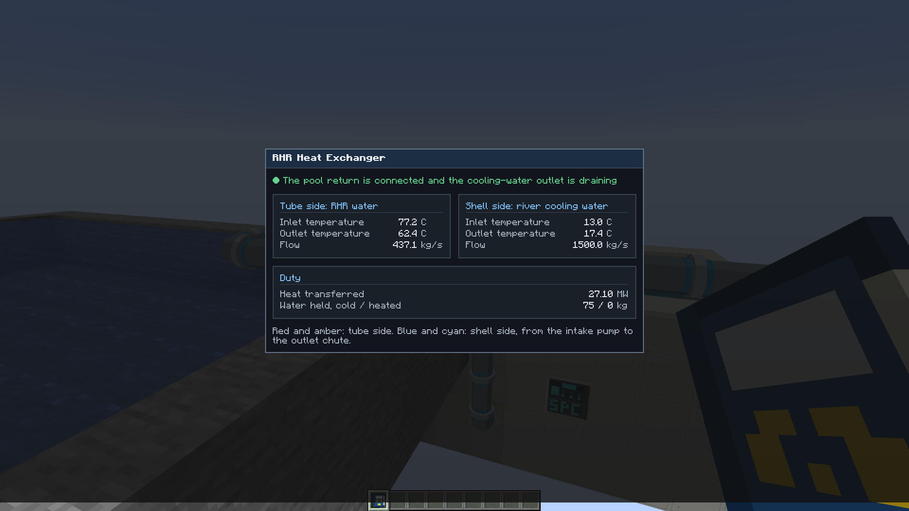

## Full-size exchanger (3 x 8 x 3 multiblock)

From alpha.55 one **RHR Heat Exchanger** item places a full-size machine: a vertical shell-and-tube unit **3 wide, 8 high
and 3 deep**, one model, one block entity, the same way the pumps work. The clicked block becomes the **centre of the
base** (the controller), so leave the whole 3 x 8 x 3 box clear, including the space around the clicked block. Placement is
refused, with nothing changed, if any cell is occupied, unloaded, outside the world or protected. Breaking any cell removes
the whole unit and returns one item. Pistons cannot push it.

What it looks like: a lagged shell (1.5 m, aluminium cladding with bands and lap joints) on four lugs that bear on a braced
steel frame; at the bottom the painted channel head and bonnet with the bolted tubesheet joint (channel flange, tubesheet
rim, shell flange, 32 through-studs); an ellipsoidal top head with a vent valve and two lifting padeyes; a spring relief
valve high on the shell; drain valves on the bonnet and the shell; a bimetal thermometer and a pressure gauge on every
nozzle; a plain nameplate. The four nozzles keep the alpha.54 colour bands and end in bolted flanges centred on a block face.

| Band | Side | Cell (offset from the controller, machine facing north) | Outward face |
| --- | --- | --- | --- |
| Red, RHR water IN | Tube side, channel head | (0, 1, -1) | North (front) |
| Amber, RHR water OUT | Tube side, channel head | (0, 1, 1) | South (back) |
| Blue, cooling water IN | Shell side, low | (-1, 2, 0) | West |
| Cyan, cooling water OUT | Shell side, high | (1, 6, 0) | East |

+x is east, +y up, +z south; offsets and faces turn with the machine. The faces are the same as a single block's (red on the
front, amber behind, blue counter-clockwise, cyan clockwise); only the flanges have moved onto those four cells. Put the
first pipe directly outside the listed face. No other face of the unit takes a pipe, and only blue and cyan expose water.

The circuits work exactly as for the single block: the RHR pump's discharge to red, amber back to the same basin (or vessel
for shutdown cooling); cooling water into blue, heated water pushed out of cyan into a pipe, a tank, a cooling tower or a
**Water Outlet Chute**. The cyan flange is six blocks up: a chute set straight against it needs open water at most four
blocks under its lip, or run a pipe down to a chute at the water's edge. Right-click **any** cell for the exchanger panel;
CC:Tweaked computers and the Networking Wrench may also use any cell, and all of them address the controller. The unit works
only while all 72 cells are loaded and standing.

**Saved exchangers.** Every exchanger placed before alpha.55 stays a working single block: the same id, model, four flange
faces and saved data, and it is never expanded into its neighbours (its saved state has no `assembled` property and loads as
the single block). Pick it up and place it again to get the full-size unit, then reconnect its pipes at the new flanges.

**Rating.** The full-size unit keeps the same physics, readouts and **27.1 MW** rating as the single block (92.5 million
Btu/h, the representative BWR RHR exchanger in EPRI 1012129). Columbia's FSAR gives **83.23 million Btu/h (24.4 MW) per
loop** of containment heat removal with 85 F service water and a 165 F pool, and **41.6 million Btu/h (12.2 MW)** of
shutdown-cooling duty per exchanger 20 hours after shutdown. Those figures do not justify a higher rating for the bigger
model, so neither form changed. Columbia's design flows are 7,450 gpm of RHR water and 7,400 gpm of service water per
exchanger, about 470 kg/s each; the game's RHR pump delivers about 445 kg/s through it.

**Why this size and shape.** Columbia's RHR exchangers are vertical, inverted U-tube units with a single-pass shell and
multi-pass tubes, 7,641 ft2 (710 m2) of tube surface each, standing in a bay from el. 559 ft to el. 589 ft of the reactor
building (FSAR, REFERENCES). The FSAR gives no dimensions, so the size is an estimate: 710 m2 of 3/4 in tubes is about 12 km
of tube, roughly 900 U-tubes with 6 m legs, which fit a tubesheet of about 1.3 m inside a 1.5 m shell. Six metres of tube legs
plus the channel head, the top head and the support frame make about 8 m, inside the 9 m (30 ft) bay. At one block per metre
that is the 3 x 8 x 3 box: a convincing height next to the 7 x 3 x 3 RHR pump, and still a footprint a player can fit in a
pump room. The channel head is at the bottom because the U-bends are at the top; the shell stands on lugs and a frame, the
arrangement BWR RHR exchangers use (seismic studies of 1100 MWe BWR units model them that way). In the real plant RHR water
is on the shell side and service water in the tubes; the game keeps RHR water on the tube side and cooling water on the shell
side, as alpha.54 did, so saved exchangers and the existing colour code mean the same thing.

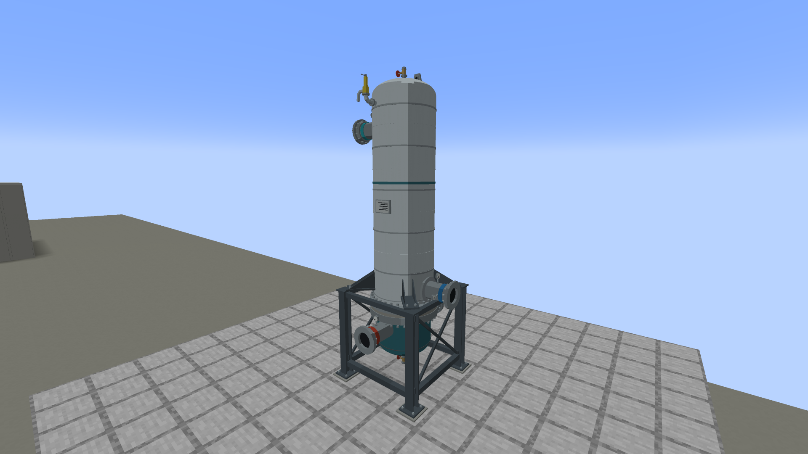
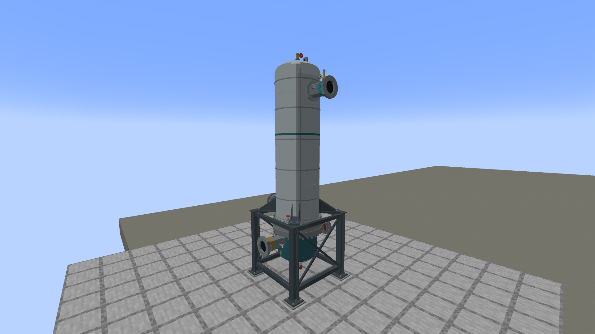
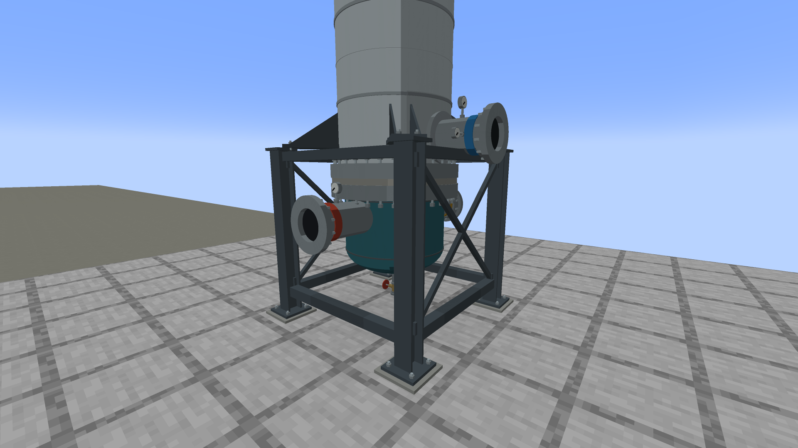
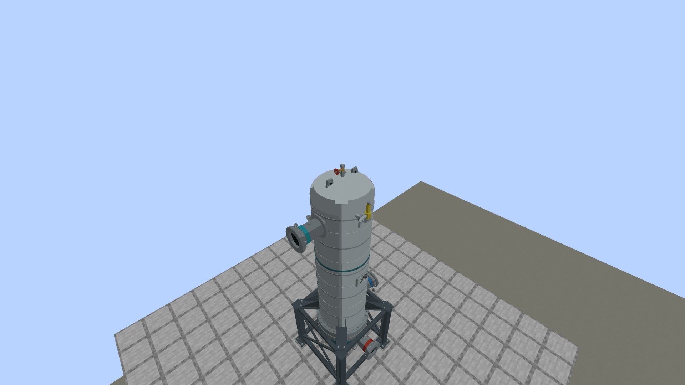
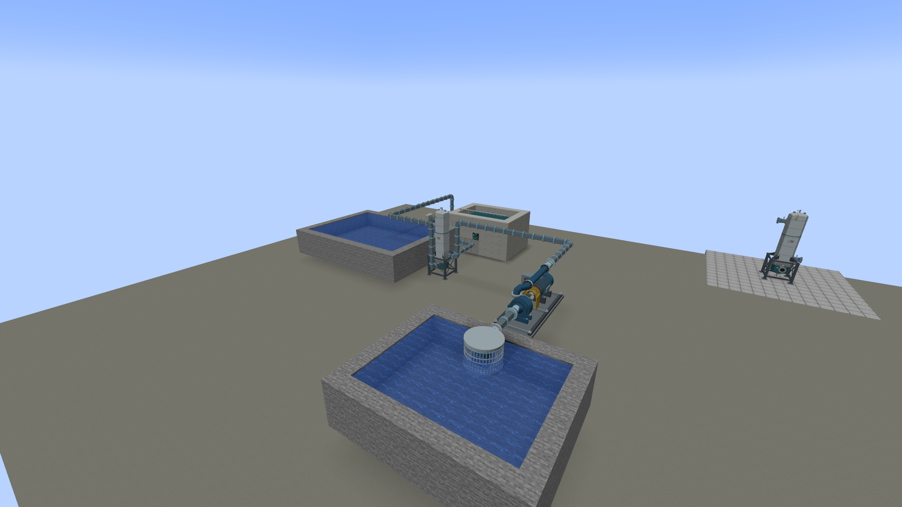
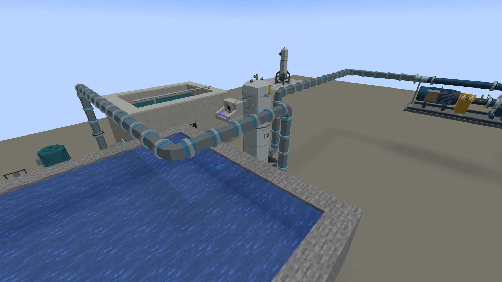
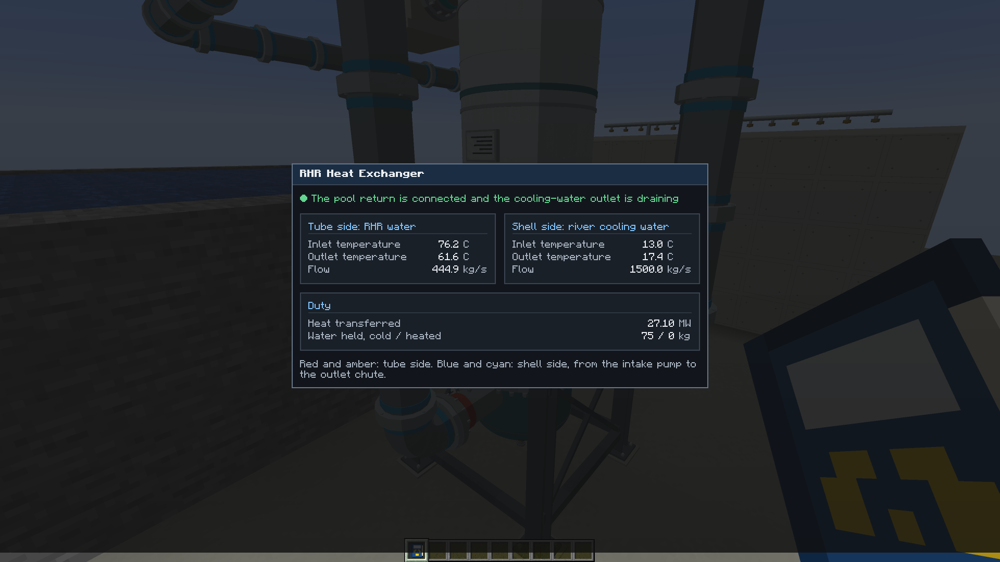

Authoring: `blender.exe --background --factory-startup --python art/models/suppression/build_hx_multiblock.py` writes
`art/models/suppression/rhr_hx_assembly.json` (26,636 triangles) and `rhr_hx_assembly.blend`; `python tools-export-hx-multiblock.py`
cell-splits it with the pump exporter's clipping (UVs and surface area preserved) into
`models/block/suppression/hx_assembly/cell_<i>`, the footprint manifest `data/bwr/exchanger_models/rhr_heat_exchanger.json`,
the blockstate, the item model and the loot table; `--check` is read-only. 69 of the 72 cells draw geometry; the three in
the middle of the shell are its hollow inside.

Verification: GameTests in namespace `bwrhx` (HxMultiblockTests): placement and breaking in all four facings, a blocked
footprint refused, every cell addressing the controller, flange faces, pipes and capabilities, both water circuits, the
river loop through the full-size unit, and a single block loading from an alpha.54 save. Pictures: `:mod:runTurbineModelCheck
-PbwrHxMultiblockCheck` (HxMultiblockClientCheck).

### REFERENCES

- Columbia Generating Station FSAR, Chapter 6, Amendment 59, Table 6.2-2 item C.3 ("RHR system-inverted U-tube, single pass
  shell, multi-pass tubes, vertical mounting"; 2 exchangers, 7,641 ft2 each, U 195 Btu/h ft2 F, 7,400 gpm service water,
  83.23 x 10^6 Btu/h per loop), Table 6.1-1 (shell SA-516 Gr 70, U-tubes SA-249 304L, tubesheet SA-105) and section
  6.2.4.3.2.2.1.3 (vent lines with motor-operated globe valves, relief valve discharge to the suppression pool):
  <https://www.nrc.gov/docs/ML1201/ML12011A160.pdf>
- Columbia FSAR, Chapter 1, Table 1.3-3 (RHR shutdown cooling: 41.6 x 10^6 Btu/h per exchanger at 20 h, 7,450 gpm RHR,
  7,400 gpm service water): <https://www.nrc.gov/docs/ML1201/ML12011A152.pdf>
- Columbia FSAR, Chapter 12, Amendment 62, section 12.2.1.2.2.5 (the exchangers occupy el. 559 ft to 589 ft on the west
  side of the reactor building): <https://www.nrc.gov/docs/ML1535/ML15355A511.pdf>
- Columbia license renewal application, section 2.3.2.1 and Table 3.2.2-1 (RHR-HX-1A/B: channel, shell, tubes, tubesheet
  and tube plugs; raw water inside the tubes, treated water in the shell):
  <https://www.nrc.gov/reactors/operating/licensing/renewal/applications/columbia/columbia-lra.pdf>
- LaSalle (BWR/5) UFSAR, Chapter 5, section 5.4.7.2.2 (drains on both sides, a shell-side vent, relief valves):
  <https://www.nrc.gov/docs/ML2211/ML22111A234.pdf>
- NRC GE BWR/4 Systems Technology Manual, Chapter 10.4 (vertical U-tube RHR exchangers, shell-side and tube-side relief
  valves, vents and drains): <https://www.nrc.gov/docs/ML1125/ML11258A369.pdf>
- NUREG-0933 Item C-9, RHR heat exchanger tube failures (tube-and-shell units, about 10,000 gpm of service water):
  <https://www.nrc.gov/sr0933/section-2-task-action-plan-items/item-c-9-rhr-heat-exchanger-tube-failures>
- Seismic fragility of vertical U-tube heat exchangers on lugs and support frames at 1100 MWe BWRs (abstract only):
  <https://www.sciencedirect.com/science/article/abs/pii/S0029549305002268>

These documents were read online; the geometry is original game work, and the nameplate and markings are generic.

## Current thermal model

- Maximum exchanger duty: **27.1 MW** (both forms), limited by actual primary flow, pool
  temperature and secondary-water availability.
- Separate cold and hot buffers: **12,000 kg each**; secondary flow up to
  **2,400 kg/s**. These are gameplay ratings, not a vendor-certified design.
- Secondary inlet uses the actual water temperature. Heat gain is bounded by
  an 11 C design range and the primary-water temperature. Connect a cooling
  tower to remove that heat. BWR pipes carry enthalpy; see
  [transport and third-party limits](PLANT-TRANSPORT.md).
- Dry secondary supply, a full hot buffer, a stopped pump or a broken primary
  return stops heat transfer. The physical model removes heat from the pool
  and adds that heat to the secondary water before it leaves the exchanger.
- There is no built-in automatic RHR start, trip or emergency control logic.

## Assets and verification

Editable source: `art/models/suppression/suppression_pool_and_heat_exchanger.blend`.
`build_models.py` runs in Blender; `tools-export-suppression.py` converts its
exported meshes to the NeoForge OBJ resources. `--check` verifies generated files.
Walls and ports use baked block models, not moving entities; neither has a server ticker.
The basin controller and exchanger handle physical updates. The client controller animates spray droplets only while water actually flows. Pipe segments retain
their existing machine-driven network behavior.

Regression coverage includes formation, unique ownership, break/repair, cached
fluid handlers after reload, all four exchanger orientations, separate water
inventories, finite cooling, fractional transfer accounting, and preservation of
condensed water during revalidation.

Detailed pump and spray source: `art/models/cooling/revise_pumps.py` (run inside
Blender), `art/models/cooling/{circulating_water_pump,makeup_water_pump}.blend`
and `art/models/suppression/pool_water_and_spray.blend`. Spray components use the
same deterministic OBJ exporter as the concrete panels.
