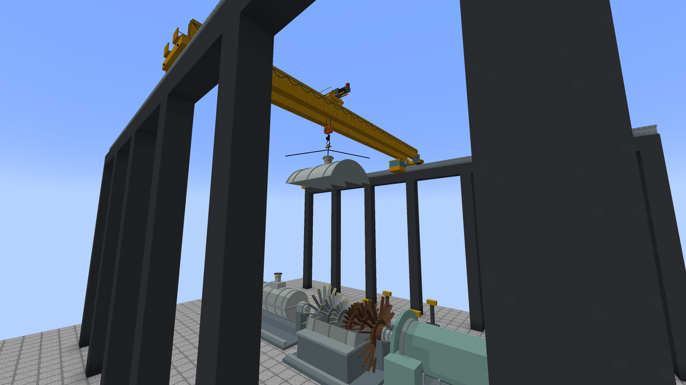
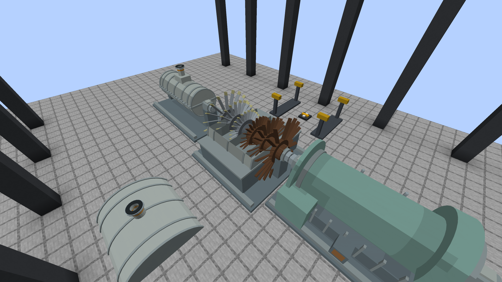
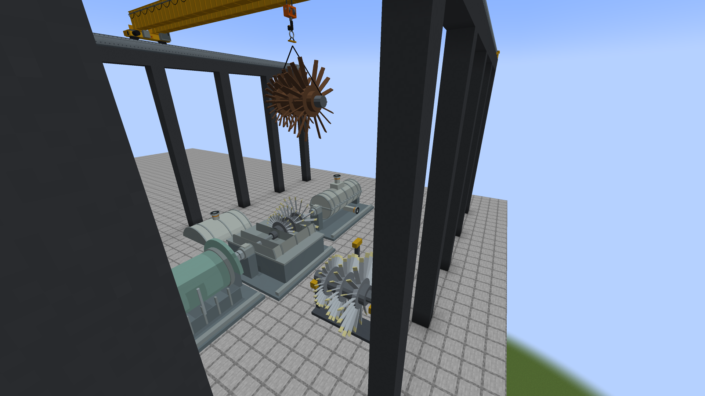
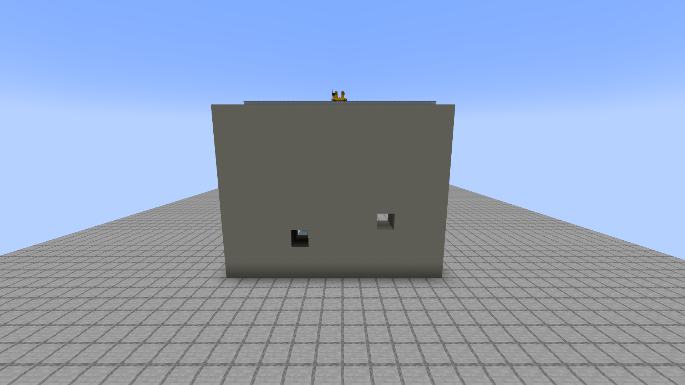

# Turbine blades, missiles and the turbine hall crane

A low-pressure (LP) turbine's last-stage blades are the longest, fastest and most loaded parts of the machine. Wet steam erodes them, a
generator breaker closed out of phase twists the whole shaft train, a generator left on the grid with no steam is driven as a motor
and its windage cooks them, and overspeed stretches them. A blade that lets go at speed leaves the casing as a **turbine missile**.
Repairing one means what it means at a real plant: the **turbine hall crane** lifts the casing's upper half (the hood) off, lifts the
damaged bladed section out, and lifts a spare one in from its stand.

All numbers are game calibration informed by published turbine data, not a manufacturer's curves. The physics is
`dev.bwr.core.turbine.TurbineBlades` (pure functions, `TurbineBladesTest`); the train step is `dev.bwr.mod.power.PowerTrain`.

**House rules, as everywhere in the mod.** Nothing acts on its own. No reverse-power relay opens the breaker, no overspeed bolt closes
the valves, no vibration monitor trips anything. The screens, panels and computers read; the player acts.

## The LP rotor: two blade sections

A double-flow LP turbine takes its steam in the middle and expands it towards both ends. Its rotor is two **blade sections**, one per
flow: **A** towards the section's facing, **B** the other end. Each is that flow's stages on their discs, the last stage longest, and
has its own condition from 0 (new) to 1 (failed). An LP section's condition (`damage` on the computer, on the old readouts) is the worse of
its shaft counter and its two blade sections; HP sections and generators are unchanged.

## What damages the blades

| Cause | Law | Numbers |
|---|---|---|
| **Wet steam** (unchanged) | the liquid over the design 0.1 % passed through, over 8,000 t (`PowerTurbine.erosionIncrement`) | both flows see the same steam, so both sections wear alike. On an HP section the wear stays in its one damage counter, as before |
| **Out-of-phase close** | transient torque `T = 2 sin(delta / 2) / 0.35` per unit of rated torque; `delta` is the phase angle at the close, or the slip's equivalent on the grid tie's own scale (`10 deg x slip / 0.067 Hz`), at most 180 | 0.5 pu in the synchronising window, 2.9 pu at 60 deg, 4.0 at 90, **5.0 at 120**, 5.7 at 180. Above 2 pu: each LP blade section loses `0.12 (T - 2)^1.5` (0.35 at 90 deg, 0.61 at 120), every turbine section's shaft `0.06 (T - 2)`. Past **5.5 pu** (about 150 deg, or closing on a machine far off speed) with the shaft over half speed an LP disc and coupling let go: a disc missile. The generator's own damage is the grid tie's existing law, unchanged |
| **Reverse power (motoring)** | a generator whose breaker is closed and that turns within 1 Hz (30 rpm) of synchronous speed is held in step by the grid. When the steam does less work than the train's windage and friction, the grid makes up the rest: the generator is a motor, delivers nothing and draws that power (shown as reverse power). The LP's exhaust hood heads for `base + 150 K x (rpm/1500)^3 x motored fraction` with a 90 s time constant; above **120 C** each blade section loses `5e-5` per second per kelvin over | at rated speed with no steam the hood passes 120 C in **about 90 s** and the blades fail after **about 9 minutes**. A train's reverse power is its windage: 3.75 MW for an LP and a generator, 7.5 MW for the reference 2 HP / 4 LP / 1 generator train |
| **Overspeed** | the shaft's existing law, 0.1 per second per unit over 110 % speed, also on the LP blade sections | at **150 % (2,250 rpm)** an LP last-stage disc bursts: a disc missile |

The base of the hood temperature is the exhaust steam's temperature while steam flows, the hall's 25 C otherwise. A coasting shaft with
the breaker open is not motored and does not heat its hood: in this shaft model the only way a dry LP stays at speed for minutes is the
grid holding it there.

## Turbine missiles

**When.** A blade section at condition 1 with the shaft turning faster than **750 rpm (half of rated)** throws a last-stage blade, once.
A failed section at standstill or under half speed throws nothing until the shaft is brought over half speed. A disc bursts at 150 %
speed, or on a close past 5.5 pu with the shaft over half speed.

**What flies.**

| Piece | Mass | Released at | Speed at rated | Energy at rated | Through its own casing |
|---|---:|---|---:|---:|---|
| Last-stage blade | 45 kg | its centroid, 2.6 m from the axis (tip 3.5 m, 550 m/s) | 408 m/s | **3.75 MJ** | loses 1 MJ |
| Disc fragment (a third of a last-stage disc) | 2,500 kg | its centroid, 1.1 m | 173 m/s | 37 MJ (84 MJ at 150 % speed) | loses 10 MJ |

Energy goes with the square of the speed at release.

**Where.** From the wheel of its flow (on the shaft axis, 2.5 blocks from the middle of the LP towards that end), tangentially, so in the
plane of the wheel: across the shaft, at an angle in that plane picked from the position and the time (straight up, straight down into the
condenser floor, sideways across the hall). It flies a ballistic line (gravity barely bends it at 400 m/s) for at most 160 blocks.

**What it does.** Block by block along the line:

- air and fluids cost nothing; the LP's own cells are passed through (its casing already took its share);
- any other block costs **6 x** the energy a vessel head spends crushing it (its blast rating as a pressure over 1 m2 through 1 m, at
  least 20 kJ): about **0.6 MJ for stone**, so a blade at rated speed goes through four or five stone blocks or a couple of metres of
  concrete, a disc fragment through dozens. With that much left the block breaks (the accident blasts' protected path: an explosion
  start, a break event per block, vanilla drops) and the piece goes on; otherwise it stops in it;
- unbreakable blocks (bedrock, a reactor's controller or formed structure), a block a protection mod keeps, or another turbine, pump or
  generator casing **stop** it (the casing it embeds in takes shaft damage from what is left);
- an entity on the line is hurt by what the piece carries (a few MJ kill anything), once;
- **a block in a chunk that is not loaded stops it there. A chunk is never loaded to look.**

As for every accident blast, breaking blocks is not optional: no setting turns it off.

**Afterwards.** The section is wrecked (the thrown flow's section reads failed with a blade thrown; a disc burst wrecks both sections and
the shaft). The missing blade unbalances the train: **45 mm/s at rated speed per thrown blade** (with the square of speed) on every section,
which damages the shafts as the existing vibration law does (0.6 % a second per 7 mm/s over 7.1). Nothing stops the turbine: close the
valves and open the breaker, then replace the section (or, after a burst, the whole LP module).

## The turbine hall crane

The turbine hall crane **is the building crane**: the same runway rails (two parallel runs, up to 40 blocks apart), the same console and
pendant, the same phases (travel, lower, hook on, lift, carry, set down, unhook, raise), the same ABORT and RESUME. Build it over the
turbine train; it does not need a reactor between its rails for these lifts. Four buttons on the pendant, four calls on the computer:

| Lift | What | From, to |
|---|---|---|
| **COVER OFF** | an LP's hood: its upper outer and inner casing halves, 7 x 2 x 7 blocks over the horizontal joint | the LP nearest the hook with its cover on, to the nearest free **Casing Laydown Stand** |
| **COVER ON** | a hood back | from a casing laydown stand (the one holding that LP's own hood first) to the open LP |
| **BLADES OUT** | the worse of the open LP's two blade sections | to a free saddle of an **LP Blade Storage Stand** |
| **BLADES IN** | a spare (undamaged) blade section | from a blade stand to the open LP's empty flow |

**Weights.** The hood is **110 t** and a blade section **62 t** (server options `turbineHoodMassT` and `lpBladeSectionMassT`), both under the
crane's **125 t** rating (an LP rotor of a 1,000 MW-class half-speed machine is a few hundred tonnes; the game's section is one flow's bladed
part of it, the hood the upper halves of the outer and inner casings, which real plants lift separately). A load over the rating is refused.

**Refused, with the reason, before anything moves:**

- **the shaft turning**: over 1 rpm, or the turning gear engaged (switch it off on the generator's screen);
- **steam in the casing** (COVER OFF): any steam in the section or flowing through it: close the stop and control valves and let it clear;
- **a hot casing** (COVER OFF): rotor metal or exhaust hood over **100 C**. The rotor metal cools with the existing 4-hour time constant;
- **the cover on** (BLADES OUT / IN), **a blade section out** (COVER ON), a section already out or in, a damaged section for BLADES IN;
- **not under the crane**: the load's footprint (7 x 7 for a hood, 4.6 m across for a section) must lie within the rails' reach;
- **the rails too low**: the load must clear the top of the turbine train (5 blocks over its floor) while it hangs; a hood hangs 3.3 blocks
  under the hook, a blade section 5.9 (its axis 3.6 under the hook on slings round its journals, its blades 2.3 m long). The message gives
  the height to build to (rails at least 9 blocks over the turbine floor for a hood, 12 for a section);
- **no free stand** in reach, a casing stand closer than 7 blocks to the turbine, or over the rating.

**The load is in exactly one place.** The hood leaves the LP when the hook closes on it (the LP is then open) and is put on the stand when
the hook lets go; a blade section the same. On the hook a load is an item the crane holds (`LP Turbine Hood`, `LP Turbine Blade Section`,
`Damaged LP Blade Section`), saved with the console: a world saved mid-lift loads the same load on the same hook and the crane carries on.
Breaking the console puts a hanging load back where it came from if that place can take it, otherwise drops it as its item. A load is never
duplicated and never lost. The crane never loads a chunk: with a place of the lift in an unloaded chunk it waits.

## An open casing

With the hood off, the LP's upper cells are open (drawn empty and walked through) and its blade sections are drawn turning nowhere in the
lower half, worn sections rust-dark. **An open casing holds no steam**: whatever the valves admit to it vents into the hall and does no work
(the screen says "Casing open: the steam vents into the hall"). Nothing stops you admitting it.

## Replacing blades

1. Take the load off: close the valves, open the breaker, let the shaft coast down, engage the turning gear under 10 rpm until the rotor is
   cold, then switch the gear off with the shaft stopped.
2. **COVER OFF.** The hood goes on a casing laydown stand.
3. **BLADES OUT.** The worse section goes on a blade stand saddle. A section over **5 %** worn comes out as a **Damaged LP Blade Section**
   (carrying its wear), one under it as a spare.
4. **BLADES IN.** A spare from a blade stand goes into the empty flow; that flow's condition becomes the spare's (0 for a new one). Repeat
   for the other flow if it needs it.
5. **COVER ON**, then start up as usual.

## Items, blocks and recipes

| Item or block | Recipe | What it is |
|---|---|---|
| **LP Turbine Blade Section** (`lp_blade_section`) | 4 iron blocks (corners), 4 iron ingots, a diamond in the middle (the stellite erosion shields of the last-stage tips) | one flow's bladed rotor section, 62 t, carries its wear |
| **Damaged LP Blade Section** (`damaged_lp_blade_section`) | comes out of a turbine; crafted alone it is scrapped into 2 iron blocks | cannot be installed |
| **LP Turbine Hood** (`lp_turbine_hood`) | comes off a turbine; a spare: five iron blocks in a half-shell | 110 t; carries the LP it came off and that LP's facing |
| **LP Blade Storage Stand** (`lp_blade_stand`) | iron ingots, an iron block, smooth stone slabs | a rack with two saddles, 2.5 blocks each side of the stand across its facing. Holds two sections, spare or damaged, drawn on the saddles. An **item handler** on every face: hoppers and pipes stock and empty it. Right-click a section on, sneak-click one off. Breaking it drops what it holds |
| **Casing Laydown Stand** (`casing_laydown_stand`) | two iron blocks on smooth stone | the cradle a hood is set on (7 x 7 of floor round it). Right-click a hood item on. Breaking it drops the hood |

## Readouts and computers

- **Power module screen, BLADES tab.** On an LP: blade sections A and B (worn %, out, a blade thrown), the cover, the exhaust hood
  temperature. On every section: the shaft condition, the **reverse power** the grid drives the train with, and the **last breaker close**
  (phase angle and the closing torque in times rated).
- **Turbine peripherals** (`bwr_hp_turbine`, `bwr_lp_turbine`, `bwr_generator`) `getStatus()` adds `shaftDamage`, `reversePowerMW`,
  `motoring`, `lastCloseAngleDegrees` and `lastCloseTorquePu` (after a close), and on an LP `coverOff`, `hoodTempC`, `bladeDamageA`,
  `bladeDamageB` and `bladeSections` (a list of `{flow, installed, damage, bladeThrown}`). `damage` and `failed` keep their meaning (on an LP
  the worse of the shaft and the blades).
- **Crane peripheral** (`bwr_building_crane`): `queueCoverOff([x, y, z])`, `queueCoverOn([x, y, z])`, `queueBladesOut([x, y, z])`,
  `queueBladesIn([x, y, z])` (no arguments: the nearest LP that wants it; with any block of an LP: that one), each `{ok, message}`;
  `getTurbineSections()` lists the LP sections under the crane (`x, y, z, coverOff, rpm, bladeA, bladeB, sectionAIn, sectionBIn, ready,
  reason`); `getStatus()` adds `turbineLoad` (`hood`, `blade_section`, `damaged_blade_section` or empty) and `turbineLoadMassT`.

```lua
local crane = peripheral.find("bwr_building_crane")
for _, lp in ipairs(crane.getTurbineSections()) do print(lp.x, lp.z, lp.bladeA, lp.reason) end
local r = crane.queueCoverOff()      -- the program's choice; nothing else starts a lift
if not r.ok then print(r.message) end
```

## Hooks for other systems (server side)

Two events on the NeoForge event bus (`dev.bwr.mod.power.TurbineEvents`), posted on the server thread after the fact, readings only:

- **`TurbineEvents.Missile`**: once per missile, after its flight: `level()`, `turbine()` (the LP's controller block), `origin()`,
  `direction()`, `end()`, `kind()` (BLADE or DISC), `energyJ()`, `massKg()`, `speedMps()`, `rpm()`, `blocksBroken()`.
- **`TurbineEvents.Vibration`**: once a second for every shaft train turning over 1 rpm or shaking over 0.1 mm/s: `level()`, `at()` (the
  worst section), `centre()` (the middle of the train), `mmPerS()` (the worst section's vibration: a healthy rotor's 1.5 mm/s at rated
  speed, a bowed rotor through the critical band, a thrown blade's imbalance), `rpm()`, `sections()`.

```java
@SubscribeEvent public static void missile(TurbineEvents.Missile e) { /* e.level(), e.origin(), e.energyJ() */ }
```

## Saves and old worlds

- An LP always writes `Blades` (two conditions); `BladesThrown`, `BladesOut` and `CoverOff` only when not the default. Any section writes
  `HoodC` above the hall's temperature and `CloseAngle`/`ClosePu` after a breaker close. A crane holding a turbine load writes
  `CarriedTurbine`; a stand writes `Items` while it holds any.
- **An LP saved before this** has no `Blades`: its one damage counter (wet steam was the LP's only wear of its own) becomes the condition of
  both blade sections, at most 0.95, so an old failed LP reads as blades about to fail rather than throwing one the moment the world loads.
  HP sections and generators keep everything as it was. A turbine that was not damaged runs exactly as before.
- The LP's cells gain a block state property `open`, false by default; old states load unchanged.

## Honest limits

- Two sections per LP, alike: the stages within a section are not separate, and both flows see the same steam and the same transients.
- The missile's flight is worked out in the tick it lets go; there is no flying entity. Its line ignores air drag.
- A blade lost does not change the LP's work; it shakes the train.
- The HP turbine's casing does not open (its blades are not modelled separately); the cover, the sections and the crane lifts are LP only.
- The crane does not check what a load sweeps through on its way, only that the rails carry it over the turbine train.
- Vacuum: the casing is opened without breaking the condenser vacuum, which is not modelled.

## Tests

Core `TurbineBladesTest` (6): the closing torque against the angle, motoring heating the hood until the blades fail in minutes, the
erosion law unchanged, overspeed and the burst speed, the missile's energy, the weights against the crane. GameTests `bwrturbine`
(`TurbineMaintenanceTests`, `-PbwrGameTestNamespaces=bwrturbine`, 14 tests): an out-of-phase close damages the train by the law at 5, 30,
60, 90 and 120 degrees (none near the window, the generator's own law unchanged); reverse power holds a closed generator at speed, draws
the train's windage, heats the hood past 120 C within two minutes and costs the blades over six minutes, stops when the player opens the
breaker, never happens with the breaker open; wet steam wears both sections by the existing law; an old LP's wear becomes blade wear and
throws nothing on load; a failed section at speed throws a blade in the plane of the wheel, through the blocks its energy allows, posting
the missile and vibration events; none at standstill or under half speed; a missile stops at a chunk that is not loaded and loads none, and
hurts what it meets; a disc bursts at 150 %; COVER OFF refused for a turning shaft, the turning gear, steam, a hot casing, an overweight
hood, a turbine not under the crane, BLADES OUT with the cover on, and rails too low; the crane lifts the hood off and back, the open casing
vents its steam; blade sections out and in, a new section resetting the damage, the damaged one coming out with its wear; a hood on the
hook saved and loaded once, and a console broken under it; the blade stand as an item handler that drops what it holds.
Client check `-PbwrTurbineHallCheck` (`TurbineHallClientCheck`) saves the pictures in `art/turbine-hall/`.









Also in `art/turbine-hall/`: `lp-blade-stand-stocked.png`, the two screens from the client check (`gui-lp-blades.png`, `gui-crane-turbine-hall.png`) and three
from `-PbwrGuiScreenCheck` (`gui-check-power-lp-blades*.png`, `gui-check-crane-turbine-hall-hood-on-hook.png`).
