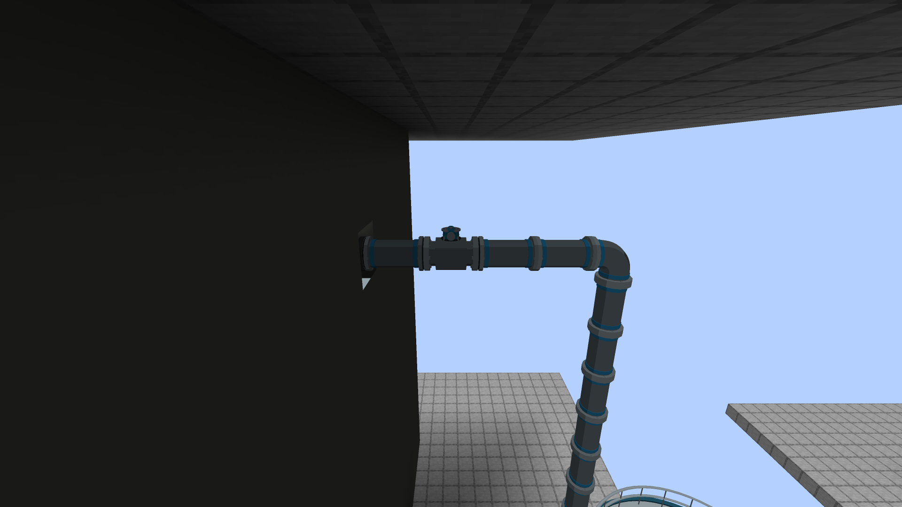

# Water supply, pump controls, and recirculation

## Condensate storage and pump suction

The **Condensate Storage Tank** holds **2,000,000 mB** of finite water. It now has
a tank-shaped model and a right-click level panel. Fill it with buckets or water
pipes; extraction is available on every face. Existing inventories are preserved.
Stored condensate uses the existing **32°C** temperature; no new storage thermal
simulation is introduced. The mod conversion is **1 mB water = 1 kg**.

Use either return-water arrangement:

- **Mekanism Mechanical Pipe → pump water-suction flange**, directly. A
  high-pressure segment is not required upstream. Configure Mekanism's source
  connection to extract/pull if the source does not push water itself.
- **Mekanism return → Condensate Storage Tank → High-Pressure Water Pipe → pump
  suction**, for a shared feedwater/emergency reserve. BWR pumps draw from the
  connected tank. A Mechanical Pipe can also extract CST water and deliver it to
  a pump's suction buffer.

On ECCS pumps select **Suction: Tank / piped water**. **Suppression pool** is a
separate manual selection. Feedwater pumps always use tank/piped water. Each inlet
buffer holds **2,000 mB**; after disconnecting a source, buffered water remains
usable until exhausted. Neither pipes nor tanks generate free water.

## Pump discharge and controls

Run **High-Pressure Water Pipe** from water discharge to an outward-facing **RPV
Water Injection Port** in the vessel wall. The port now has a full pressure-boundary
cube, fixing the recessed-face gap. Right-click it to check vessel ownership.
Ordinary pipes cannot bypass the pump and inject against vessel pressure.

Right-click any powered pump cell to open its panel:

- Enter **speed 0–100%**, press Apply/Enter, and Start/Stop. Actual speed ramps up;
  power supply and reactor pressure still limit delivery.
- Read target/actual speed, water flow, pressure differential, suction-water
  temperature, and stored FE or steam-drive identification.
- Choose **Control: Panel / Redstone / Computer** (RCP/RIP: Panel/Computer).
  Computer ownership disables manual buttons until control is handed back.
- On ECCS choose tank/piped-water or pool suction. On RHR select reactor injection
  or pool cooling.

Electric pumps require FE and have no steam ports or steam-admission readout.
RCIC, HPCI and turbine feedwater pumps retain their steam admission/exhaust paths.
Existing core-spray rings are still needed for LPCS/HPCS. No new sprayer or
condenser is added.

Speed commands control shaft speed separately from the existing flow throttle.
Lua now exposes `setSpeed(0..1)` and `getTargetSpeed()` for ECCS/feedwater. Older
saves default to 100% speed demand. No automatic start or source switching is
added. RCP/RIP show their core-flow contribution and vessel pressure/temperature;
their external water-loop temperature and pump head are not separately simulated.
Disconnected recirculation pumps show temperature unavailable. Passive jets have
no independent motor or speed panel.

## External recirculation

The DVSS model occupies a 5 × 5 footprint and is 10 blocks tall. Build two separate High-Pressure Water
Pipe headers: **RPV top outlet → blue rear lower suction**, and **teal front
upper discharge → RPV bottom inlet**. Both ports must belong to the same formed
vessel. The top outlet goes in the upper half of a side wall; the bottom inlet
in either lowest side-wall row beside the interior. Both face outward.

New jet assemblies occupy one column. Align them across opposite walls in the
same row and at the same height, with opposite facings. Their bases can be 1 or 2 blocks
above the bottom shell. A loop without matched jets provides weak circulation;
matched jets raise capacity. See [RECIRCULATION.md](RECIRCULATION.md) for the
flow table, placement example and the new reactor INFO tab.

Breaking a header removes its flow contribution. New jets register within one
second; pump associations refresh within two seconds. Recirculation does not
create water or cooling. RIP mounting is unchanged.

## Motor-Operated Water Valve

A one-block, two-flange valve for **any BWR water line**: feedwater, condensate, ECCS suction and discharge, RHR, cooling water, a cavity drain.
Put it inline in High-Pressure Water Pipe (the flanges are the two ends on its axis; the actuator and the sides are not ports). It is the
water line's isolation and throttling valve: before it, the only valve a water line had was the containment water penetration's FE
isolation actuator. The steam side keeps its MSIV, stop, control, bypass and relief valves. Recipe: redstone, iron, copper and a High-Pressure
Water Pipe. Creative tab: Realistic BWR.

| What | Value |
| --- | --- |
| Opening | 0 to 100 % |
| Full stroke | **20 s** (400 ticks), either direction, at any opening in between |
| FE | **50 FE/t while the motor drives it**: a full stroke is 20 000 FE, which is also the buffer (20 000 FE, taken on every face but the two flanges) |
| Holding | Holds its position with **no power and no draw** (FAIL AS-IS, the default). It does not move on its own: nothing automatic operates it |
| New valves | Closed, FAIL AS-IS, no stored energy |
| Rating | The pipe's: the tooltip, the right-click text, the status and the signals carry the same nameplate as the High-Pressure Water Pipe (2,500 psi (simulation)) and the wear threshold below |

**Control (the latest command wins).**

* **Redstone, proportional:** signal strength 0 demands closed, 15 fully open, in between `strength / 15` (7 is 47 %). Only a change of the strength is a
  command (a neighbour that changes without changing the signal does not undo a panel or computer demand); a valve placed beside a powered block takes that demand.
* **Panel / Networking Wrench:** a controller station or a control switch on a board bound to the valve. Command `position` (0 to 1) and `open` (on is fully open,
  off closed); signals `position`, `open`, `closed`, `flow`, plus `target`, `powered`, `energy_fe`, `fail_mode`, `rating_psi`, `wear_above_psig`. Position is a POSITION
  quantity, so a gauge with Measures set to position accepts it. See [SIGNALS.md](SIGNALS.md#motor-operated-water-valve).
* **CC:Tweaked** (`bwr_motor_operated_water_valve`): `setPosition(fraction)`, `open()`, `close()`, `getPosition()`, `getDemand()`, `setFailPosition("as_is"|"open"|"closed")`,
  `getFailPosition()`, `getStatus()`.

**Fail position (the player's setting).** Default **FAIL AS-IS**: with no power it stays where it is. **FAIL OPEN** and **FAIL CLOSED** are a spring and a latch: while
the valve stands away from its fail position the latch draws **20 FE/t**, and when the buffer cannot pay (or cannot pay a stroke) the spring takes the valve to the
fail position at the normal stroke rate, **using no FE**. The spring also helps a stroke towards the fail position for free; a stroke away from it needs the motor's
power. A full buffer holds the latch for 50 s, so the valve fails about 50 s after its supply is lost (less if the buffer was not full). Set it with the signal `fail_mode`
(0 as-is, 1 open, 2 closed; a panel selector can write it), with CC, or by **sneak-clicking** the valve (cycles the three). It is saved only when not FAIL AS-IS. There is no
modelled control signal to lose (a redstone signal or a command is a demand): "loss of power" is the one trigger. This is a chosen hardware behaviour, like an air-operated valve's
spring: no sensor, no plant condition and no trip moves it.

**Flow.** A route through the valve is open to the extent the valve is, and the narrowest valve on a route governs it, exactly as a steam valve scales its supply: a pump
whose suction or discharge line has the valve passes its rated flow times the line's opening (`AssemblyPlumbing` water lines are full-bore unless a motor-operated valve is on them,
then the most open route's opening), a closed valve leaves the pump no source, and the cavity drain's flow is multiplied by it. Position changes never rebuild the pipe survey. The
valve counts the water that passes it on the drain line (`flow`); pump lines are throttled but not metered.

**Isolation and the LOCA code.** The valve is a valve in [PORT-LOCA-UPDATE.md](PORT-LOCA-UPDATE.md) terms: a closed valve between a break and the vessel isolates the break; stroking it
open starts the leak, shutting it isolates it again, and the line's accumulated stress is kept.

**Wear and failure are the pipe's, not a second model.** The valve is part of the line, so the feedwater, recirculation or steam line it sits in wears under the vessel's overpressure
by `BoundaryStress` (stress accumulates above 1,250 psig and the line can fail once worn out). When the line fails the pipe whip takes the block at the break (a valve there goes like the pipe it
replaced) and spares the rest of the line, a valve beside the break included, like the other pipe blocks of the line. The valve has no wear of its own.

Models: `art/models/water_valves/build_models.py` (headless Blender), exported by `python tools-export-water-valves.py [--check]`.

## Pipe compatibility

Water and steam pipes now have round Blender-built fittings. Their default
bands are blue and amber respectively. Right-click a segment with any vanilla
dye to recolor its bands; one dye is used per changed segment in survival.
Colors persist through saves and do not change fluid compatibility. See
[Modern pumps and pipes](MODERN-PUMPS-AND-PIPES.md) for model and upgrade details.

| Application | Pipe |
| --- | --- |
| Condensate / return water → pump suction | Mechanical Pipe or other NeoForge water pipe; BWR water pipe also works |
| Tank or suppression-pool controller → pump suction | High-Pressure Water Pipe; select the matching source |
| Pump discharge → RPV injection port | High-Pressure Water Pipe |
| RHR pool-cooling discharge → selected pool | High-Pressure Water Pipe |
| Vessel recirculation ports ↔ RCP | High-Pressure Water Pipe |
| Isolating or throttling any of the above | Motor-Operated Water Valve inline |
| Reactor water cleanup: vessel outlet or bottom drain port → RWCU pump → (optional exchangers) → stainless steel nanofilter → feedwater port (blowdown to a tank through a valve) | High-Pressure Water Pipe, see [RWCU.md](RWCU.md) |
| Reactor well drain → condensate tank | Cavity Drain Port, High-Pressure Water Pipe, Motor-Operated Water Valve, Condensate Storage Tank |
| Higher condensate tank → reactor well (gravity fill) | Condensate Storage Tank, High-Pressure Water Pipe, Motor-Operated Water Valve, Cavity Fill Port |
| Pump discharge → reactor well | a feed, condensate, RHR or core spray pump's discharge, High-Pressure Water Pipe, Cavity Fill Port |
| RPV steam nozzle → main turbine or turbine-driven pump | High-Pressure Steam Pipe |
| RCIC/HPCI exhaust → submerged pool quencher | High-Pressure Steam Pipe |
| Turbine feed-pump exhaust → turbine steam outlet | High-Pressure Steam Pipe |

Steam and water pipes never join. Pump casings do not bridge the headers. BWR
water pipes forward pushed NeoForge water to actual storage; they have no per-pipe
inventory and do not extract from arbitrary external tanks. Surveys stop at 256
loaded blocks and never load chunks.

## Existing worlds

- Existing RCPs retain compact occupancy, orientation and same-height front/back
  connections. New placements build the DVSS model with an elevated discharge.
  Rewire through the vessel recirculation ports and match jets on opposite sides.
- Tank inventory, pump commands and existing block IDs are preserved. Legacy
  compact pumps remain compact until picked up and placed again.
- Legacy RCIC/HPCI cubes remain supported but hidden from recipes/creative.
- Replace steam tubes used for water with water pipes. Modeled pump discharge
  must reach an injection port rather than the reactor controller.
- No automatic conversion moves or deletes equipment.

## Pressure nameplate

The tooltip remains **ASME B31.1-inspired | Design pressure: 2,500 psi (simulation)**.
It is a gameplay nameplate, not certification or a pipe-burst solver; pump curves
and reactor backpressure govern delivery.

## Verification

Runtime tests cover placement, sided ports, actual Mekanism Mechanical Pipe network
delivery into electric pumps, finite tank/buffer accounting, save/load, panel versus
computer control, jet-count limits and broken/reversed recirculation loops. Client
checks bake the models; optional panel QA opens real server-synchronized screens
in a new isolated world. The fixture does not build a complete Mekanism Generators
turbine. See [BUILD-STATUS.md](BUILD-STATUS.md) for results.
